# RockShiny Creator

The admin and song-making studio for RockShiny. You can open a Rocksmith 2014
`.psarc` or start a new song from an audio file. Then edit the beat grid,
sections, charts and lyrics on a timeline that works like an audio or video
editor. Keep a chart's difficulty levels, edit them by hand or build them
automatically. Split the mix into instrument stems, fetch lyrics and sync them
to the singing, draft the rhythm and bass charts by ear or play any part in
with a tuner, and save a `.psarc` for PC or Mac.

It runs in two ways, and both use the same front end:

| Delivery | Entry point | Notes |
|---|---|---|
| **Shiny** (standalone) | `shiny::runApp("creator")` | Opens songs from the library folder or an upload. A save goes into the library and RockShiny's own readers check it. The `creator/` folder runs this way **on its own**, copied anywhere (see *Run it*). |
| **Shiny** (inside RockShiny) | the **Creator** page of `shiny::runApp()` | The same module. *Play it* / *Sing it* opens the saved song in the Instrument or Karaoke mode. Turn it off with `options(rockshiny.creator = FALSE)`. |
| **HTML** (offline) | `creator/RockShinyCreator.html` | One 745 KB file that opens from disk with no server and no network. It reads, decodes, edits and writes `.psarc` files inside the page. Rebuild it with `creator_build_html()`. |

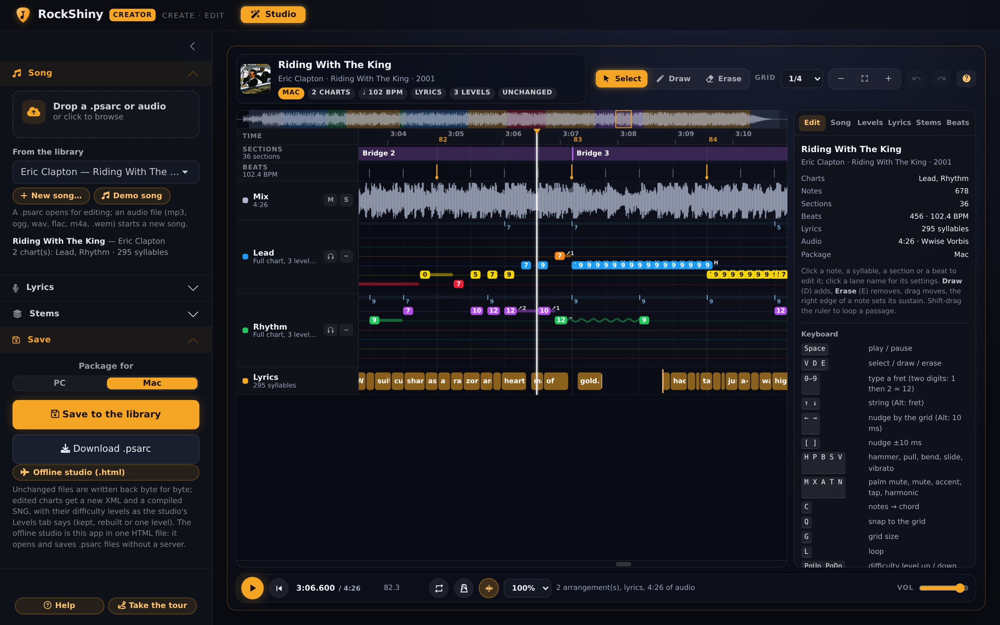

**New to it?** Read [TUTORIAL.md](TUTORIAL.md), watch the [video tour](docs/video/creator-tour.mp4) (about 3 minutes),
press **?** in the studio for Help and the guided tour, or click **Demo song** to open
*Night Drive*, a complete song the Creator makes from scratch.

| | | |
|---|---|---|
| 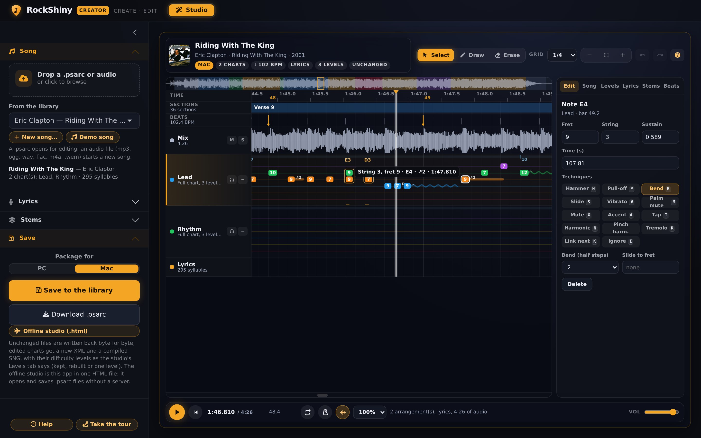 **Chart editing** | 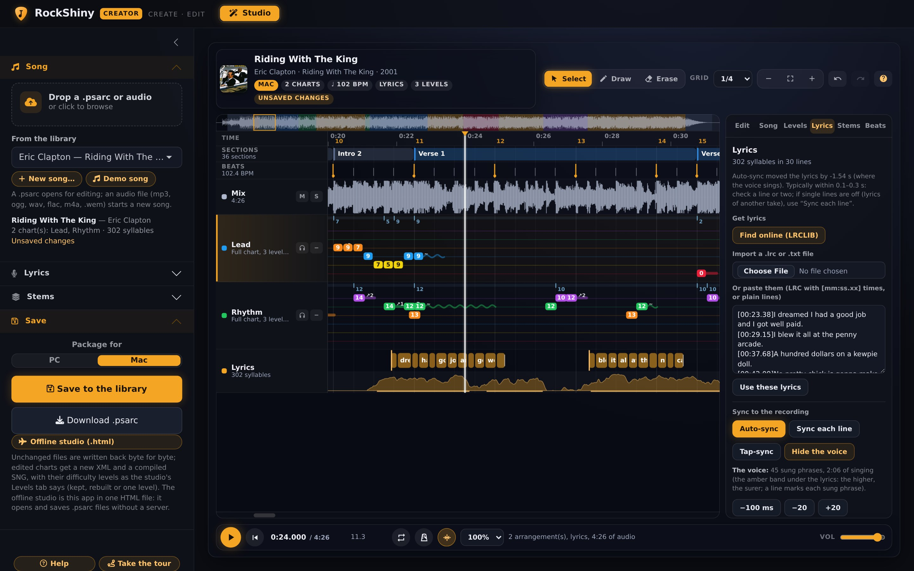 **Lyrics synced to the singing** | 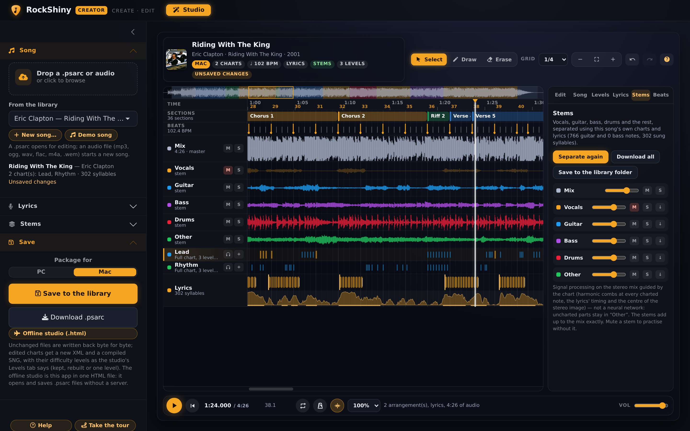 **Instrument stems** |
| 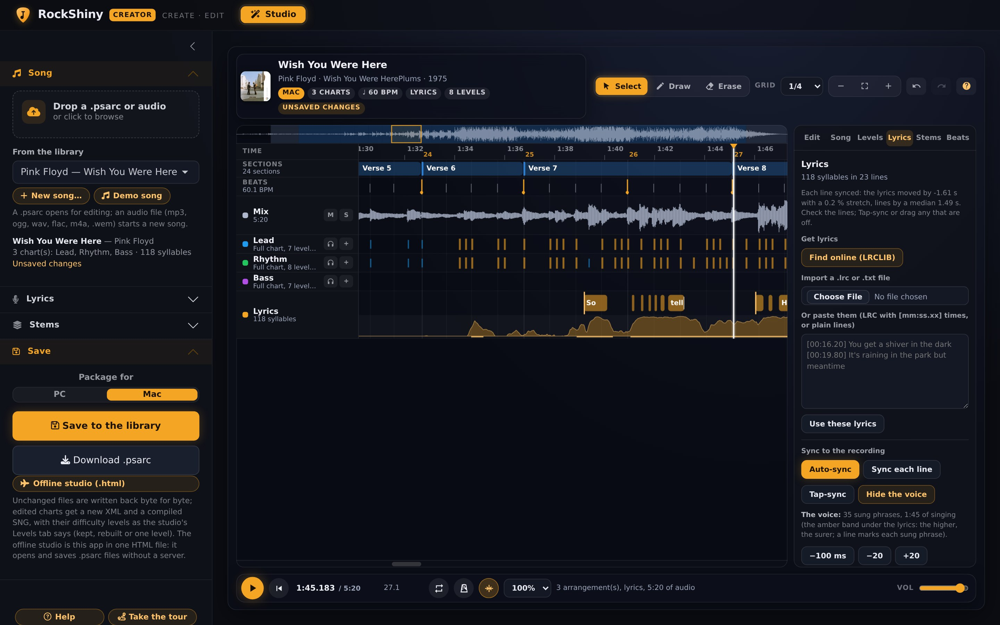 **Lyrics over the voice** | 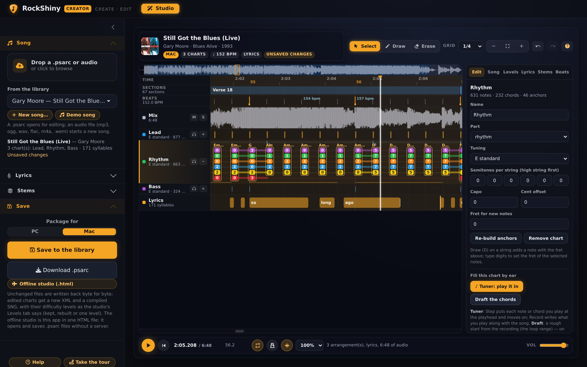 **A chart drafted by ear** | 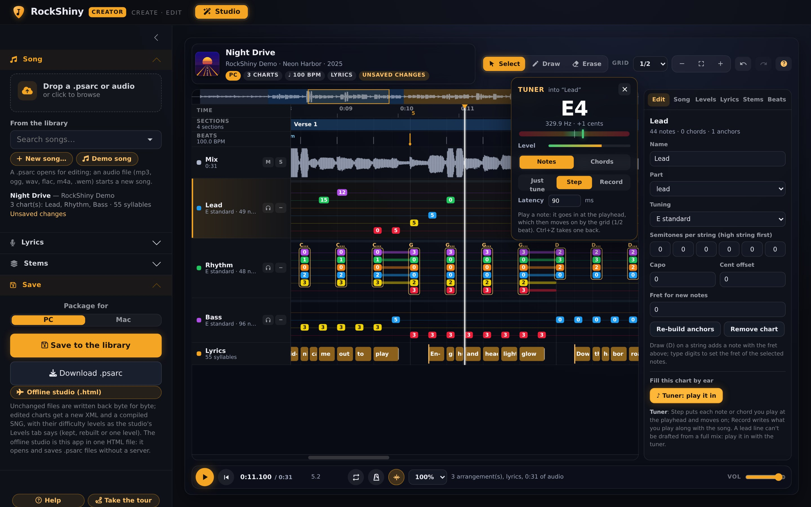 **Play it in with the tuner** |
| 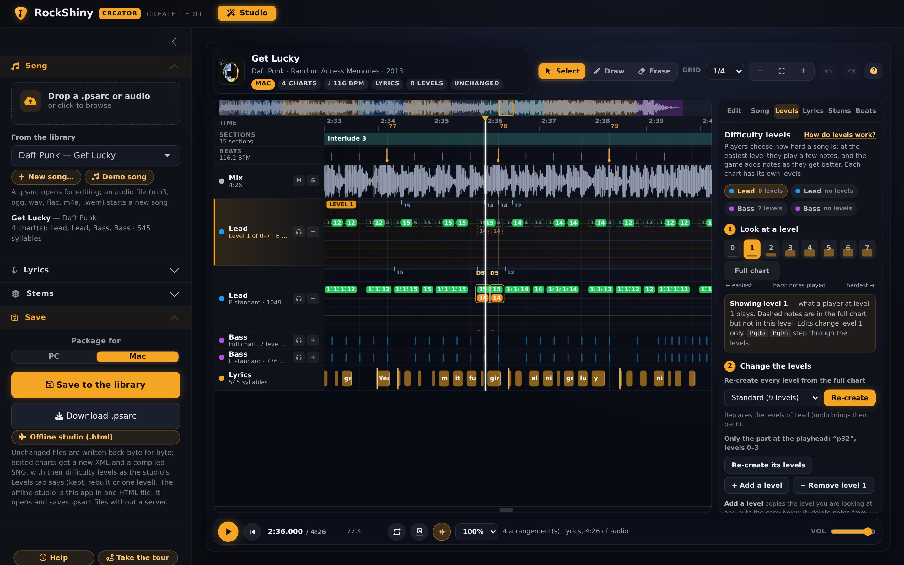 **Difficulty levels** | 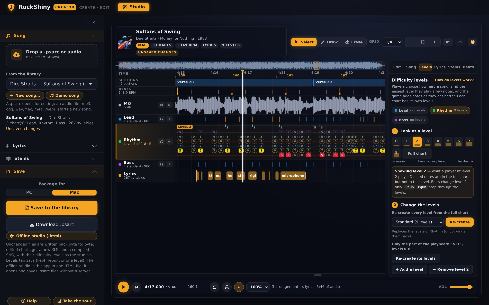 **Easier levels, automatic** | 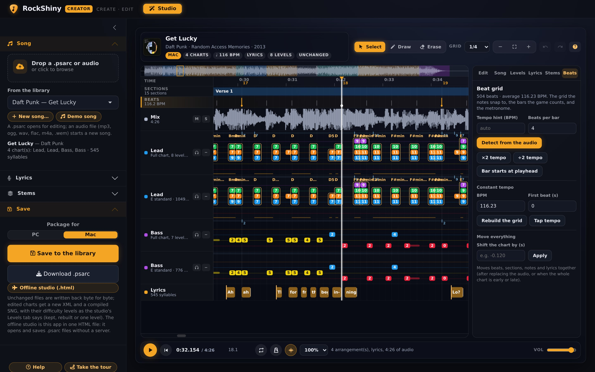 **Beats and tempo** |
| 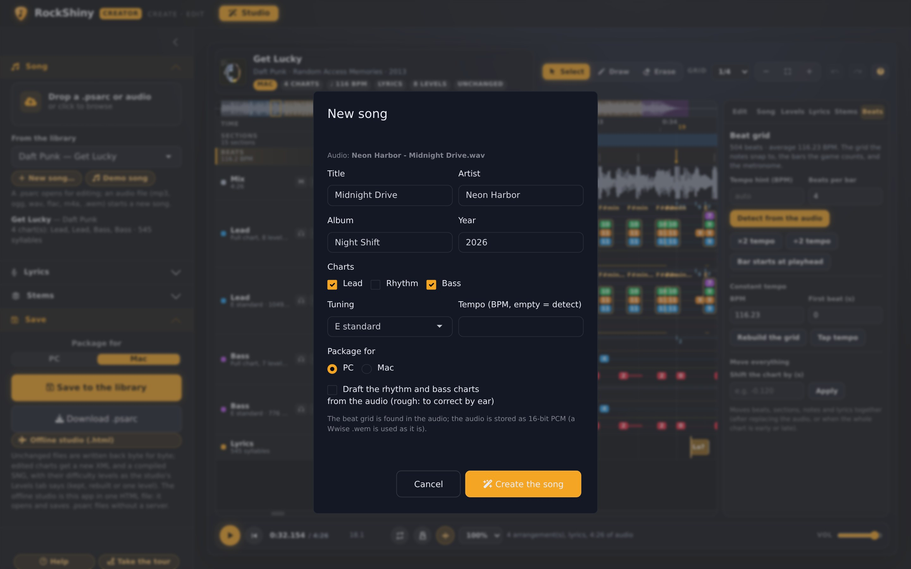 **A new song from audio** | 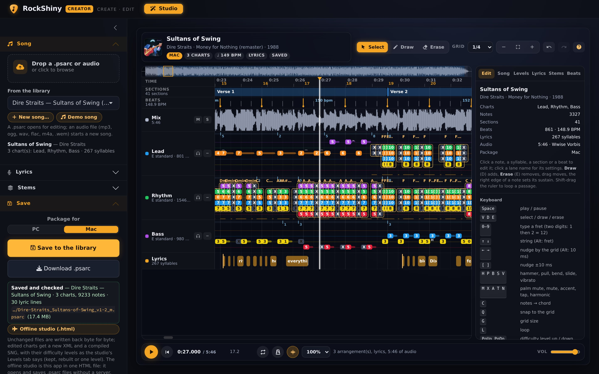 **Save, checked** | 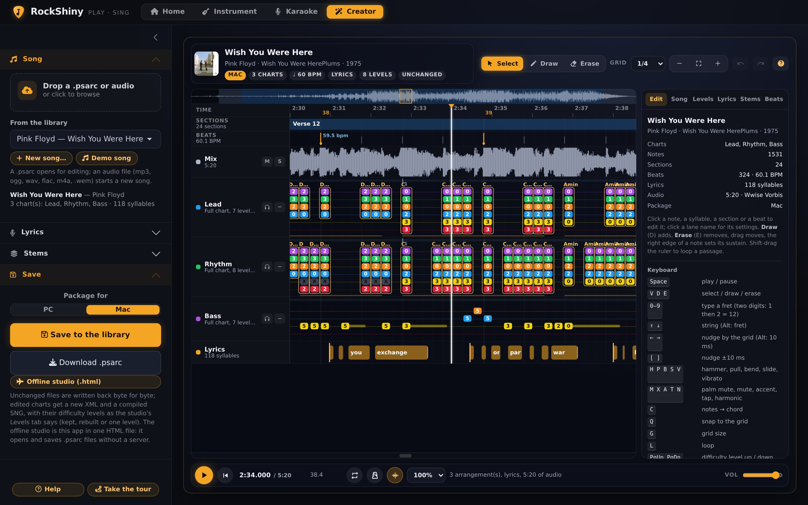 **A page of RockShiny** |
| 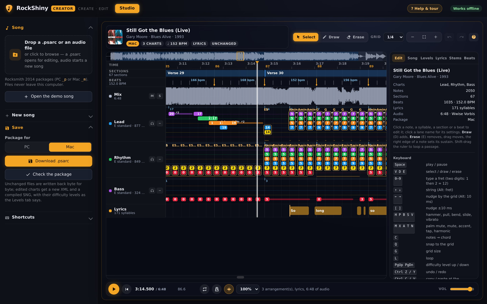 **One offline HTML file** | 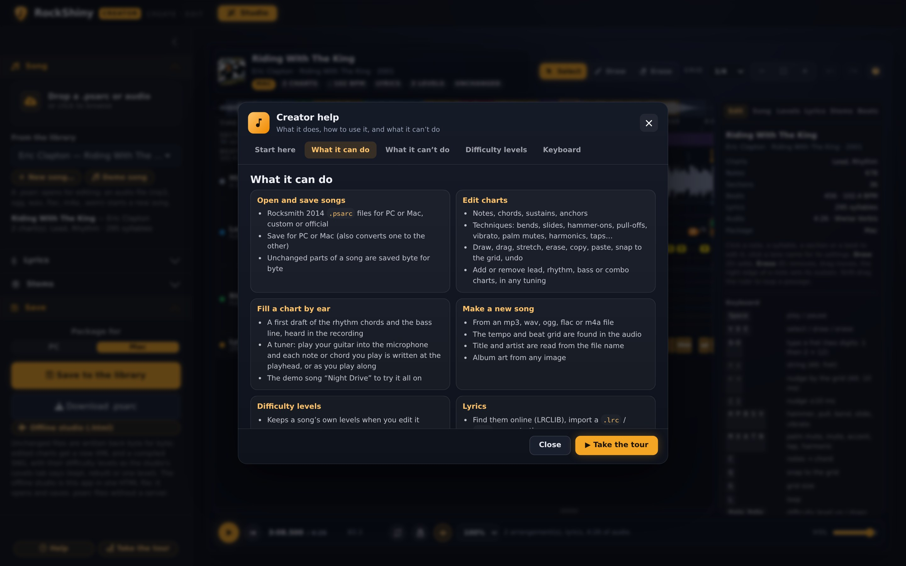 **Help built in** | 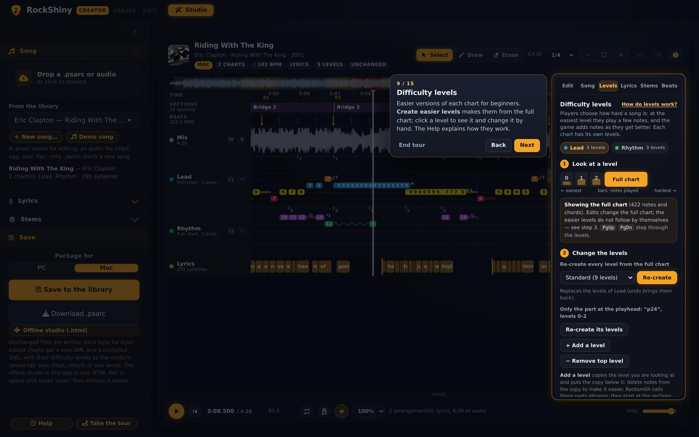 **A guided tour** |

The captions of every screenshot are in [docs/screenshots/manifest.json](docs/screenshots/manifest.json).

## Run it

```r
# from the RockShiny folder
shiny::runApp("creator")                         # the Creator on its own
shiny::runApp()                                  # RockShiny, with the Creator page in the navbar

# the offline studio (one self-contained HTML file)
setwd("creator"); source("global.R")
creator_build_html()                             # -> creator/RockShinyCreator.html
creator_build_html("~/Desktop/Creator.html")
```

**The `creator/` folder on its own.** Copy `creator/` anywhere, without the rest
of RockShiny, and `shiny::runApp("creator")` (or `shiny::runApp()` inside it)
still works. `global.R` looks for RockShiny's R code in the folder above; when
it is not there, it uses the copy bundled in [`rockshiny/`](rockshiny/README.md)
(RockShiny's `R/`, its app CSS, the drop zone, the karaoke lyrics tools and the
audio conversion script, 440 KB, MIT). On its own, the library is
`creator/songs/` (made on first use) unless `options(rockshiny.library_dir = ...)`
says otherwise. `python3 creator/tools/vendor_rockshiny.py` refreshes the copy
from RockShiny, and `--check` (also a test) says whether it is current.

**Inside RockShiny** the module is plugged in with three lines of `app.R`:

```r
creator_on <- isTRUE(getOption("rockshiny.creator", TRUE)) && file.exists("creator/global.R")
if (creator_on) source("creator/global.R", local = TRUE)          # loads the module (not RockShiny's R/ again)
# UI:      bslib::nav_panel("Creator", value = "creator", mod_creator_ui("creator"))
# server:  creator <- mod_creator_server("creator", lib = lib, on_play = function(path, mode) ...)
#          creator$pause() when another page is shown
```

The Creator uses RockShiny's options: `rockshiny.library_dir` (where songs are
opened from and saved to), `rockshiny.cache_dir` and `rockshiny.lyrics_online`.
It adds `rockshiny.creator` (set it to `FALSE` and RockShiny leaves the page
out), `rockshiny.root` (where RockShiny's code is, when it is neither above nor
bundled) and raises `shiny.maxRequestSize` to at least 512 MB, because packages
travel between the browser and R. The packages it needs are the ones RockShiny
already uses: shiny, bslib, htmltools, xml2 and openssl. Audio conversion on
the server also uses RockShiny's `vgmstream-cli` + `ffmpeg`. The browser
decodes Wwise audio without them, and the server only steps in when a browser
can't play Ogg Vorbis.

## What it does

| Feature | How |
|---|---|
| **Open / decode `.psarc`** | The PSARC reader (AES-CFB TOC, zlib blocks) and SNG decryption (AES-CTR, PC and Mac keys) are written in JavaScript. It parses the full SNG and keeps every difficulty level (see *Difficulty levels*). It decompiles SNG to arrangement XML when a package has no XML. It decodes Wwise Vorbis to Ogg (a port of ww2ogg + revorb with the aoTuV codebooks) or PCM wem to WAV. |
| **Encode `.psarc`** | Saves write only what changed. Anything you didn't edit goes back byte for byte. An edited chart gets a new XML plus a compiled SNG. Metadata edits patch the manifests, `.hsan`, xblock and aggregate graph. Album art is re-encoded as DXT1 DDS at 256, 128 and 64 px, and the audio bank is rebuilt. You can convert a song between PC and Mac. |
| **New songs from scratch** | Drop an mp3, ogg, wav, flac, m4a or `.wem`. The title and artist come from the file name and the beat grid from the audio, and you get empty lead, rhythm and bass charts (any tuning), or a first draft of the rhythm and bass (*Draft the rhythm and bass charts* in the form). The audio is stored as PCM wem. |
| **The demo song** | *Night Drive* (RockShiny Demo, 100 BPM, E minor): an original song the engine composes and renders from scratch, with lead, rhythm and bass charts, 8 lines of lyrics sung by a synthesised formant voice, drums and album art. Every tab and tool works on it, it needs no rights, and the tests use it when the sample songs are not there. *Demo song* in the sidebar or the empty studio. |
| **Timeline editor** | Layout: an overview strip, a ruler, a section lane and a beat lane, the mix waveform, one lane per chart drawn as tablature, and a lyrics lane. Select, draw and erase notes; drag and stretch; edit chords; quantize to a grid; copy and paste; undo and redo. An inspector edits fret, string, sustain, bend, slide and every technique. Also: loop a range, zoom, metronome, guide tones, and keyboard shortcuts for everything. |
| **Difficulty levels** | Rocksmith's dynamic difficulty: one chart per level, and each part of the song (*phrase*) has its own top level. Levels are **kept** when you edit. The Levels tab has three steps. **1. Look at a level:** the timeline shows the full chart or any single level (what a player at that level plays), with the notes that level leaves out drawn as dashed ghosts; an edit lands in the level on screen. **2. Change the levels:** *Create easier levels* / *Re-create* makes them from the full chart, for the whole chart or the part at the playhead; *Add a level* copies the level on screen as a new, easier one to thin out; *Remove* deletes one. **3. When you save:** keep the levels as they are, re-create them from the full chart on every save, or save the full chart only. `PgUp` / `PgDn` step through the levels, and undo covers all of it. |
| **Lyrics** | Sources: LRCLIB (in the browser, or through R with RockShiny's lookup and cache), a sidecar `.lrc`, an imported `.lrc` or `.txt` file, or pasted text. RockShiny's karaoke syllable splitter turns lines into Rocksmith syllables. **Auto-sync** slides the lyrics onto the singing: a **voice model** (below) lays the syllables over the sung phrases, checked against RockShiny's onset aligner (when the two disagree by more than 0.8 s, the onsets win unless they put the syllables clearly less on the singing). **Sync each line** fits lyrics of another take or timed roughly: a shift and a stretch for the whole, then each line onto its own phrase. **Show the voice** draws where someone sings under the lyrics (how sure the model is, and a line under each sung phrase; the gaps are the silences). Then tap-sync, stretch or drag fixes single syllables. The lyrics are saved as the package's vocals XML + SNG. |
| **The voice model** | `rsc-voice.js`: the mix cut down to the voice's range (a 40-band mel spectrum, 80 Hz–8 kHz, of the centre channel and of the sides at 22.05 kHz, each band normalised to the song), described over 50 ms and 0.5 s (level, the 4–8 Hz movement of syllables and vibrato, how much sits in the centre, how it stands out of the last 2 s): 200 numbers per 10 ms frame, into a logistic model trained on the sample songs' own lyrics. It runs in a Web Worker (about 5 s for a 4½-minute song). Retrain it with [`tools/ear/`](tools/ear/README.md). |
| **Fill a chart by ear** | In a chart's panel. **Draft the chords** (6-string) / **Draft the bass line**: the recording's chroma (harmonics suppressed) and bass register at 11 kHz, chord templates on every beat smoothed by Viterbi, the bass on the chords' roots in the octave it is heard in; notes placed on the fretboard by dynamic programming (least hand movement), chords in playable shapes for the chart's tuning. Over the loop range or the whole song, one undo step. **Tuner: play it in**: your guitar or bass into the microphone; YIN pitch (note name and cents), chords judged once per strum; **Step** writes each note or chord at the playhead and moves on by the grid, **Record** writes what you play along with the song (minus the input's latency). A lead line is not drafted from a full mix: it is played in. |
| **Help and tour** | The **Help** dialog (the **?** button or key, *Help* in the Shiny sidebar, *Help & tour* in the offline page) covers: start here, what it can do, what it can't do, difficulty levels, keyboard. **Take the tour** moves a spotlight over every part of the studio and of its host page (open, library, save) with an explanation of each. The written version is [TUTORIAL.md](TUTORIAL.md). |
| **Beats and tempo** | Beat detection (onsets, tempo with a metrical harmonic sum, Ellis dynamic-programming beat tracking, bar phase from bass chroma), a tempo from any beat on, drag a beat, set bar starts, ×2 / ÷2, shift the chart. |
| **Stems** | Vocals, guitar, bass, drums and the rest. The separation uses the song's own charts (a harmonic comb at every charted note) and lyrics (where the voice is) as soft masks over an STFT, runs in a Web Worker, and the stems add back up to the mix. In the studio you can mute, solo and mix them; download each stem as WAV, or (in Shiny) save them in a `"<song> (stems)"` folder in the library. |
| **Check** | In Shiny, every saved package is read back with RockShiny's R parsers: for each chart, the XML and the SNG must agree (for charts with difficulty levels, at 0, ⅓, ⅔ and full difficulty); the lyrics, art and audio must be present. The HTML page reads the package back with the engine. |

## How it is put together

```
creator/
  app.R, global.R            standalone app; global.R loads RockShiny's R/ (above, or rockshiny/) and R/ here
  R/
    mod_creator.R            mod_creator_ui() / mod_creator_server(): sidebar + studio (the whole module)
    mod_studio.R             the studio output and its bridge (files in and out of the browser)
    mod_project.R            open: dropzone, library, demo song, new-song form
    mod_lyrics.R             lyrics lookup through RockShiny (sidecar .lrc, LRCLIB, cache)
    mod_stems.R              run the separation; save stems into the library
    mod_export.R             PC / Mac, save to the library + check, download, offline HTML
    creator_package.R        creator_psarc_write() (R PSARC writer), creator_validate()
    creator_assets.R         htmlDependencies (engine, studio, RockShiny's karaoke-sync.js)
    creator_html.R           creator_build_html(): everything inlined in one page
  inst/engine/               the codec and the analysis, in plain JavaScript (no dependencies; browser, Worker, Node)
    rsc-core, -aes, -psarc   bytes, MD5, zlib, AES-CFB/CTR, PSARC read/write
    rsc-xml, -arrangement    XML, the arrangement document model
    rsc-sng, -compile        SNG decrypt/parse/serialize, XML -> SNG compiler
    rsc-vocals               vocals SNG (+ the font glyph table)
    rsc-manifest             song keys, manifests, hsan, xblock, aggregate graph, showlights
    rsc-wem, -codebooks      Wwise Vorbis -> Ogg, PCM wem, sound banks
    rsc-dds                  DXT1 album art
    rsc-project              a song as a JSON project: open, edit, save with minimal changes
    rsc-difficulty           difficulty levels: views of one level, edits per level, levels by hand and automatic
    rsc-demo                 the demo song, composed and rendered from scratch
    rsc-dsp, -beats, -sync, -stems   FFT/STFT, beat tracking, lyrics sync helpers, stem separation
    rsc-voice                the voice model: where someone sings, sung phrases, lyrics laid over them
    rsc-transcribe           by ear: YIN, chroma, chord naming, drafts of chords and bass, fretboard placement
  inst/studio/               the studio UI (rsc-studio, -timeline, -inspector, -tools, -fill (drafts, tuner),
                             -audio, -help, -shiny; creator.css)
  inst/page/                 the offline page's host (sidebar: open, demo, new song, save, check)
  rockshiny/                 RockShiny's code for the folder on its own (see rockshiny/README.md)
  RockShinyCreator.html      the prebuilt offline studio
  docs/screenshots/          the screenshots above (+ manifest.json with their captions)
  docs/video/                the video tour and the RockShiny teaser (+ posters)
  tests/                     js/ (Node), testthat/ (R), frontend/ (Playwright)
  tools/
    screenshots.py           the screenshots
    video/                   the videos (recorded from the running apps; music synthesised)
    ear/                     the voice model's training, and the measurements of sync and drafts
    vendor_rockshiny.py      refresh / check rockshiny/
    check_heavy_files.py     files over 1 MB, and any stored twice
```

**Isolation.** Every Shiny input sits in the module's namespace. Every CSS
class is `.rsc-*` and every JavaScript global is under `window.RSCreator`.
The assets are the Creator's own `htmlDependency`s, and the module sets only
its own options plus `shiny.maxRequestSize`. When RockShiny's R code is
already loaded, `global.R` does not load it again. RockShiny's `app.R`
changed in three places: it sources `creator/global.R`, adds the nav panel,
and calls `mod_creator_server()`, which pauses the studio when you switch
modes and opens saved songs in the player. In `inst/app/app.js`, the
space-bar handler ignores keys inside the studio.

**Look.** The Creator uses RockShiny's design tokens and components:
the bslib theme (`#0b0d13` / `#e8eaf1` / `#f5a524`), the glass cards, the
`.rs-sidebar` accordion, the `.rs-dropzone`, the `.rs-shortcuts` and the
mode-switch navbar. The standalone app and the offline page use the same brand
and chrome, with a *Creator* tag; the tuner panel and the voice band use the
same amber accent and glass.

**R API.**

```r
mod_creator_ui(id, sidebar_width = 340)
mod_creator_server(id, lib = NULL, on_play = NULL)
#   -> list(state = reactive(studio state), saved = reactive(last saved path),
#           open = function(path, name), pause = function())
creator_page(id)                     # the standalone page (RockShiny's theme, brand and navbar)
creator_build_html(file = "creator/RockShinyCreator.html", title = "RockShiny Creator")
creator_psarc_files(path)            # list(name = raw) of a package (R reader)
creator_psarc_write(files, file)     # write a PSARC from R (used by the tests)
creator_validate(path, audio = FALSE) # read back with RockShiny's parsers -> list(ok, lines, charts)
```

**JavaScript API** (`RSCreator.engine`, also in Node via `tests/js/load.js`):

```js
const E = RSCreator.engine;
const { project, source } = await E.projectFromPsarc(bytes);   // open
project.meta.title = "New title";                                // edit (plain JSON)
const out = await E.projectSave(project, source, { platform: "pc" });   // -> Uint8Array .psarc
const fresh = await E.projectNew({ title, artist, audio: { channels, sampleRate },   // or { wem }
  bpm, offset, arrangements: [{ kind: "lead", tuning }] });
const demo = await E.demoSong({ platform: "mac" });             // the demo song: {project, source, score, stems}
E.ddShow(project.arrangements[0], 2);                           // edit level 2 of a chart (null: the hardest)
E.ddAuto(project.arrangements[1], { maxLevels: 8 });             // build its levels from the hardest chart
E.ddSetMode(project.arrangements[1], "auto");                   // "keep" | "auto" (rebuild when saving) | "flat"

const V = RSCreator.voice, T = RSCreator.transcribe;
const { p } = await V.activity(channels, sampleRate);           // p(voice), 100 frames/s
V.segments(p);                                                   // sung phrases [{t0, t1}]
V.alignGlobal(V.linesOf(syllables), V.evidence(p));             // {shift, confidence}
V.alignLines(V.linesOf(syllables), V.evidence(p));              // {starts, shift, drift}
const an = await T.analyse(channels, sampleRate);               // chroma + bass salience + tuning
T.chordsOnBeats(an, project.beats);                             // [{time, end, root, quality, name}]
T.yin(frame, sampleRate);                                       // {hz, clarity, rms}
const studio = new RSCreator.Studio(element, { host: { name: "page" } });  // the editor UI
```

## Tests

```bash
node --test creator/tests/js/test-*.js                                      # engine, levels, DSP, demo song, by ear (uses songs/ when there)
Rscript -e 'testthat::test_dir("creator/tests/testthat")'                   # R: writer, checker, modules (shiny::testServer)
python3 creator/tests/frontend/check_creator.py                             # browser: A offline page, B standalone app, C inside RockShiny,
                                                                            #   D difficulty levels, E help and tour, F by ear (demo, voice,
                                                                            #   drafts, the tuner with a fake microphone)
python3 creator/tools/vendor_rockshiny.py --check                           # the bundled rockshiny/ is current
python3 creator/tools/screenshots.py URL_STANDALONE URL_ROCKSHINY           # the screenshots
```

The tests use the 18 sample packages in RockShiny's `songs/` when they are there.
With the `creator/` folder on its own they use the demo song instead (made by the
engine at test time), and part C (the Creator inside RockShiny) is skipped: every
other test runs. Results (R 4.3.3, shiny 1.10, bslib 0.9, Node 22, Chromium):
Node 34 tests, R testthat all pass, browser parts A–F all pass, in the RockShiny
folder and in a copy of `creator/` alone.

| Check | Result |
|---|---|
| PSARC read → write | all 18 archives give identical entries |
| SNG parse → serialize | 64 / 64 byte-identical |
| Open + save without edits | byte-identical files in every package |
| XML → SNG compiler vs. the community toolkit's SNGs | 99.986 % of 2.49 M fields identical (the rest: note order in regenerated XML, 8 anchors, 6 odd iteration counts) |
| Vocals SNG | 13 / 13 byte-identical |
| Wwise sound banks rebuilt | 36 / 36 byte-identical |
| Wwise Vorbis → Ogg | sample-identical to `wem2ogg`, exact length |
| Album art DDS | identical header, 40 dB PSNR |
| Edited, converted (PC ↔ Mac), new and demo packages | RockShiny's R reader: XML and SNG agree in every chart |
| Dynamic Difficulty merge | same notes and chords as RockShiny's `build_chart()` in all 51 arrangements |
| Difficulty levels kept (25 charts with levels) | viewing and re-committing every level changes nothing; the hardest view equals the merged chart; saved unedited, they equal the file's levels. An edit at level *k* changes only level *k* of that phrase. Adding an easier copy and then removing it again returns the original levels. RockShiny's readers agree (XML and SNG) at 0, ⅓, ⅔ and full difficulty on edited, rebuilt and flattened packages |
| Automatic levels vs. the hand-made ones (same 25 charts, 556 phrases) | every level contains the one below (4 305 / 4 305 checks), and the top level is the hardest chart in all 759 phrases. The *easy* level (the game's hero level 1) matches the author's with an F1 of 0.77 on note times, against 0.45 for a random subset of the same size. Time to create the levels: 0.03–0.65 s per chart |
| Beat tracking (17 songs vs. their charts) | tempo right in 16 / 17 (allowing ×2 / ÷2), mean beat F-measure 0.67 (0.78 allowing ×2 / ÷2), bar phase right 9 / 12 |
| Stems (a synthetic chart-driven mix) | SDR gain: vocals +9.9, guitar +7.1, drums +8.4, other +7.7, bass +3.1 dB; stems sum to the mix at 65 dB SNR; a 4½-minute song in ~30 s in the browser |
| The voice model (11 songs with lyrics, each scored by a model trained on the other 10) | frame AUC 0.77 (0.54–0.92 by song); the centre-channel level alone: 0.65 |
| Auto-sync (same 11 songs, lyrics moved by up to 2.5 s, 3 tries each, 1 218 lines, models that never saw the song) | median line error **0.08 s**, 75 % of lines within 0.3 s, 92 % within 0.5 s, worst 0.72 s. The previous auto-sync (onsets only): 0.30 s, 48 %, 84 %, worst 0.72 s |
| Sync each line (same songs) | lines timed roughly (±0.8 s): median 0.35 s (one shift: 0.51 s); another take 0.5 % slower, lines ±0.3 s: 0.28 s (0.38 s). Lines only ±0.3 s off: better left to one shift (0.22 s vs 0.26 s), so Auto-sync stays the default |
| Chord draft (10 songs with a rhythm chart, against the chart's own chords) | root right on 51 % of the chords (0.17–0.86 by song); the demo song 50–65 % |
| Bass draft (12 songs with a bass chart) | F-measure 0.21 (the same note within 0.1 s); 0.31 in any octave |
| Tuner (a fake microphone in Chromium: plucked strings) | E2 A2 D3 G3 B3 E4 named and written in order; the same note re-plucked while ringing and overlapping notes written once each; G C D Em strums named; Record places notes a second apart a second apart |

Measure it yourself: [`tools/ear/`](tools/ear/README.md) decodes the sample songs
(`prep.js`), retrains and tests the voice model (`voice_train.py`) and scores the
sync and the drafts (`eval_sync.js --loso`, `eval_drafts.js`). The voice model
was trained on the same 11 songs it is measured on, which is why the sync
numbers above use models that left the song out.

## Limits

- **No transcription.** The drafts from a recording are a rough start: about
  half of the chords and a third of the bass notes come out right on the sample
  songs, and loud vocals or a busy mix make them worse. Lead parts are not
  drafted at all (a lead line can't be told out of a full mix this way: F 0.05):
  play them in with the tuner, or draw them.
- **The tuner** needs a microphone or line input (the browser asks), a clean
  signal and a quiet room; heavy distortion or several instruments at once
  confuse it. Chords are named from major, minor, power, 7th and minor 7th
  shapes. Set the latency once for *Record*.
- **The voice model** learnt from 11 songs (mostly rock and pop with one lead
  singer). It hears some songs well (AUC 0.9) and others poorly (0.54): loud
  guitars in the centre, backing vocals or electronic voices fool it. Auto-sync
  then falls back on the onset aligner, and a line can still be off by up to
  0.7 s. Tap-sync, stretch or a drag finishes the job. LRCLIB needs the network;
  offline, import a `.lrc` or paste the lyrics.
- Stem separation is signal processing guided by the charts (there is no
  neural model). Bass and uncharted instruments separate the least well. The
  stems are good for practice and muting, not for release.
- Detected beats may need ×2 / ÷2 or a bar start fixed by hand (the Beats
  tab has a button for each).
- Automatic levels choose *which* notes to keep (by beat strength, with chords
  cut down from the top string) and keep everything else about a note. They
  don't rewrite a part into simpler fingerings or change rhythms, the way a
  human arranger might. The shares of notes per level were tuned on the sample
  songs' hand-made levels, and the same songs are used to measure them above.
- When sections change, the phrases are rebuilt from them. Each level carries
  over, but a merged phrase takes the highest top level of the phrases it
  covers, and links between phrases (`newLinkedDiffs`) are dropped.
- New songs (and the demo song) store their audio as PCM wem. RockShiny reads
  those packages, but they have not been tried in the Rocksmith game itself
  (there was no copy to test with).
- The offline page decodes Wwise audio to Ogg Vorbis, which Safari may not
  play. The Shiny host falls back to converting on the server.
- The demo song is synthesised: its voice is a formant model, not a singer, so
  the voice model hears it less surely than a real voice (and the chord draft
  finds 50–65 % of its chords).
