# RockShiny Creator — tutorial

The Creator is RockShiny's song studio. You can open a Rocksmith 2014 song and
change it, or start a new song from an audio file, then save it for the game and
for RockShiny. This page walks through it step by step and says plainly what it
can and can't do.

**Help is built in.** Press **?** in the studio, or use the **?** button
(top-right of the studio), **Help** in the sidebar (Shiny), or **Help & tour**
in the header (the offline file). The Help dialog covers the same ground as this
page. **Take the tour** then moves a spotlight over every part of the studio
with a short explanation of each; use the arrow keys to step through it and
**Esc** to leave.

▶ **Video tour:** [docs/video/creator-tour.mp4](docs/video/creator-tour.mp4) (about 3 minutes, no narration, captions in the picture)

| | |
|---|---|
| 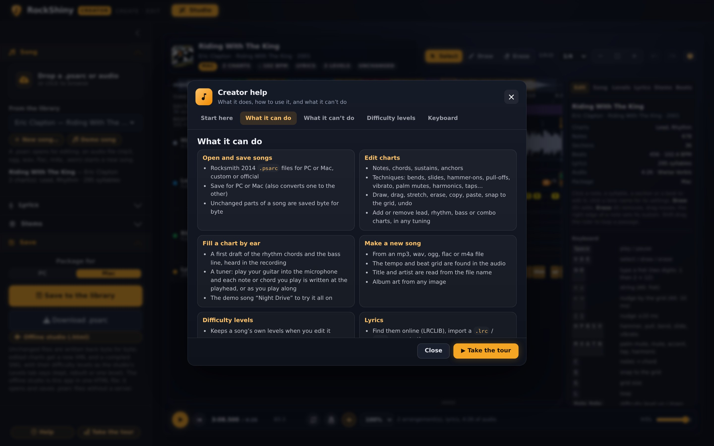 | 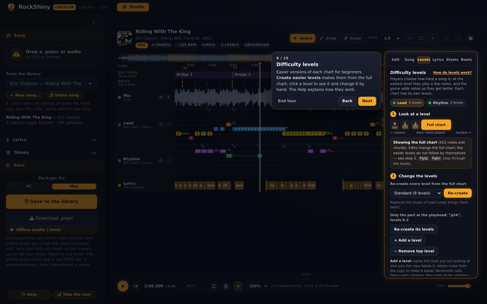 |

---

## Where to run it

| | |
|---|---|
| Inside RockShiny | `shiny::runApp()` → the **Creator** page in the navbar |
| On its own | `shiny::runApp("creator")` |
| Offline, no R | open `creator/RockShinyCreator.html` in Chrome, Edge or Firefox |

The studio is the same in all three. In Shiny, songs come from RockShiny's
library folder and saves go back into it. The offline file opens and downloads
files on your computer.

The `creator/` folder also runs **on its own**, copied anywhere without the rest
of RockShiny: it carries the parts of RockShiny it needs in `creator/rockshiny/`,
and its library is then `creator/songs/` (or `options(rockshiny.library_dir = ...)`).

**Nothing to open yet?** Click **Open the demo song** (in the empty studio or the
sidebar). *Night Drive* is a short song the Creator makes from scratch, with lead,
rhythm and bass charts, lyrics sung by a synthesised voice and album art: every
tab and tool works on it, and nobody's rights are involved.

## The screen

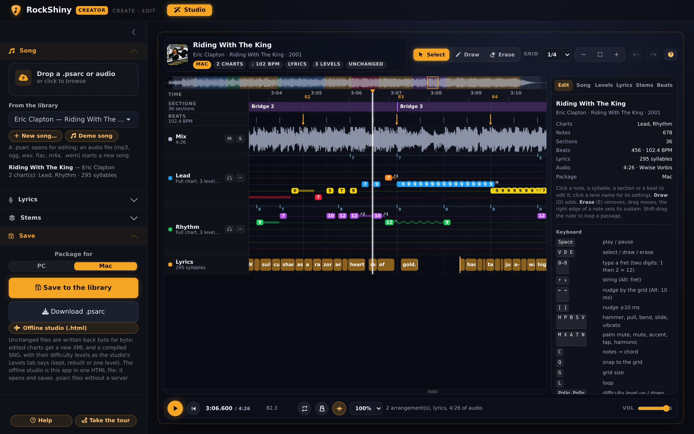

- **Left, the sidebar:** open a song, start a new one, save.
- **Top:** the song (title, tags), the tools (**Select** V, **Draw** D,
  **Erase** E), the **Grid** that new and moved things snap to, zoom, undo/redo
  and **?**.
- **Middle, the timeline:** one row per track. From the top: sections, beats,
  the recording (**Mix**), one row per **chart** drawn as tablature (a line per
  string, with the fret on each note), and the **lyrics**. Scroll with the
  wheel, zoom with <kbd>Ctrl</kbd> + wheel, and drag on the time ruler to loop a
  passage.
- **Right, the panel:** **Edit** (whatever you selected), **Song**, **Levels**,
  **Lyrics**, **Stems**, **Beats**.
- **Bottom:** play/pause (<kbd>Space</kbd>), back to the start, loop
  (<kbd>L</kbd>), metronome, follow the playhead, speed.

## 1. Fix something in an existing song

1. Open the song: pick it in **From the library**, or drop a `.psarc` on the
   drop zone.
2. Find the spot. Play it, or click the time ruler.
3. Click the note. The **Edit** tab shows its fret, string, sustain and
   techniques.
4. Change it: type the fret (<kbd>1</kbd> then <kbd>2</kbd> gives 12).
   <kbd>↑</kbd> / <kbd>↓</kbd> move it to another string. Technique keys:
   - <kbd>H</kbd> hammer-on, <kbd>P</kbd> pull-off
   - <kbd>B</kbd> bend, <kbd>S</kbd> slide, <kbd>V</kbd> vibrato
   - <kbd>M</kbd> palm mute, <kbd>X</kbd> mute, <kbd>A</kbd> accent
   - <kbd>T</kbd> tap, <kbd>N</kbd> harmonic
   
   Drag a note to move it; drag its right edge to change its sustain.
5. Listen: the headphones button on a chart plays it as guide tones.
6. Save (see step 8). <kbd>Ctrl</kbd> + <kbd>Z</kbd> undoes anything before then.

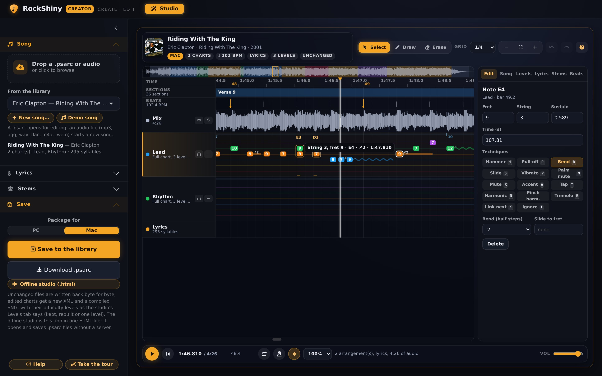

## 2. Make a new song from an audio file

1. Drop an **mp3, wav, ogg, flac or m4a** on the drop zone (a Wwise `.wem` works
   too).
2. Check the form: the title and artist come from the file name
   (`Artist - Title.mp3`). Choose the charts you want (lead, rhythm, bass), the
   tuning and PC or Mac, then **Create the song**.
3. The beat grid is detected from the audio. Look at it in the **Beats** tab:
   - If the tempo is twice or half the real one, use **×2** / **÷2**.
   - If bars start one beat late, move the playhead to a downbeat and click
     **Bar starts at playhead**.
   - Or type the tempo and the time of the first beat, then **Rebuild the
     grid**.
4. Add sections: with **Draw**, click on the sections row; double-click a section
   to rename it (intro, verse, chorus…).
5. Draw the notes: **Draw** (<kbd>D</kbd>), click on a string at the right time,
   then type the fret. Select several notes that start together and press
   <kbd>C</kbd> to make a chord.
6. Add the lyrics (see step 4), then save.

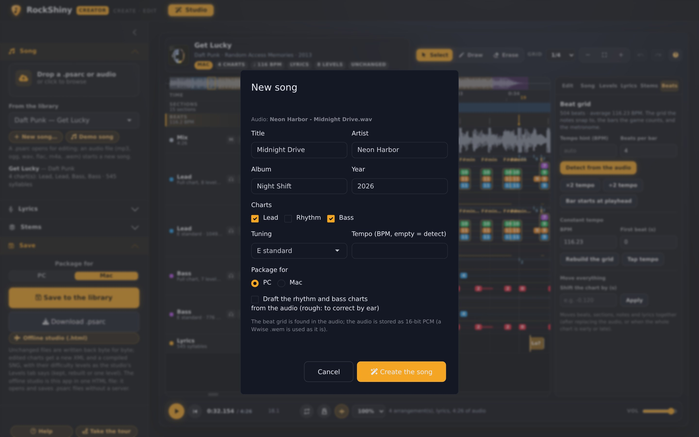

## 3. Difficulty levels

In Rocksmith every player chooses how hard a song is. A chart can have
**difficulty levels**: level 0 is the easiest, each level adds notes, and the top
level is the full chart. The song is cut into parts, which Rocksmith calls
*phrases*; they start at the sections. Each part has its own number of levels.

Open the **Levels** tab. Its buttons at the top choose the chart.

- **A chart with no levels yet:** choose **How many** (Standard makes 9 in the
  busiest parts), then click **Create easier levels**.
  - The easiest level keeps about one note in eight, on the strongest beats.
  - Each level above adds notes, until the top level is the full chart.
  - Chords are played on fewer strings at the easy levels.
- **Step 1, look at a level:** click a level number, or press <kbd>PgUp</kbd> /
  <kbd>PgDn</kbd>.
  - The timeline shows what a player at that level plays. Dashed notes are in
    the full chart but not in this level.
  - **Full chart** goes back to the full chart.
- **Step 2, change the levels:**
  - While a level is shown, delete or draw notes; only that level changes.
  - **Re-create** makes all the levels again from the full chart. Undo brings
    back the old ones.
  - For *the part at the playhead*:
    - **Re-create its levels** rebuilds only that part.
    - **+ Add a level** copies the level you are looking at as a new, easier
      one. Thin it out by deleting notes.
    - **− Remove** deletes a level.
- **Step 3, when you save:**
  - **Keep the levels as they are** (your hand edits stay).
  - **Re-create them from the full chart** (each save makes new levels, so they
    follow your later edits of the full chart).
  - **Save the full chart only** (no levels).

Songs that already have levels keep them when you edit. The Creator never
flattens them unless you ask. In RockShiny, the **Difficulty** slider of the
Instrument page uses the levels.

| | |
|---|---|
| 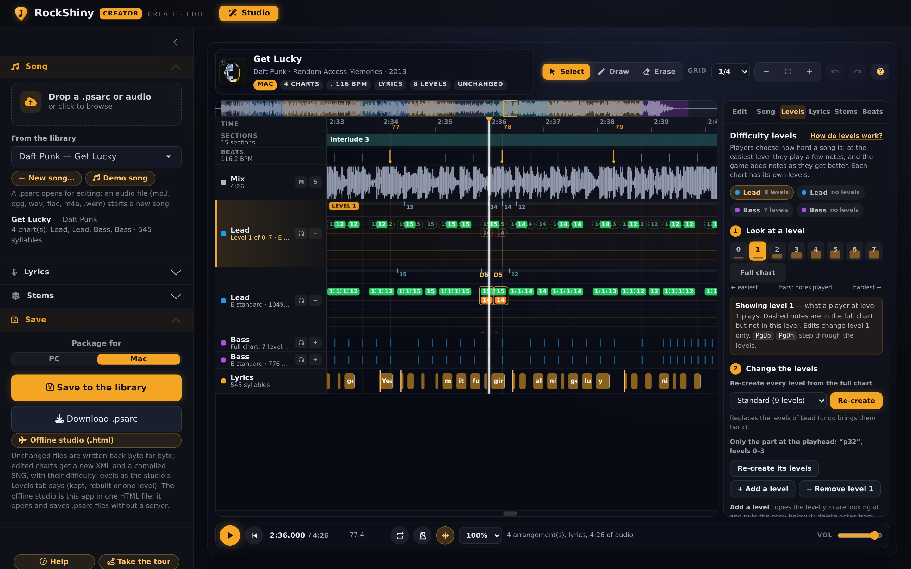 | 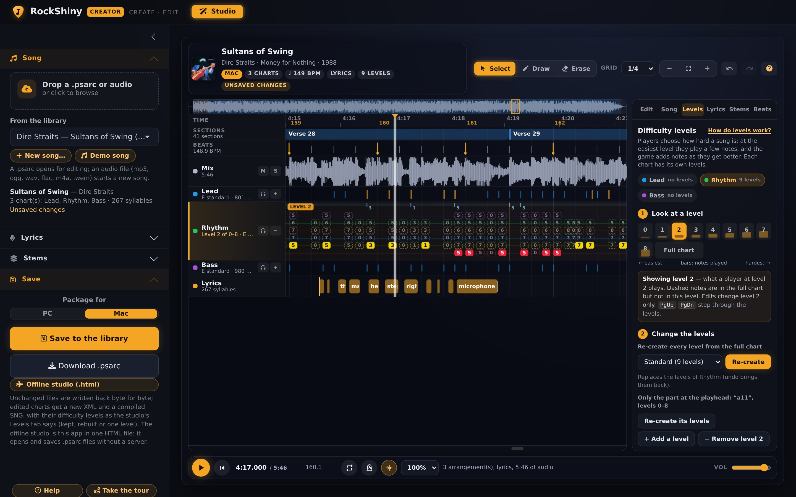 |

## 4. Lyrics

In the **Lyrics** tab:

- **Find online (LRCLIB)** looks up timed lyrics by artist and title (this needs
  an internet connection). Or import a `.lrc` / `.txt` file, or paste the lyrics.
- **Auto-sync** slides all the lyrics to where the recording sings. A voice
  model listens for the singing (its frequencies, in the centre of the mix, with
  the rhythm of syllables) and lays the lines over the sung phrases; RockShiny's
  onset aligner checks it. Use it for lyrics timed on this recording (LRCLIB, a
  `.lrc`): the typical line lands within 0.1 s and three lines in four within
  0.3 s.
- **Sync each line** is for lyrics timed roughly or taken from another take (a
  live version, a different tempo): it fits the whole, with a small stretch, then
  moves each line onto its own sung phrase. Lines ±0.8 s off come back to about
  0.35 s; for lyrics that are already close, Auto-sync is better.
- **Show the voice** draws where someone sings under the lyrics row: a band for
  how sure the model is, and a line under each sung phrase (the gaps are the
  silences). Handy to see at a glance whether a line sits on the singing.
- **Tap-sync**: play the song and press <kbd>T</kbd> as each line starts.
- Fine-tune: drag syllables, nudge them (<kbd>[</kbd> <kbd>]</kbd>, ±10 ms), or
  shift everything ±20 / ±100 ms. **Stretch** fits lyrics from another take.

The lyrics are split into Rocksmith syllables, for the game and for RockShiny's
karaoke.

| | |
|---|---|
| 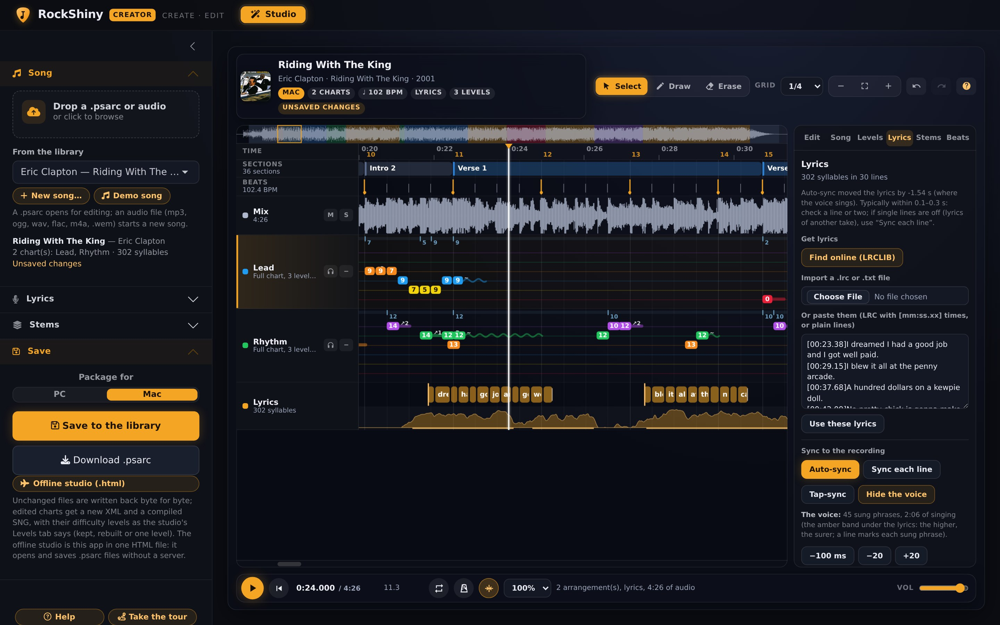 | 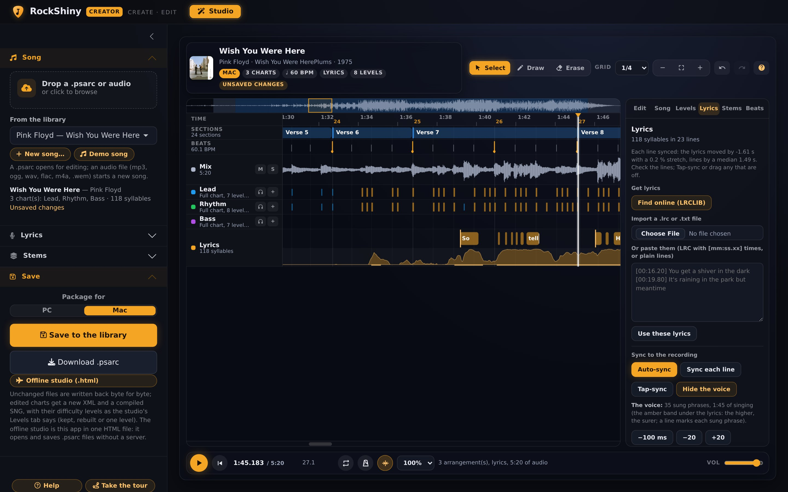 |

## 5. Stems

In the **Stems** tab, **Separate stems** splits the recording into vocals,
guitar, bass, drums and "other". It uses the song's own charts and lyrics as a
guide.

- Each stem gets a row with **M** (mute), **S** (solo) and a volume.
- Download each stem as a WAV. In Shiny, **Save to the library folder** keeps
  them next to the song.

Typical use: mute the guitar to play along, or solo the vocals to check the
lyrics.

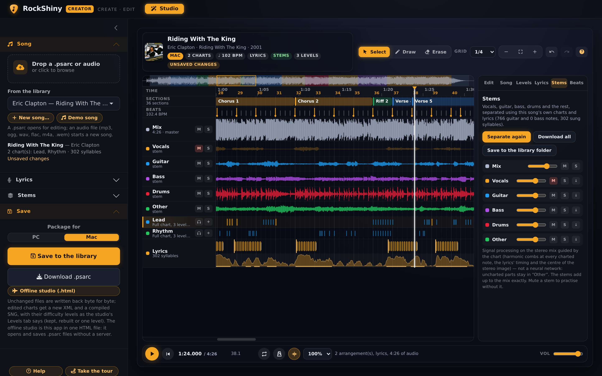

## 6. Fill a chart by ear

Click a chart's name on the timeline: its panel ends with **Fill this chart by
ear**.

- **Draft the chords** (a rhythm chart) or **Draft the bass
  line** (a bass chart) listens to the recording and writes a first draft on the
  beat grid: a chord on every beat, in an open or barre shape for the chart's
  tuning; for the bass, the chords' roots in the bass's octave. With a loop set,
  only the loop range is drafted. It is rough: on the sample songs about half of
  the chords come out right and a third of the bass notes. Listen with the
  headphones button and fix the rest. <kbd>Ctrl</kbd>+<kbd>Z</kbd> takes the
  whole draft back.
- **Tuner: play it in** opens a tuner on your microphone (or a line input). Play
  a note: it shows its name and how many cents off it is. Then choose what it
  does with what you play:
  - **Just tune**: nothing is written.
  - **Step**: each note (or, in **Chords**, each strum) goes in at the playhead,
    and the playhead moves on by the grid. Play the part note by note at your own
    pace.
  - **Record**: press Play and play along; each note goes in at the time you
    played it, minus the **Latency** of your input (set it once: play along to a
    few beats and adjust until the notes sit on them).
  
  The tuner picks the string and fret nearest your hand's last position. Notes
  from a clean guitar or bass work best; chords are named once per strum (major,
  minor, power chords, 7th and minor 7th).
- **Lead parts** can't be drafted from a full mix: play them in with the tuner.

| | |
|---|---|
| 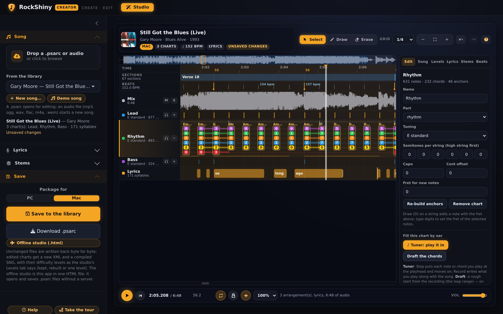 | 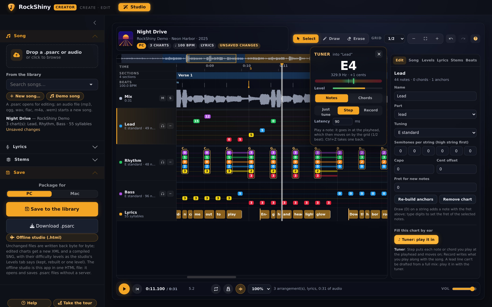 |

## 7. Song details and charts

In the **Song** tab you can set the title, artist, album, year, the names used
for sorting, the volumes and the album art (any image). **Add a chart** adds a
lead, rhythm, bass or combo chart in any tuning. Click a chart's name on the
timeline for its own settings: name, part, tuning, capo, cent offset.

## 8. Save

Choose **PC** or **Mac**; this also converts a song from one to the other.

- **In Shiny**: **Save to the library** writes a *new* file next to your songs,
  never over an existing one. RockShiny's own readers then check it: every
  chart must read the same from both of its files (XML and SNG), at every
  difficulty. **Play it** / **Sing it** then opens it in the Instrument or
  Karaoke page. **Download .psarc** gives you the file.
- **Offline file**: **Download .psarc**; **Check the package** reads it back.

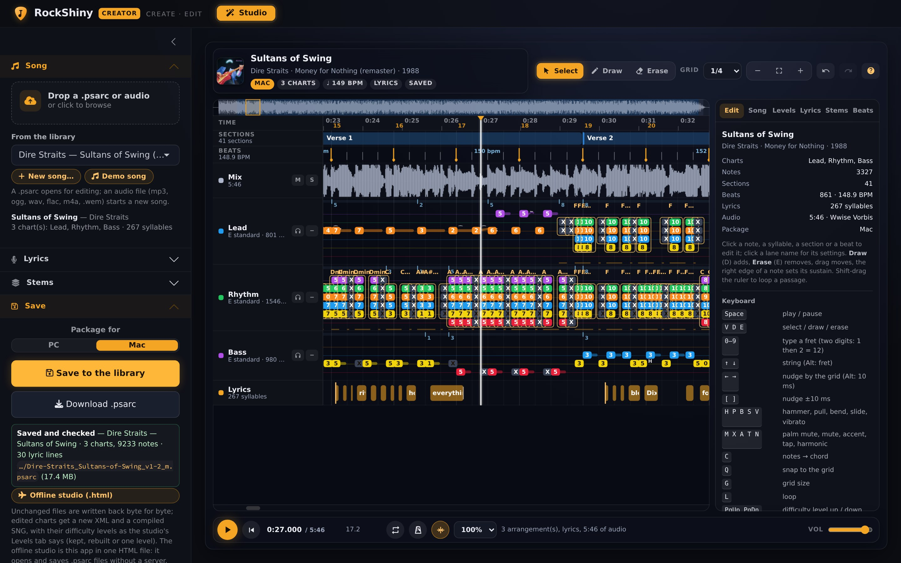

## What it can't do

- **It doesn't transcribe a song for you.** The drafts from a recording are
  rough (about half of the chords, a third of the bass notes), and lead parts
  are not drafted at all. Play them in with the tuner, draw them, or edit an
  existing song.
- **Stems are not studio quality.** They come from signal processing guided by
  the chart and the lyrics, not from an AI model, and anything without a chart
  stays in "other". They're good for practising and muting, not for release.
- **Automatic levels pick notes; they don't re-arrange.** Easier levels keep the
  notes on the strongest beats and play chords on fewer strings. They never
  change a fingering or a rhythm the way a person would.
- **Lyrics sync is a first pass.** Auto-sync gets three lines in four within
  0.3 s; Sync each line, tap-sync or dragging finishes the job. Loud guitars or
  backing vocals can fool the voice model. Looking lyrics up online needs the
  internet.
- **The tuner needs a microphone** (the browser asks) and a clean signal; in a
  noisy room or with heavy distortion it misses notes.
- **Detected beats may need a fix:** ×2 / ÷2, or "Bar starts at playhead".
- **No tone designer.** A song keeps its guitar tones; new songs get a plain
  default tone.
- **Not tested in the game.** Saved songs pass RockShiny's checks, but no one has
  loaded them in Rocksmith itself yet. New songs store uncompressed audio, so
  their files are larger.
- **Only Rocksmith 2014, on PC or Mac.** Not Rocksmith+, not the 2012 edition,
  and not console packages.
- **The offline file** works best in Chrome, Edge or Firefox; Safari may not
  play its audio.
- **Only open and share songs you own.**

## Keyboard

| Keys | |
|---|---|
| <kbd>Space</kbd> | play / pause |
| <kbd>V</kbd> <kbd>D</kbd> <kbd>E</kbd> | select / draw / erase |
| <kbd>0</kbd>–<kbd>9</kbd> | type a fret (two digits: 1 then 2 = 12) |
| <kbd>↑</kbd> <kbd>↓</kbd> | string (Alt: fret) |
| <kbd>←</kbd> <kbd>→</kbd> | nudge by the grid (Alt: 10 ms) |
| <kbd>[</kbd> <kbd>]</kbd> | nudge ±10 ms |
| <kbd>H</kbd> <kbd>P</kbd> <kbd>B</kbd> <kbd>S</kbd> <kbd>V</kbd> | hammer-on, pull-off, bend, slide, vibrato (with a note selected) |
| <kbd>M</kbd> <kbd>X</kbd> <kbd>A</kbd> <kbd>T</kbd> <kbd>N</kbd> | palm mute, mute, accent, tap, harmonic |
| <kbd>C</kbd> | notes → chord |
| <kbd>Q</kbd> / <kbd>G</kbd> | snap to the grid / grid size |
| <kbd>L</kbd> | loop |
| <kbd>PgUp</kbd> <kbd>PgDn</kbd> | difficulty level up / down |
| <kbd>Ctrl</kbd>+<kbd>Z</kbd> / <kbd>Y</kbd> | undo / redo |
| <kbd>Ctrl</kbd>+<kbd>C</kbd> / <kbd>V</kbd> | copy / paste at the playhead |
| <kbd>Del</kbd> | delete |
| <kbd>?</kbd> | help and the tour |
