# RockShiny: design and delivery

RockShiny belongs to the **Lumen** framework (cinematic, high-contrast, glass-driven) of the Taiga design system. Its dialect: **Stage dark**.

- Framework styleguide: [`../../taiga-design-system/inst/guides/lumen/STYLEGUIDE.md`](../../taiga-design-system/inst/guides/lumen/STYLEGUIDE.md) (in R: `taiga::taiga_guide("lumen-styleguide")`)
- Requirements for new projects: [`../../taiga-design-system/inst/guides/lumen/REQUIREMENTS.md`](../../taiga-design-system/inst/guides/lumen/REQUIREMENTS.md)
- Delivery model (Shiny · Quarto · HTML): [`../../taiga-design-system/inst/guides/DELIVERY_MODEL.md`](../../taiga-design-system/inst/guides/DELIVERY_MODEL.md)
- Extracted tokens: [`../../taiga-design-system/inst/extdata/tokens/RockShiny.json`](../../taiga-design-system/inst/extdata/tokens/RockShiny.json) (in R: `taiga::taiga_extracted("RockShiny")`), contrast: [`contrast.md`](../../taiga-design-system/inst/extdata/tokens/contrast.md)

## Look

A bslib theme (`bg #0b0d13`, `fg #e8eaf1`, `primary #f5a524`, `.9rem`, radius `.55rem`) around an immersive 3-D highway on a radial stage (`#1a2035 → #0b0d13`); glass HUD cards (`rgba(14,17,26,.72)`, `blur(10px) saturate(140%)`); instrument colours in code (`STRING_COLORS`: `#e8203a #f2d40c #1f9cf0 #f5891d #22c55e #b04ee6`).

| | |
|---|---|
| Where the look lives | `inst/app/app.css`, `inst/highway/{highway.css, renderer*.js, binding.js}`, `inst/karaoke/{karaoke.css, page.css}`, theme in `app.R` |
| Token scope | `.rs-hw (--rs-*)` |
| Custom properties | 9 |
| `backdrop-filter` / gradients / keyframes | 4 / 11 / 2 |
| Font stacks | `ui-monospace, SFMono-Regular, Menlo, monospace`, `var(--rs-font)` |
| Component namespaces (most used) | `rs`, `is`, `irs`, `accordion`, `bslib`, `shiny`, `progress`, `form` |

## Feature screenshots

Captured from the players themselves in headless Chromium: the highway test harness (`tests/frontend/harness.html`) and the karaoke harness, with the real song data (charts and lyrics read from the `.psarc` files by `tests/reference`) and the songs' own audio (decoded by `tools/karaoke_export_html.py`). Screen 08 is a page written by the karaoke exporter, opened from disk. The app's sidebar is not in these shots; the songs are from `songs/`. Screens 15–17 show singing in the karaoke harness, the singer synthetic (`tests/frontend/sing_synth.js`) fed in as the microphone. Screens 12–13 show the home page in its harness (`tests/frontend/home_harness.html`), 14 the app's page rebuilt in py-shiny. Screens 09–11 show the big-library work: 09 is the folder dialog in a py-shiny rebuild of the app's sidebars (same bslib, shiny.js and `app.css`; the R app itself was not run), 10 a catalog of 827 generated songs (`tests/reference/make_big_library.py`) opened from disk, 11 line-timed web lyrics wiped syllable by syllable in the karaoke harness.

Files: `docs/features/*.jpg` (2880 × 1800), with titles, captions and provenance per screenshot in `docs/features/manifest.json`.

| | |
|---|---|
| 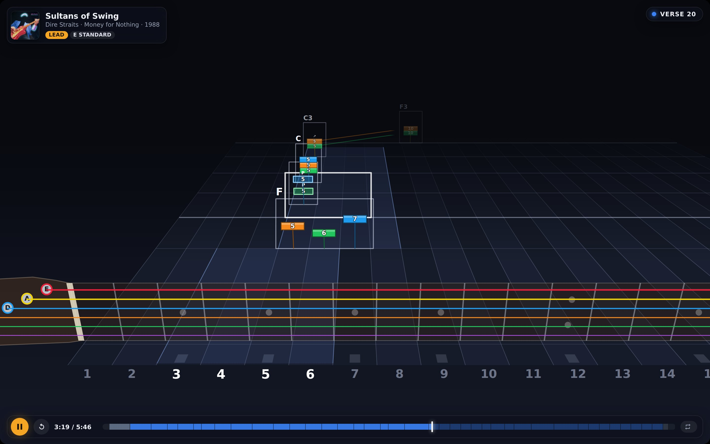 **Note highway**: Sultans of Swing, lead: the 3-D highway with chord frames and names, the song's album art, section, tuning, lyrics and timeline. | 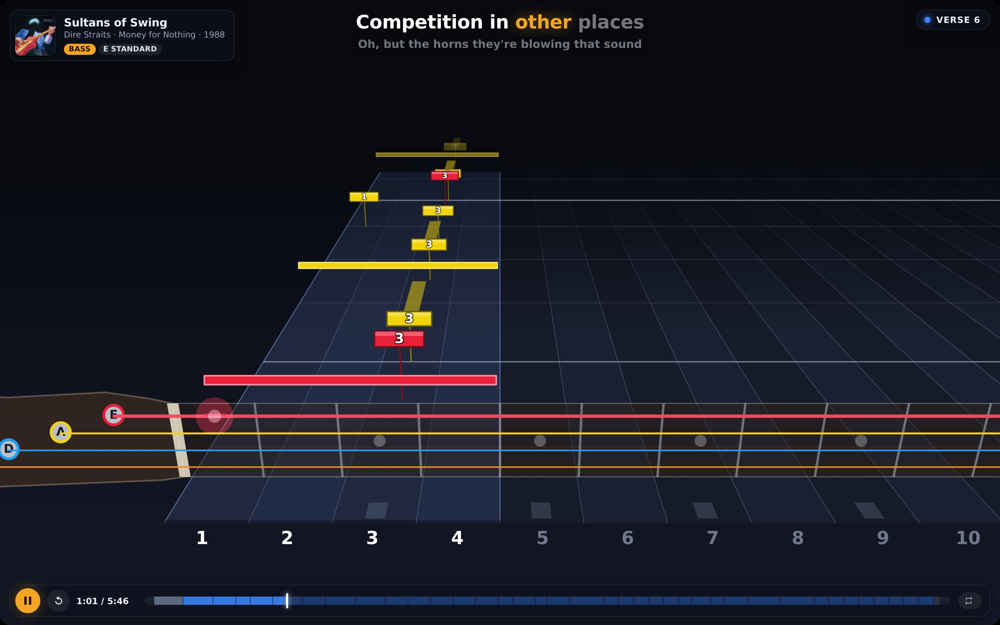 **Bass**: Sultans of Swing, bass: four strings, the ghost neck and headstock with tuning pegs, sustains. |
| 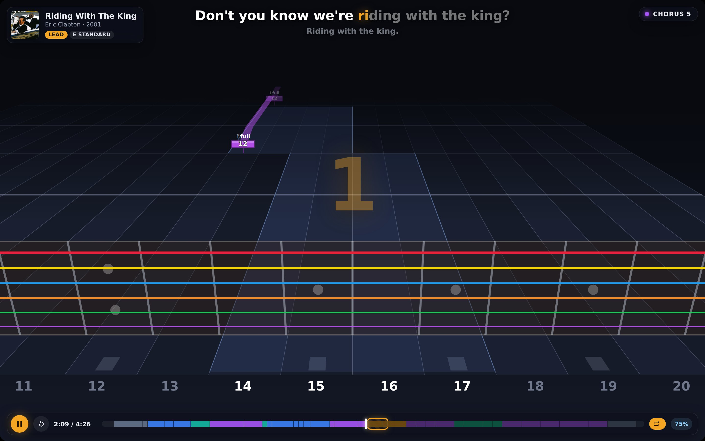 **Practice loop**: Riding With The King, lead: the solo looped at 75% with a lead-in countdown; the loop band on the timeline, speed up on each pass. | 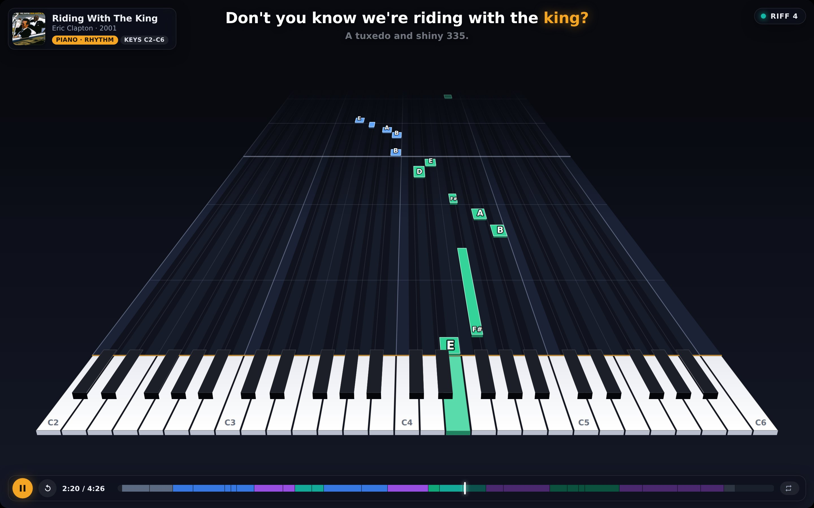 **Piano**: Riding With The King, rhythm part on a 3-D keyboard highway, hands coloured (left blue, right green). |
| 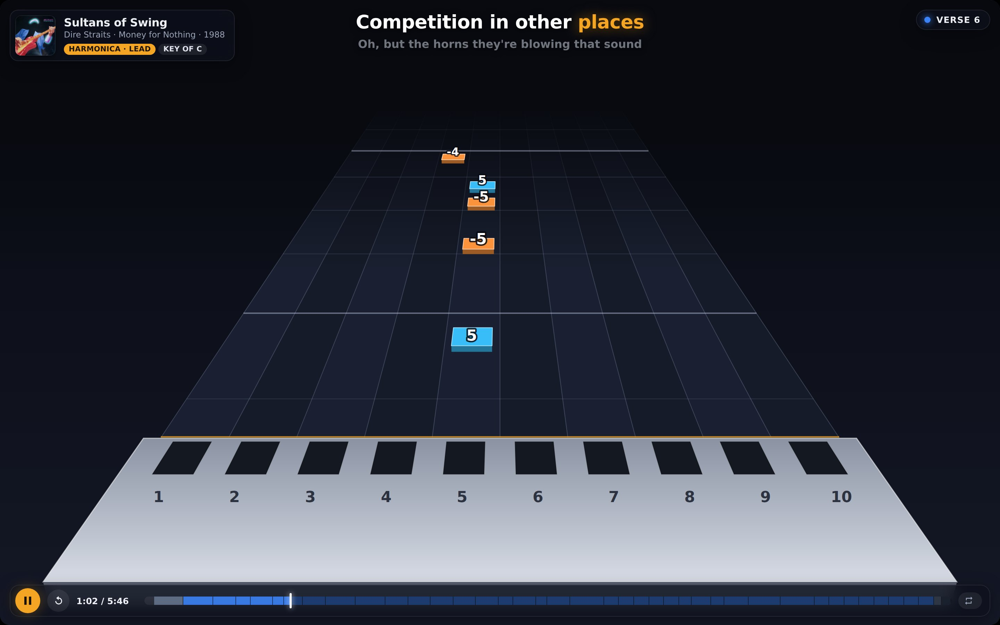 **Harmonica**: Sultans of Swing, lead on a 10-hole harmonica: best harp key (C), blow/draw tab. | 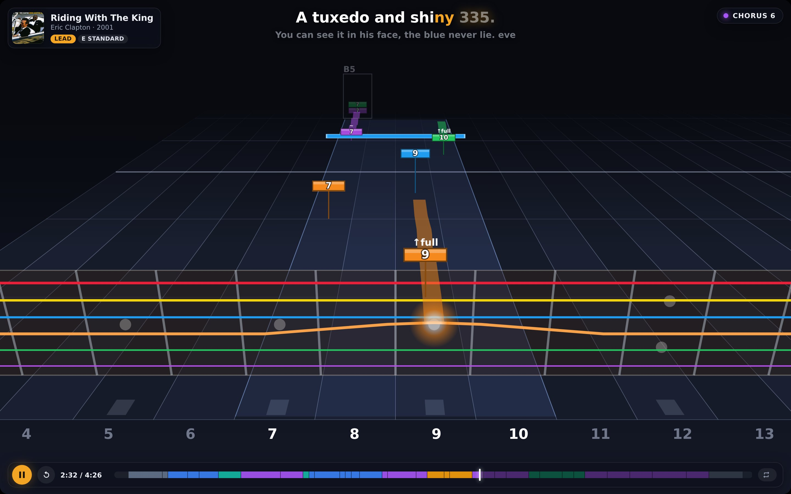 **HTML/SVG renderer**: Riding With The King, lead on the second, zero-dependency HTML/SVG renderer: a full bend and vibrato, switchable at runtime. |
| 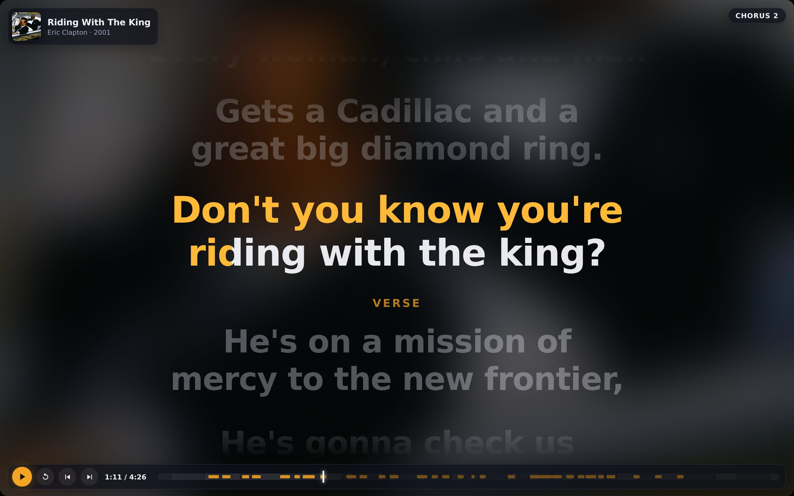 **Karaoke**: Riding With The King: the current line wipes syllable by syllable in time with the audio; section names, timeline of the sung lines. | 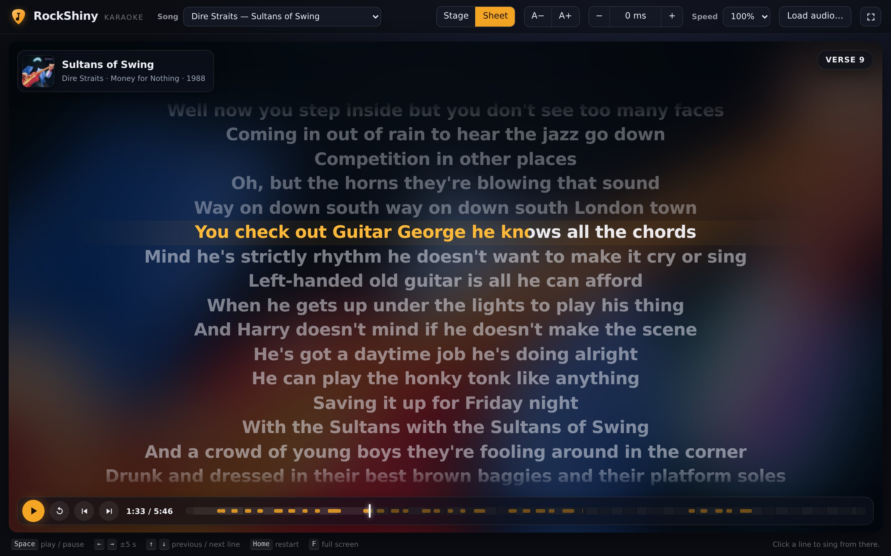 **Karaoke as a standalone HTML page**: karaoke_export_html(): the same player in one offline page, here as a songbook in the lyric-sheet view. |
| 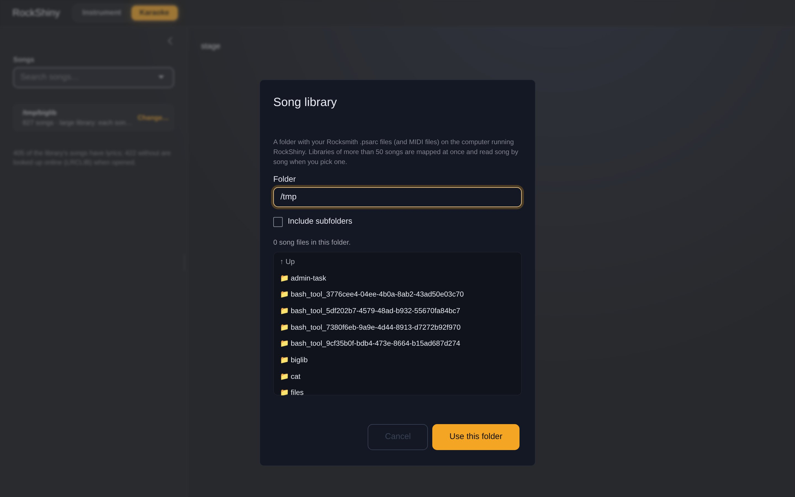 **Song library**: the folder dialog (*Change…* under either song list): type a path or browse the folders of the computer running the app; subfolders optional. | 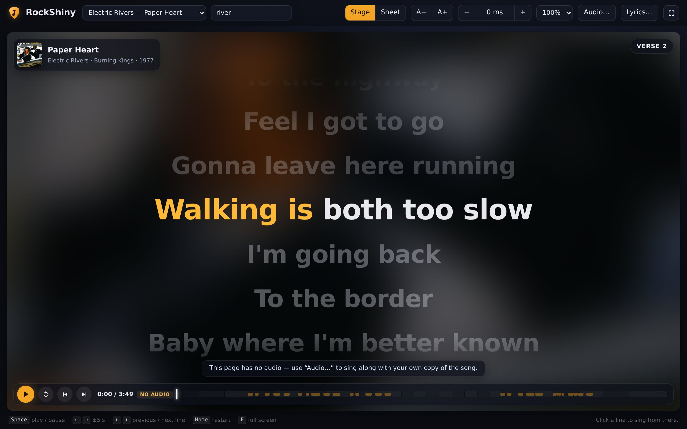 **Karaoke catalog**: 827 songs as one offline page; the list is searchable and each song loads when picked. |
| 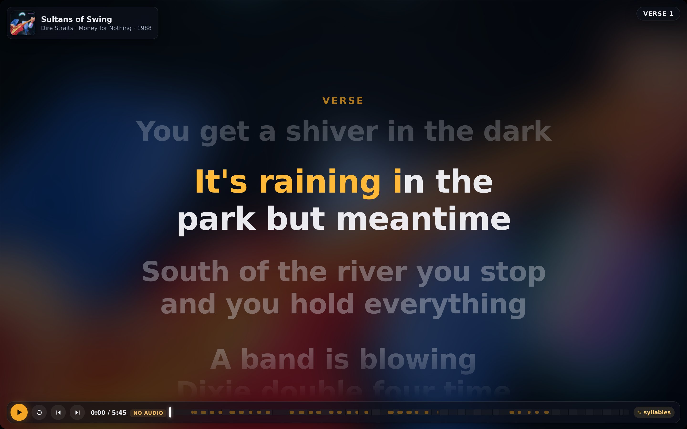 **Web lyrics, syllable by syllable**: lyrics timed by line (LRC) wiped per syllable with estimated timing, flagged by the ≈ syllables badge. | 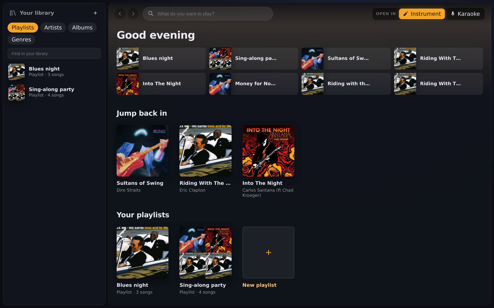 **Home**: the first page, after a streaming app's home: your library panel (playlists, artists, albums, genres), quick tiles, shelves of cards; "Open in: Instrument \| Karaoke". |
| 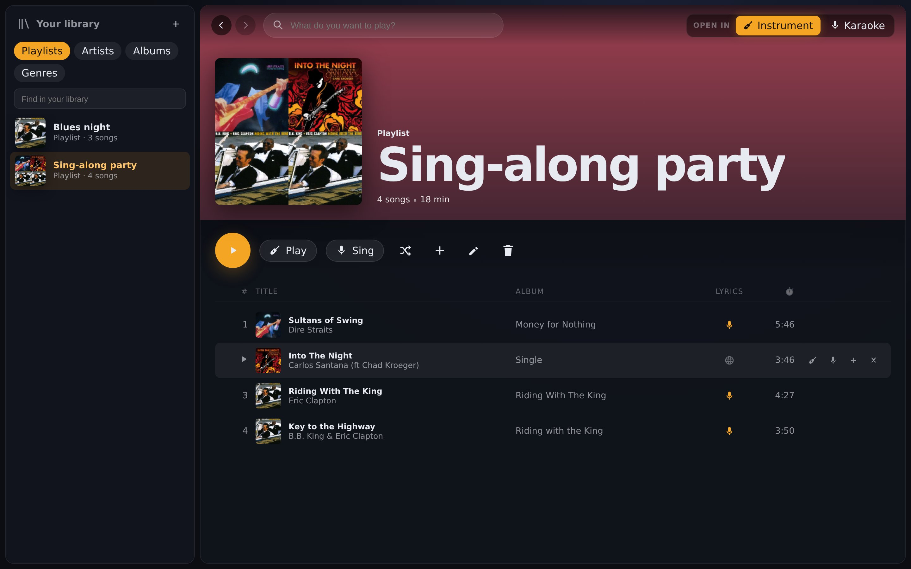 **Playlist**: mosaic cover and a backdrop from its colours; Play (instrument), Sing (karaoke), shuffle, rename, delete; drag songs into order. | 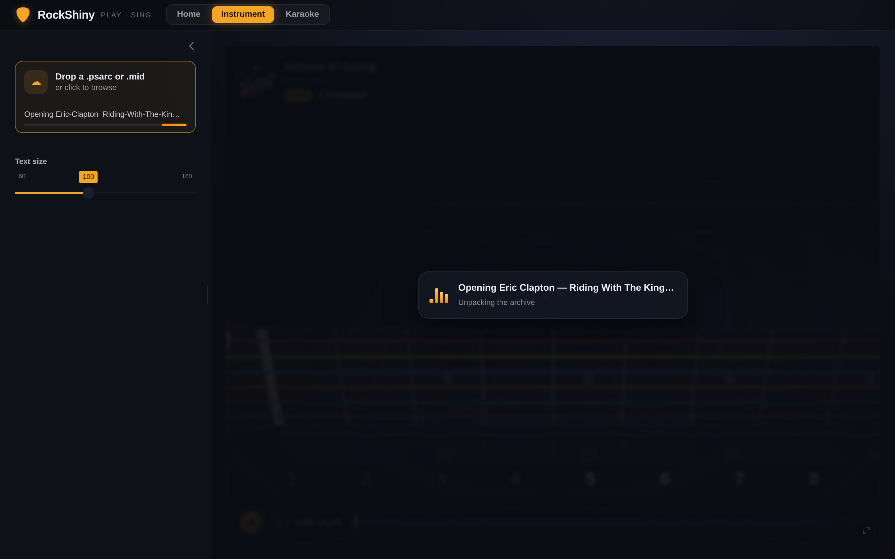 **Opening a song**: upload progress in the dropzone and an overlay on the player until the song is on screen. |
|  **Singing, scored**: Get Lucky with the original voice at 30 % and a (synthetic) singer on the microphone: the pitch lane (charted melody in amber, the voice as dots coloured by accuracy), the live score and the last line's rating. |  **Results of a sung song**: score, rating, pitch and timing, lines sung, best streak, a bar per line, personal best. |
|  **The original voice**: the transport's voice popover: volume 0–100 % and mute, estimated from the stereo mix. | |

## Delivery formats: Shiny · Quarto · HTML

Every Taiga project specifies the triple-format delivery model (one front end, three hosts). Status for RockShiny:

| Format | Status | Entry point | What it gives |
|---|---|---|---|
| Shiny | ✓ shipped | `shiny::runApp()` (`app.R`) | PSARC/MIDI import, audio conversion, scoring history saved by R; Instrument and Karaoke modes. |
| Creator (studio) | ✓ Shiny, ✓ HTML | `shiny::runApp("creator")`, the *Creator* page of `shiny::runApp()` (`mod_creator_ui()` / `mod_creator_server()`); `creator/RockShinyCreator.html` (`creator_build_html()`) | The song-making studio: .psarc decode / encode, timeline editor, difficulty levels (kept, by hand, automatic), stems, lyrics sync, save for PC or Mac; built-in Help (can / can't) and guided tour ([tutorial](../creator/TUTORIAL.md), [video tour](video/creator-tour.mp4)). The same front end in both, with RockShiny's look (`.rs-sidebar`, `.rs-dropzone`, bslib theme; own namespace `.rsc-*`). Screenshots: [`creator/`](creator/). |
| Quarto | **specified, not yet built** | planned `rs_quarto_block(song, …)` | A highway inside a lesson document; sections and loops as links. |
| HTML | ✓ **karaoke**; highway **specified, not yet built** | `karaoke_export_html(songs, file)` (also *Download as HTML* in the app, and `tools/karaoke_export_html.py` without R), `karaoke_export_library(dir, file)` for big libraries; planned `rs_export_html(song, arrangement, instrument)` | Karaoke: lyrics JSON + player assets inline, one song or a songbook (up to 12 with embedded audio), audio embedded / as files / none ("Load audio…"); a whole library as a searchable catalog whose songs load when picked (from disk, or built on request by `--serve`); the same front end as the Shiny module, including Shuffle, the original-voice control and the singing score (personal bests in the browser). Highway: chart JSON + assets inline; guide tones. Audio only with redistribution rights. |

The Quarto and HTML formats are specified in the delivery model, with a plan that reuses what the app already has: [`DELIVERY_MODEL.md` §5.1](../../taiga-design-system/inst/guides/DELIVERY_MODEL.md#51-plans-for-the-gaps). Requirements: DLV-01 to DLV-32.

Capability matrix:

| Capability | Shiny | Quarto | HTML |
|---|---|---|---|
| Runs without a server | – | ✓ | ✓ |
| Server-side computation / secrets | ✓ | – | – |
| Persistence across sessions and devices | ✓ | browser only | browser only |
| Author commentary around the tool | – | ✓ | – |
| Works offline / e-mailable | – | with `embed-resources` | ✓ |

