# RockShiny — Quick Guide

Open your Rocksmith 2014 songs (`.psarc`) and **play along** on a 3-D note highway, or
**sing along** with karaoke lyrics, with the song's own audio in sync.

This guide is the short version. Every detail, decision and measurement is in the
**[Implementation Guide](IMPLEMENTATION_GUIDE.md)**.

<br>

| Home | Play along | Sing along |
|:---:|:---:|:---:|
| 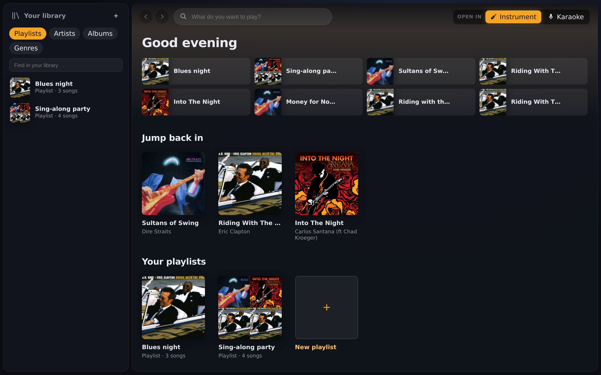 | 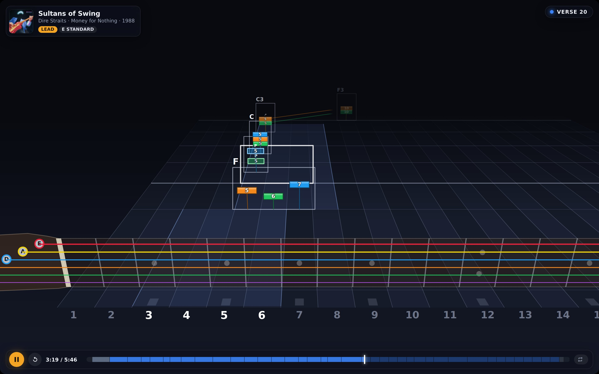 | 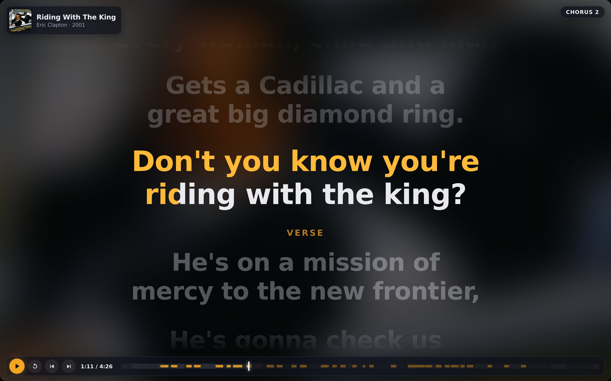 |
| your library, playlists, search | guitar, bass, piano or harmonica | lyrics light up syllable by syllable |

<br>

## Contents

1. [What it does](#1-what-it-does)
2. [Run it](#2-run-it)
3. [Using the app](#3-using-the-app)
4. [Karaoke pages you can share](#4-karaoke-pages-you-can-share)
5. [How it works](#5-how-it-works)
6. [What's where](#6-whats-where)
7. [Tests](#7-tests)
8. [Troubleshooting](#8-troubleshooting)

<br>

---

## 1. What it does

| Feature | What you get |
|---|---|
| **Note highway** | Rocksmith-style 3-D highway for any guitar or bass part, with chords, bends, slides and the other techniques animated. |
| **Other instruments** | Play the same part on a 3-D **piano** or a 10-hole **harmonica** (best harp key chosen for you). MIDI files work too. |
| **Practice** | Loop any sections with a lead-in countdown, slow down, speed up a little on each pass, lower the difficulty. |
| **Scoring (beta)** | Play a real guitar into the microphone or a cable; notes light up when you hit them, with a results card and personal bests. |
| **Karaoke** | Big lyrics, each syllable wiped in colour as it is sung. Songs without lyrics in the file get theirs from the web (LRCLIB), synced to the recording automatically and wiped syllable by syllable too (estimated timing). |
| **Home and playlists** | The first page: your library by artist, album and genre, recently played, search, and playlists; anything plays in the instrument or the karaoke mode, one song after the other. |
| **Big libraries** | Point the app at any folder (with subfolders): hundreds of songs open at once; each song is read fully only when you pick it. |
| **Offline pages** | Any karaoke song (or a whole songbook) as one `.html` file that plays anywhere, no R needed; a big library as a catalog page that loads each song when picked. |

<br>

---

## 2. Run it

**1. Install the R packages** (once):

```r
renv::install(c("xml2", "openssl")); renv::snapshot()
```

**2. Install the audio tools** (once; without them everything works, silently):

| Tool | macOS | Windows / Linux |
|---|---|---|
| `vgmstream-cli` | `brew install vgmstream` | release zip from <https://vgmstream.org> |
| `ffmpeg` | `brew install ffmpeg` | <https://ffmpeg.org> |

> FFmpeg alone **cannot** read Rocksmith audio (`.wem`); vgmstream decodes it first.

**3. Start the app:**

```r
shiny::runApp()
```

The app opens on its **Home** page. Put your `.psarc` files in `songs/`, or choose your own
folder with **Change…** (bottom left of Home, or under a mode's song list, §3), or drag a
file onto a sidebar. For a small library the app decodes the audio in the background the
first time; after that, songs open instantly.

<br>

---

## 3. Using the app

The buttons at the top switch between **Home | Instrument | Karaoke**. The two modes each
have their own sidebar and player; switching pauses the other one.

### Home


Your library the way a music app shows it:

- **Left, *Your library*:** your playlists, or all artists, albums or genres (the chips), with
  a filter. **+** creates a playlist. The library folder and *Change…* are at the bottom.
- **Right:** a greeting and quick tiles (your playlists, what you played lately), then
  shelves: *Jump back in*, *Your playlists*, *Sing along* (songs with lyrics in the file),
  *Artists*, *Albums*, *Genres*, *Recently added*. *Show all* opens a whole shelf.
- **Search** (top): songs, artists, albums, playlists and genres as you type.
- **Open in: Instrument | Karaoke** (top right) decides where the ▶ buttons open songs. Album,
  artist, genre and playlist pages also have explicit **Play** (instrument) and **Sing**
  (karaoke) buttons, and **shuffle**.

Pressing play on an album, an artist, a genre or a playlist switches to that mode and plays the
songs **one after the other**: a *Playing from …* bar at the top of the mode's sidebar shows
where you are, with previous / next; when a song ends, the next one opens. Opening another
song by hand ends the queue. MIDI files are skipped when singing (they have no recording).

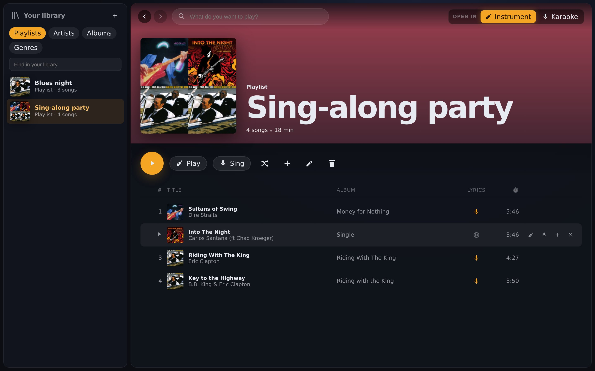

**Playlists:** **+** on any song, album, artist or
search result adds to a playlist (or a new one). On a playlist's page: click the name to rename
it, drag songs into order, **×** removes one, the bin deletes the playlist. Playlists are kept
on your computer (`playlists.json` in the app's data folder) and find songs again when files
are moved (by artist and title).

**Genres:** Rocksmith files carry no genre. Open an artist and click **Set genre** (it applies
to all their songs); the app also looks artists' genres up online on **MusicBrainz** in the
background (only the artist's name is sent; switch it off with
`options(rockshiny.genres_online = FALSE)`). A genre you set wins.

### Your song library

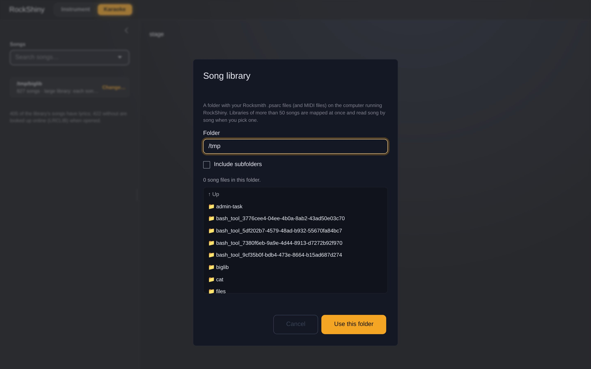

Under each song list a line shows the library folder and its songs. **Change…** opens a
dialog: type a folder, or click through the folders of the computer running the app, tick
*Include subfolders* if your songs are sorted into folders, then **Use this folder**. Both
modes switch to it, and the app remembers it next time.

| Library | What happens |
|---|---|
| up to **50 songs** | everything is read at once: titles, lyrics or not, and the audio is decoded in the background so songs start instantly |
| **more than 50** (e.g. 827 songs, 6 GB) | the folder is *mapped* in a moment: the lists fill at once (from file names at first), titles and lyrics are checked in the background (the status line counts), and a song's audio is decoded only when you pick it |

What was read is kept in an index, so the next start is instant either way. The threshold is
`options(rockshiny.library_lazy_threshold = 50)`. On a shared server,
`options(rockshiny.library_picker = FALSE)` hides *Change…*.

### Instrument mode

1. **Song:** pick a song from the library (or drop a file), then an *Arrangement*
   (Lead, Rhythm, Bass…) and what to *Play on* (guitar/bass, piano, harmonica). A dropped
   file shows its upload progress, then *Opening…*, and is **kept**: it appears in the song
   lists under *Uploaded* (in both modes) from then on.
2. **Practice:** choose *From / To* sections and switch on *Loop this part*. Double-click a
   section in the timeline does the same.
3. **Display**, **Audio & sync**, **Scoring** and **Performance** hold the rest.

If the song has lyrics, a **Sing along in karaoke mode** button appears under the song.

### Karaoke mode

1. **Song:** the list has two groups: **songs with lyrics**, and songs without lyrics in
   the file, whose lyrics are **looked up online** when you open them (see below). While a
   big library is still being checked, a third group lists the songs *not checked yet*. You
   can also drop a `.lrc` lyrics file on the sidebar to give the current song its lyrics.
2. **Display:** *Stage* (big lines) or *Lyric sheet* (the whole song), text size, count-in
   dots, section names, album-art backdrop.
3. **Audio & sync:** *Lyrics timing* moves the highlight earlier or later; *Speed* slows the
   song down without changing its pitch.
4. **Take it with you:** *Download as HTML* saves the song as an offline page.

Click any line to sing from there. *Play it in instrument mode* switches back with the same
song.

#### Songs without lyrics in the file

Where the lyrics come from, first hit wins:

| Source | How |
|---|---|
| a `.lrc` file next to the song | `songs/Song_m.psarc` + `songs/Song_m.lrc` |
| a `.lrc` dropped on the karaoke sidebar | for the song that is open; remembered |
| **LRCLIB** (lrclib.net) | a free, open database of *synced* lyrics; searched by artist and title |

Web lyrics are timed for *a* recording of the song, not necessarily this one. So when the
audio has loaded, the player **syncs them to this recording** by itself (a few seconds;
the sidebar shows the result), and remembers it. If a line is a little early or late,
nudge *Lyrics timing*.

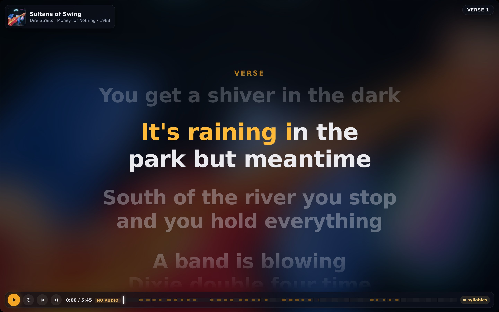

Web lyrics are usually timed **by line**, not by syllable. The player still wipes them
**syllable by syllable**: it splits the words into syllables and spreads them over the line
with a timing model fitted to real sung lyrics. That is an *estimate* (typically within a
few tenths of a second, see the Implementation Guide), and the player says so with a
**≈ syllables** badge. Lyrics with word timings (“enhanced” LRC, `<mm:ss.xx>` before each
word) are wiped at their real times.

Switch the lookup off with *Look up missing lyrics online* (or
`options(rockshiny.lyrics_online = FALSE)`); only the artist and title are sent.

### Opening a song

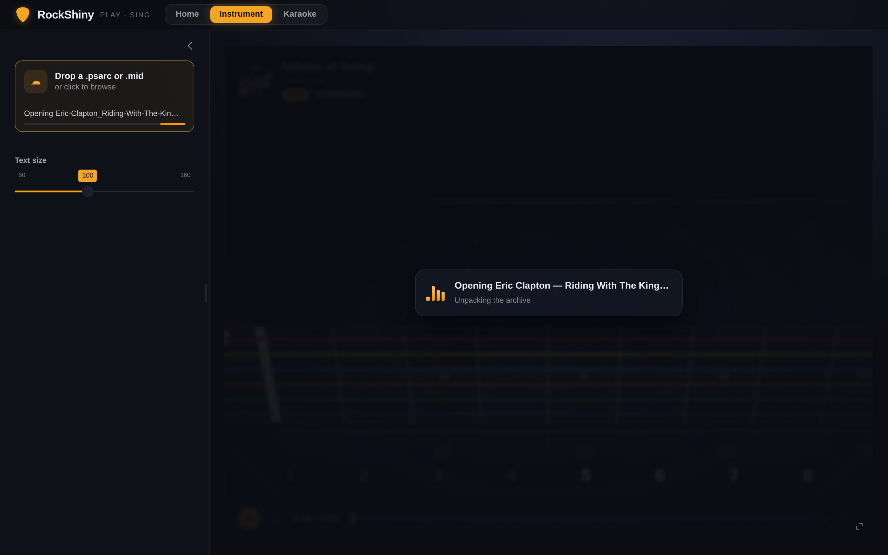

While a song is being read, the player shows an **Opening *Artist — Title*…** overlay, and a
dropped file's progress shows in the dropzone (uploading with a percentage, opening, done).
Both go away as soon as the song is on screen.

### Keyboard shortcuts

| Key | Instrument | Karaoke |
|---|---|---|
| `Space` | play / pause | play / pause |
| `←` `→` | ± 5 s | ± 5 s |
| `↑` `↓` | — | previous / next line |
| `Home` | back to the start (or the loop start) | back to the start |
| `L` | loop on / off | — |

<br>

---

## 4. Karaoke pages you can share

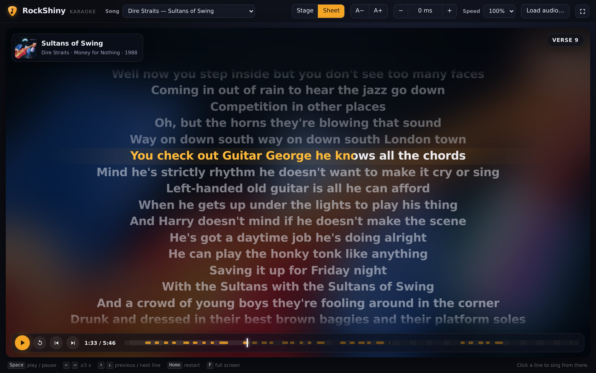

One `.html` file with the lyrics, the album art, the audio and the same player as the app.
It opens offline in any browser.

**From R:**

```r
karaoke_export_html("songs/Dire-Straits_Sultans-of-Swing_v443_m.psarc", "sultans.html")
karaoke_export_html(karaoke_choices("songs"), "songbook.html", audio = "files")   # all songs with lyrics
```

**Without R (Python):** one command builds **`exports/index.html`**, every song in
`songs/` with its audio, ready to open:

```bash
pip install wem2ogg                       # decodes the audio (unless vgmstream-cli is installed)
python3 tools/karaoke_export_html.py      # -> exports/index.html
python3 tools/karaoke_export_html.py --serve          # ... and serve it at http://localhost:8000/index.html
```

More control:

```bash
python3 tools/karaoke_export_html.py songs/Dire-Straits_Sultans-of-Swing_v443_m.psarc -o sultans.html
python3 tools/karaoke_export_html.py --library songs -o songbook.html --audio files
```

Both write the **same page, byte for byte**. Nothing else is required: `cryptography` is
optional (faster). Songs whose lyrics cannot be found while exporting (e.g. offline) are
kept, and the page looks their lyrics up itself when it is opened.

#### A big library: a catalog

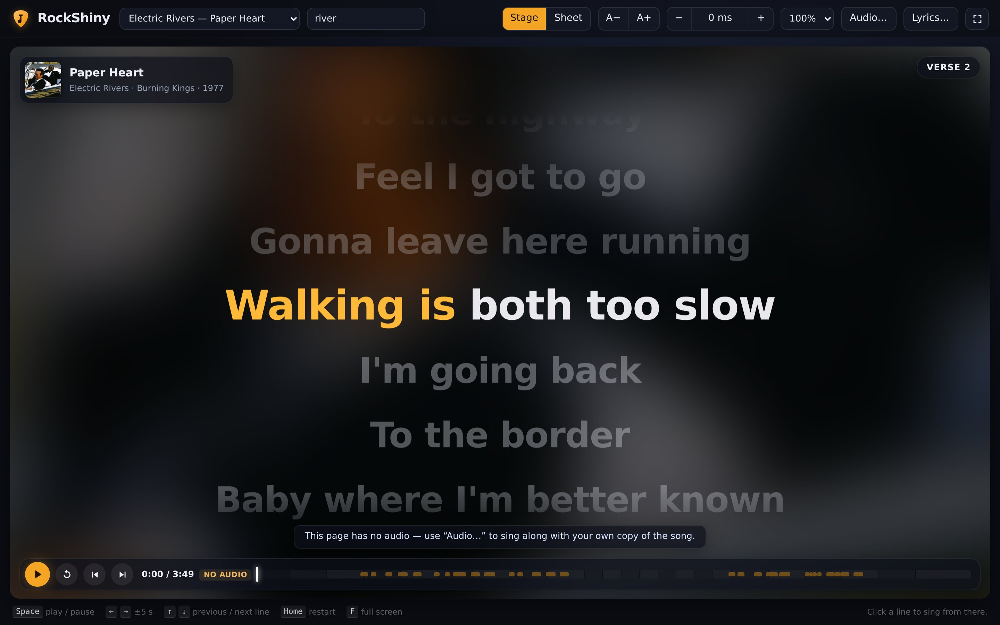

One page can hold at most **12 songs with their audio inside** (each adds ~7 MB that the
browser must read before anything plays). A whole library becomes a **catalog**: a small
page with a searchable song list, plus one small file per song that is loaded when you pick
it; the audio sits next to it.

```r
karaoke_export_library("~/Music/Rocksmith", "karaoke/index.html")   # R
```

```bash
python3 tools/karaoke_export_html.py --library ~/Music/Rocksmith --recursive -o karaoke/index.html --jobs 4
python3 tools/karaoke_export_html.py --library ~/Music/Rocksmith --audio none -o karaoke/index.html  # lyrics only, fast
python3 tools/karaoke_export_html.py --library ~/Music/Rocksmith --serve     # build nothing up front
```

| | 827 songs (6.2 GB), measured |
|---|---|
| the catalog page | 0.3 MB, opens in ~2 s from disk, searching the list takes milliseconds |
| picking a song | lyrics on stage in ~0.1–0.3 s |
| building it, lyrics only (`--audio none`) | under a minute |
| building it with audio | the audio conversion dominates: seconds per song (`--jobs` runs several at once); re-runs only add what is new |
| `--serve` | starts in under a second; each song is built the first time it is opened (lyrics at once, audio a few seconds later) and kept |

`--library` folders with more than 50 songs become catalogs automatically (`--single` to
prevent it).

| Option (R / Python) | Values | Use it for |
|---|---|---|
| `audio` / `--audio` | `embed` (default, up to 12 songs), `files`, `none` | one portable file · a big songbook · lyrics only |
| `audio_format` / `--audio-format` | `auto`, `mp3`, `m4a` (Python also `copy`) | `mp3`/`m4a` for older Safari |

The page has **Audio…** (pair the lyrics with your own copy of the song) and **Lyrics…**
(a `.lrc` file for the current song) buttons; it remembers lyrics, syncs and settings.
Only share pages with embedded audio when you have the rights to the recording.

<br>

---

## 5. How it works

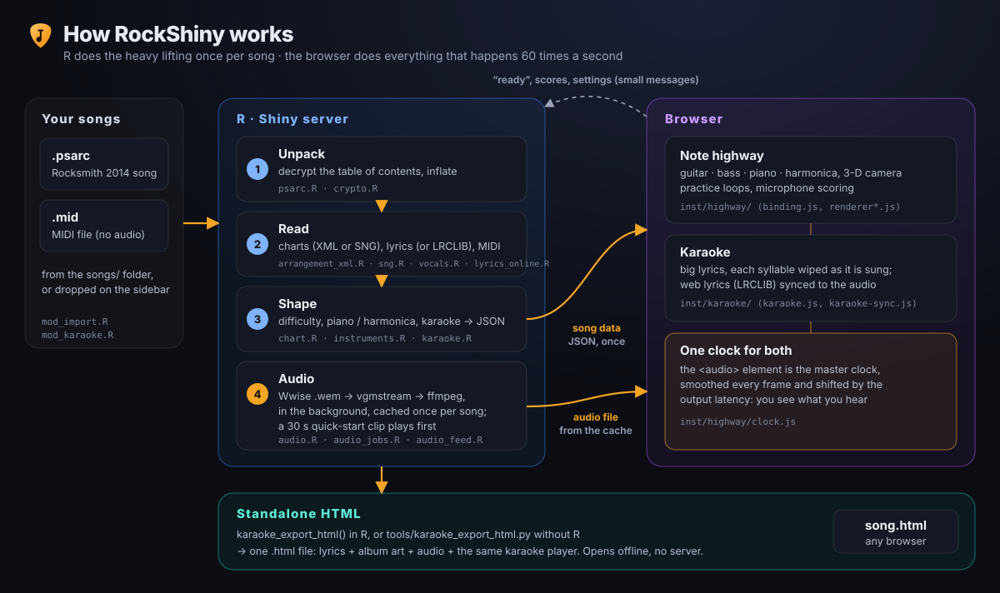

- **R works once per song:** it unpacks the `.psarc`, reads the note charts and lyrics, and
  sends them to the browser as JSON.
- **Audio is converted in the background** and cached, so each song is decoded only once.
- **The browser does everything 60 times a second:** drawing the highway or the lyrics,
  following the audio.
- **Both players share one clock:** the audio itself. They correct for the sound card's
  delay, so what you see matches what you hear.

Details: [Implementation Guide §1](IMPLEMENTATION_GUIDE.md#1-architecture) and
[§4 step by step](IMPLEMENTATION_GUIDE.md#4-step-by-step).

<br>

---

## 6. What's where

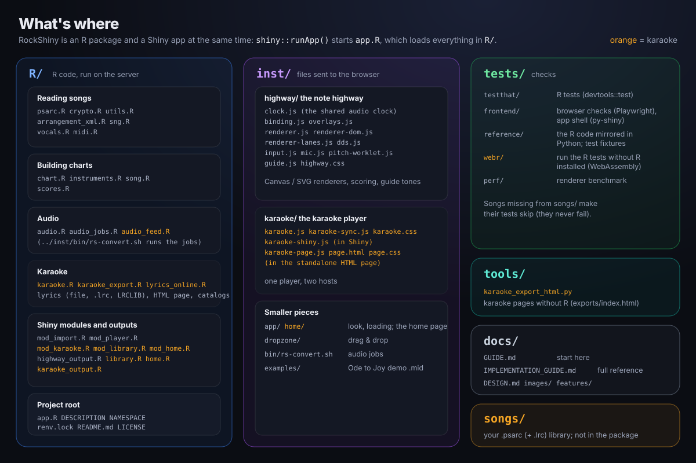

| I want to change… | Look in |
|---|---|
| the page layout, the mode switch | `app.R`, `inst/app/app.css` |
| the instrument sidebar | `R/mod_player.R`, `R/mod_import.R` |
| the karaoke sidebar, HTML download | `R/mod_karaoke.R` |
| the home page, playlists, genres, the play queue | `R/home.R`, `R/mod_home.R`, `inst/home/home.js`, `inst/home/home.css` |
| loading overlay, upload progress | `inst/app/app.js`, `inst/dropzone/dropzone.js` |
| the library folder, big libraries | `R/library.R`, `R/mod_library.R` |
| how songs are read | `R/psarc.R`, `R/arrangement_xml.R`, `R/sng.R`, `R/vocals.R` |
| audio conversion | `R/audio.R`, `R/audio_jobs.R`, `inst/bin/rs-convert.sh` |
| the highway's look | `inst/highway/renderer*.js`, `inst/highway/highway.css` |
| the karaoke's look and timing | `inst/karaoke/karaoke.js`, `inst/karaoke/karaoke.css` |
| the offline page, catalogs | `inst/karaoke/page.html`, `karaoke-page.js`, `R/karaoke_export.R`, `tools/karaoke_export_html.py` |
| web lyrics: syllables, sync | `inst/karaoke/karaoke-sync.js`, `R/lyrics_online.R` |

Full tree: [Implementation Guide §2](IMPLEMENTATION_GUIDE.md#2-directory-structure).

<br>

---

## 7. Tests

```r
devtools::test()                                  # R tests
```

```bash
python3 tests/frontend/check_karaoke.py           # karaoke in a real browser (Playwright), incl. lyrics sync
python3 tests/frontend/check_app_shell.py         # the app's topbar and mode switch (real bslib, via py-shiny)
python3 tests/frontend/check_library.py           # big libraries: catalog page, lazy server, library UI
python3 tests/frontend/check_home.py              # the home page: views, playing, playlists, genres, 827 songs
python3 tests/reference/check_export_parity.py    # R and Python write identical pages (R via webR)
python3 tests/frontend/check_frontend.py          # the highway in a real browser
python3 tests/reference/check_lyrics_lookup.py    # the lyrics lookup over HTTP (a local stand-in for LRCLIB)
node tests/webr/run_webr.mjs tests/webr/run_tests.R   # R tests without R installed
```

- Tests that need a particular song **skip** when it is not in `songs/`; they never fail
  because of it. The skip message names the song.
- A big test library: `python3 tests/reference/make_big_library.py /tmp/biglib` writes 827
  distinct `.psarc` files (6.2 GB) made from the sample songs; `check_library.py` uses it
  when it is there, and `tests/perf/library_bench.R` times the R side on it.
- Browser checks need `pip install playwright cryptography numpy`, `playwright install
  chromium` and ffmpeg; `check_app_shell.py` also `pip install shiny libsass` (py-shiny
  ships the same bslib as the app, so the app's page can be rebuilt without R).
- Results and method: [Implementation Guide §5](IMPLEMENTATION_GUIDE.md#5-verification).

<br>

---

## 8. Troubleshooting

| Symptom | Fix |
|---|---|
| "no audio" in the player | install `vgmstream-cli` and `ffmpeg` (§2), or point to them: `options(rockshiny.vgmstream = "...", rockshiny.ffmpeg = "...")` |
| a song's lyrics are not found online | put a `.lrc` next to the `.psarc` (same name), or drop one on the karaoke sidebar |
| web lyrics are out of step | wait for "synced to this recording" after the audio loads; then *Lyrics timing* |
| "Could not reach the lyrics service" | offline (or the site is down): nothing is cached, so it is tried again next time |
| the lyrics light up too early or late | *Audio & sync → Lyrics timing* (in the offline page: the − / + buttons) |
| web lyrics: the syllable wipe runs ahead or lags inside a line | expected now and then: for lyrics timed by line the syllable times are estimated (≈ badge); a word-timed `.lrc` fixes it |
| a big library shows file names instead of titles | it is still being checked (see the status line); it finishes in the background |
| songs added to the library folder do not show | they appear within a few seconds when added to the folder itself; for subfolders, *Change…* → *Use this folder* re-reads it |
| notes and sound feel out of step on the highway | *Audio & sync → Fine-tune offset*; Safari does not report its audio delay |
| an offline page plays no sound in Safari | export with `audio_format = "mp3"` (Python: `--audio-format mp3`) |
| arrow keys switched the mode instead of seeking | fixed: after a mode switch, the player has the keyboard |
| the pause button sometimes did nothing (Space worked) | fixed: the highway redrew its play icon 10 times a second, and a click that spanned a redraw was lost |
| a playlist shows "not in the library any more" | the file was deleted or renamed *and* retitled; remove the entry (×) |
| genres stay empty | offline, or MusicBrainz does not know the artist: set the genre on the artist's page |
| `R CMD check`: "files with future time stamps" | the files were copied from another machine; `touch` them (or re-save) |
| `R CMD check`: `.DS_Store` in the check directory | created by macOS Finder; delete it, it is not part of the package |
