# RockShiny — Implementation Guide

**The complete reference:** every module, every design decision, every measurement.

> **New here?** Start with the short **[GUIDE.md](GUIDE.md)**: what the app does, how to run it,
> and where things are, in ten minutes. Come back here for the details.

RockShiny is a Shiny app that opens Rocksmith 2014 `.psarc` files (and Standard MIDI files)
and plays them on a Rocksmith-style 3-D note highway, with the song audio in sync, on
guitar/bass, piano or harmonica.

A second mode, **karaoke**, shows the lyrics of songs that have them, highlighted syllable by
syllable in time with the audio, in the app or as a standalone HTML page (Step 13). The
library can be any folder, including big ones (hundreds of songs, gigabytes): they are
mapped at once and each song is read fully only when it is picked (Step 14). The app opens on
a **home page** in the manner of a music-streaming app: the library by artist, album and genre,
playlists, recently played and search; anything plays in either mode, one song after the
other (Step 15). Each start opens a random song (Step 17). In karaoke mode you can turn the
original singer down and **sing into the microphone for a score**, compared with the song's
melody or key in real time (Step 18).

<br>

| | | |
|:---:|:---:|:---:|
| 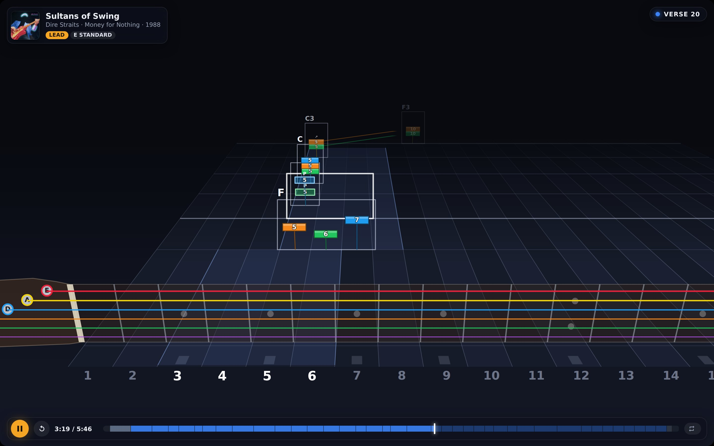<br>**Note highway** | 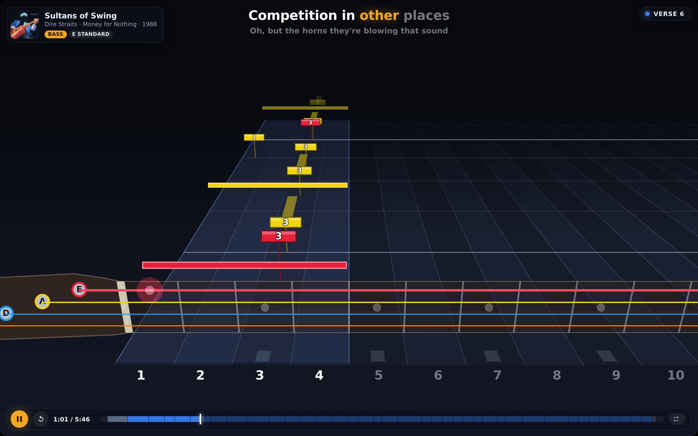<br>**Bass: ghost neck and headstock** | 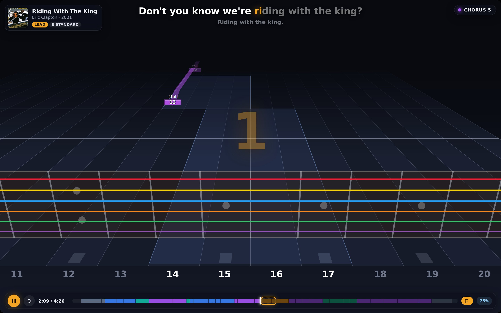<br>**Practice loop** |
| 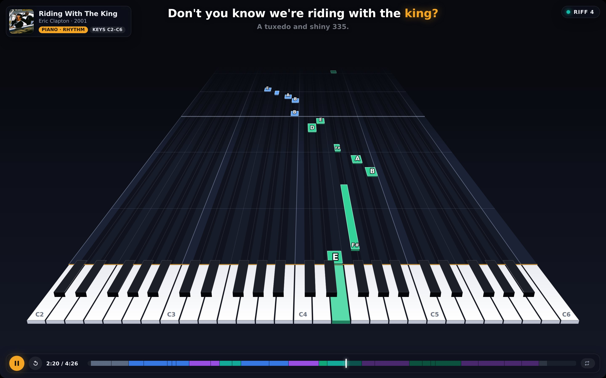<br>**Piano** | 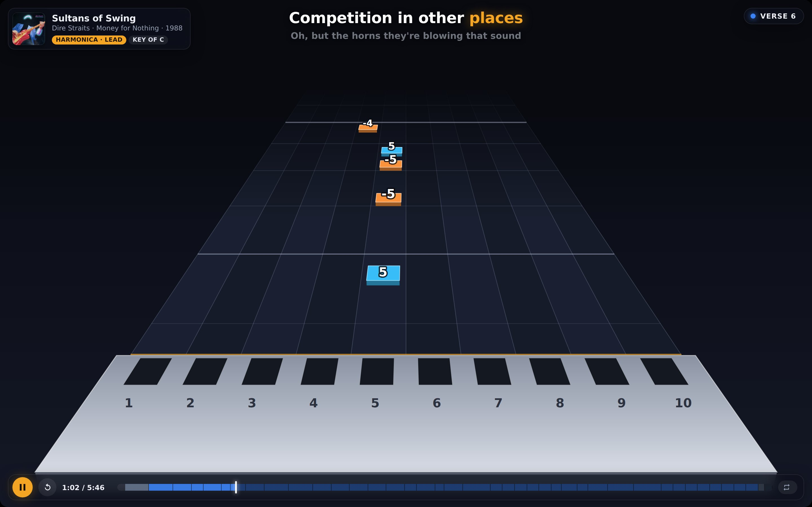<br>**Harmonica** | 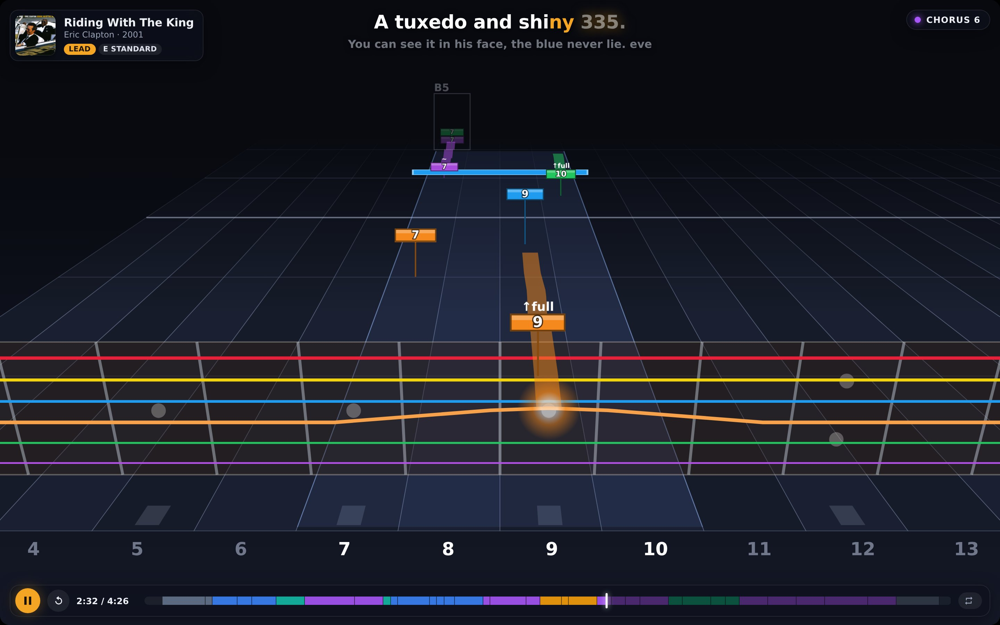<br>**HTML/SVG renderer** |
| 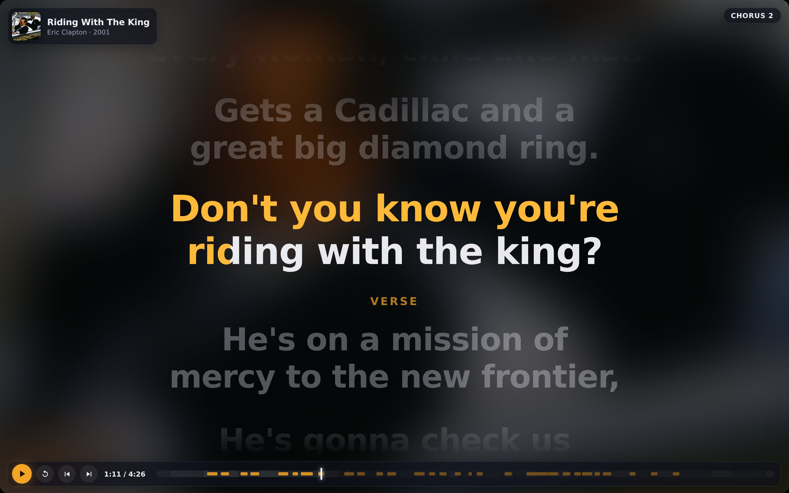<br>**Karaoke** | 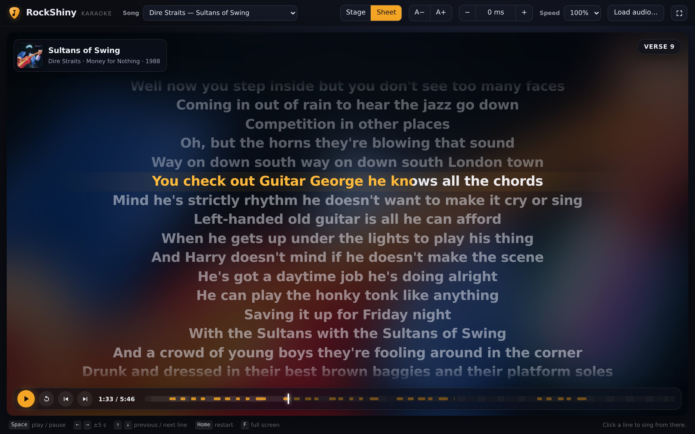<br>**Karaoke as a standalone page** | 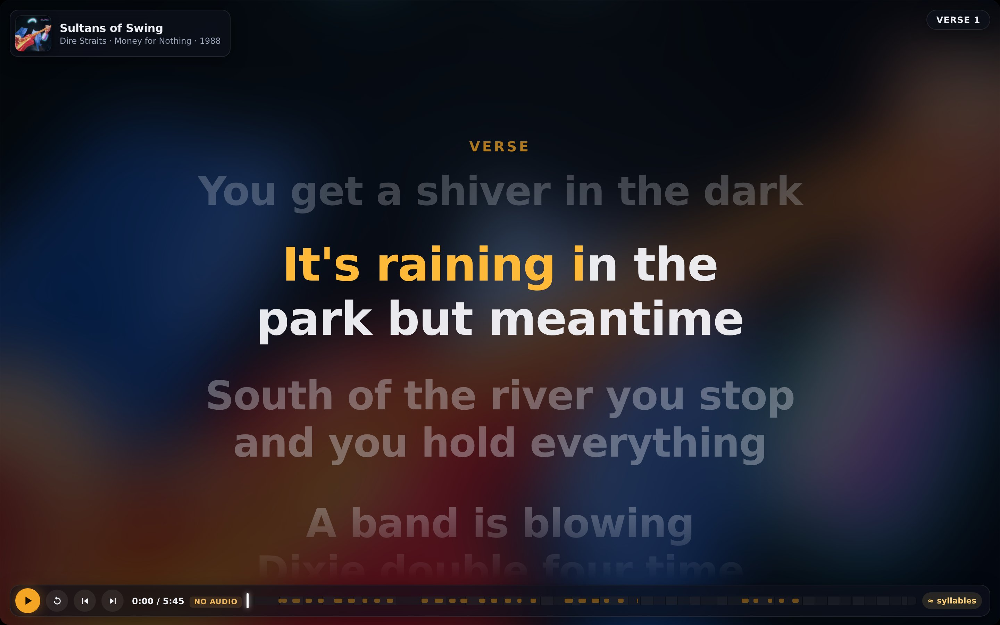<br>**Web lyrics, syllable by syllable** |
| 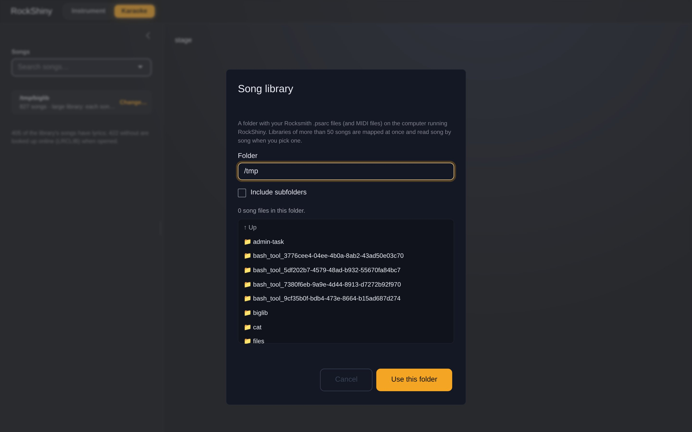<br>**Song library folder** | 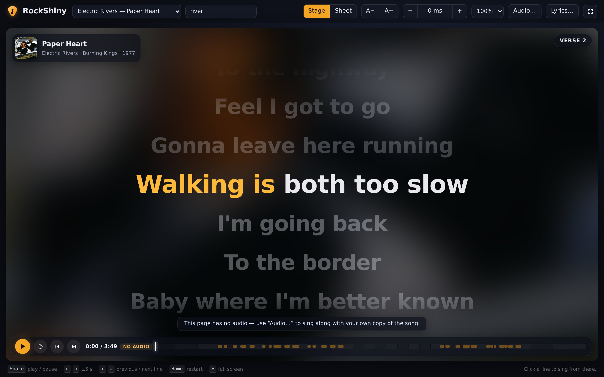<br>**A catalog of 827 songs** | 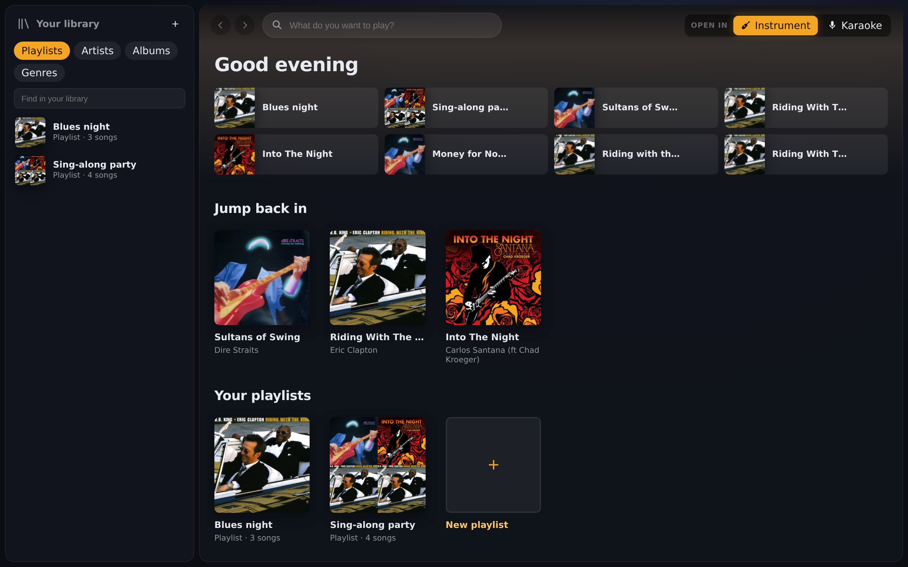<br>**Home** |
| 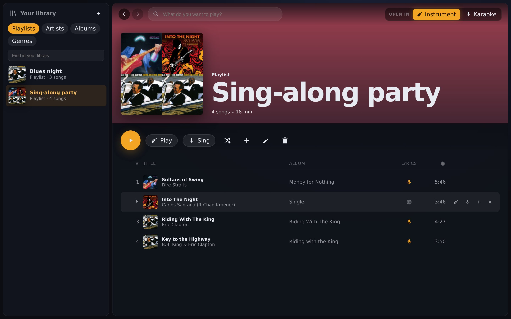<br>**Playlist** | 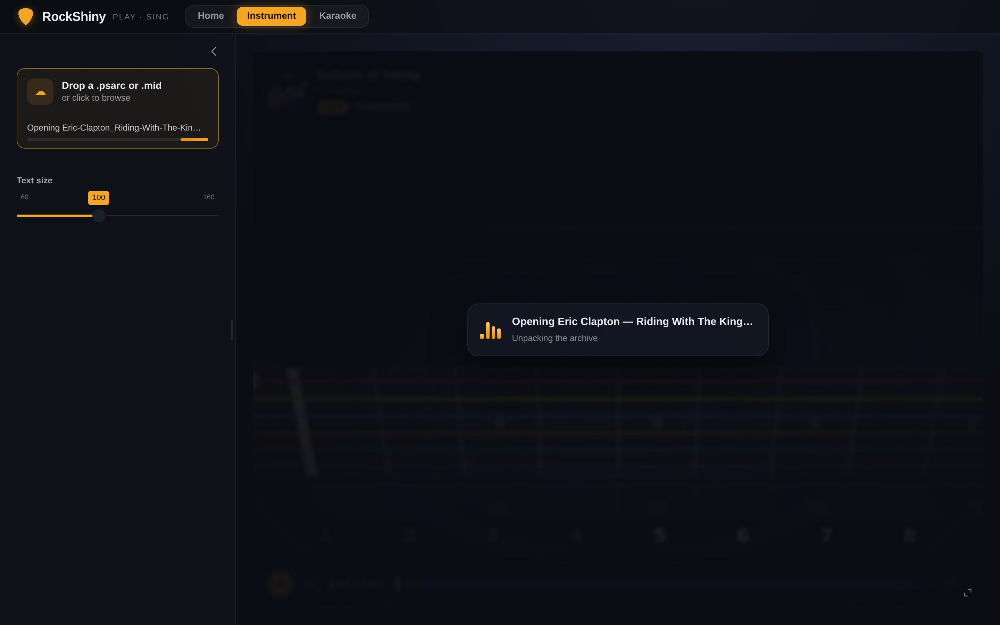<br>**Opening a song** | <br>**Singing, scored** |
| <br>**Results of a sung song** | <br>**The original voice: volume, mute** | |

<br>

## Contents

1. [Architecture](#1-architecture)
2. [Directory structure](#2-directory-structure)
3. [Setup](#3-setup)
4. [Step by step](#4-step-by-step)
   - [Step 1 · PSARC container](#step-1--psarc-container)
   - [Step 2 · Arrangements and the right audio file](#step-2--arrangements-and-the-right-audio-file)
   - [Step 3 · Note charts](#step-3--note-charts)
   - [Step 4 · Chart model and JSON contract](#step-4--chart-model-and-json-contract)
   - [Step 5 · Audio](#step-5--audio)
   - [Step 6 · Shiny integration](#step-6--shiny-integration)
   - [Step 7 · The renderers](#step-7--the-renderers)
   - [Step 8 · Audio/visual sync](#step-8--audiovisual-sync)
   - [Step 9 · Song card, lyrics and practice](#step-9--song-card-lyrics-and-practice)
   - [Step 10 · Input seam for scoring](#step-10--input-seam-for-scoring)
   - [Step 11 · Microphone scoring](#step-11--microphone-scoring)
   - [Step 12 · Piano and harmonica](#step-12--piano-and-harmonica)
   - [Step 13 · Karaoke mode](#step-13--karaoke-mode)
   - [Step 14 · Big song libraries](#step-14--big-song-libraries)
   - [Step 15 · Home, playlists and genres](#step-15--home-playlists-and-genres)
   - [Step 16 · Opening songs: progress, uploads, and the pause button](#step-16--opening-songs-progress-uploads-and-the-pause-button)
   - [Step 17 · Shuffle, a wider timing range, and a bigger sample library](#step-17--shuffle-a-wider-timing-range-and-a-bigger-sample-library)
   - [Step 18 · Singing: the original voice turned down, and a score for your singing](#step-18--singing-the-original-voice-turned-down-and-a-score-for-your-singing)
5. [Verification](#5-verification)
6. [Performance: Shiny page vs plain HTML, Canvas vs HTML/SVG](#6-performance-shiny-page-vs-plain-html-canvas-vs-htmlsvg)
7. [Known limitations and next steps](#7-known-limitations-and-next-steps)

<br>

---

## 1. Architecture

R does file I/O, decryption, decompression and data wrangling, **once per song**.
The browser does everything that runs **per frame**.
Nothing that needs precise timing goes through the R websocket.

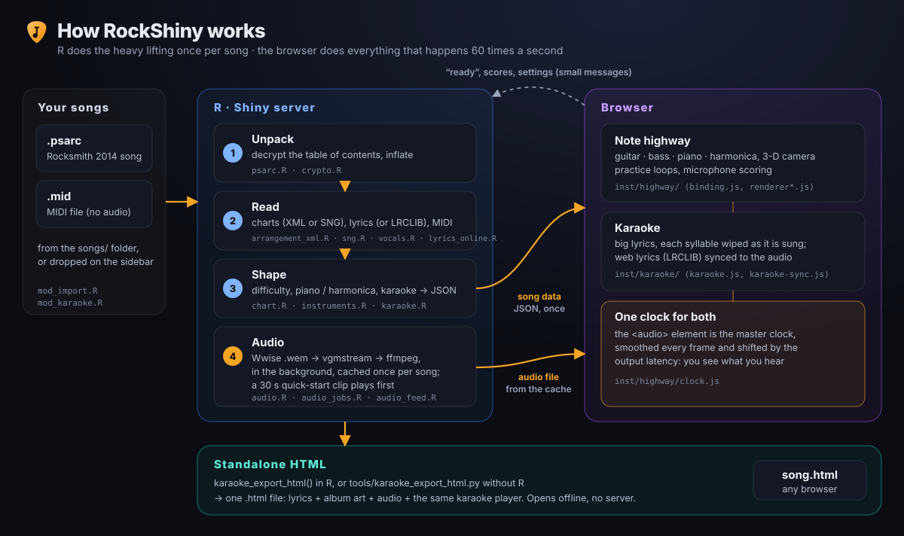

### Detailed flow

```
 ┌──────────────────────────── R (Shiny server) ─────────────────────────────┐
 │ mod_import ──► load_song() ──► psarc_open()  AES-CFB TOC, zlib blocks      │
 │                     │                                                      │
 │                     ├─► song_chart() ─► parse_arrangement_xml()  (CDLC)    │
 │                     │                 └► parse_arrangement_sng() (official)│
 │                     │                 └► build_chart()  DD merge, chords   │
 │                     │                 └► chart_for_instrument() piano/harp │
 │                     │                 └► chart_json()   column JSON ───────┼──► output value (once)
 │ .mid ─► read_midi() ─► midi_parts() ─► (same chart path, no audio)         │
 │                     └─► song_audio() ─► find_song_wem() (.bnk lookup)      │
 │                                        convert_wem() vgmstream → ffmpeg    │
 │                                        cache/<md5>/audio.ogg ─────────────┼──► static URL (httpuv)
 │ mod_karaoke ─► load_karaoke_song() ─► song_vocals_raw() + manifest + art   │
 │                     └─► karaoke_json()  lyrics columns ────────────────────┼──► output value (once)
 │                     └─► audio_feed()    same cache + background jobs ──────┼──► static URL (httpuv)
 │                     └─► karaoke_export_html()  standalone page (HTML) ─────┼──► .html file
 └────────────────────────────────────────────────────────────────────────────┘
 ┌──────────────────────────── Browser ──────────────────────────────────────┐
 │ binding.js   Shiny output binding + controller (transport, keys, loop)     │
 │ clock.js     <audio> is the master clock, extrapolated per frame          │
 │ renderer.js  Canvas 2D + hand-rolled perspective camera, draw(t)           │
 │ renderer-lanes.js  piano keyboard / harmonica lanes (same camera + clock)  │
 │ guide.js     guide tones: the chart on a Web Audio synth, latency-aligned  │
 │  requestAnimationFrame ─► clock.tick(ts) ─► renderer.draw(t - offset)       │
 │ mic.js       getUserMedia ─► AudioWorklet (pitch-worklet.js: onsets +      │
 │              spectra) ─► NoteVerifier ─► input.js HitJudge ─► renderers    │
 │ karaoke.js   lyrics: timing model + DOM view, on clock.js (same sync);     │
 │              hosts: karaoke-shiny.js (Shiny) / karaoke-page.js (HTML page) │
 └────────────────────────────────────────────────────────────────────────────┘
```

### Channels between R and the browser

| Channel | Direction | When | Payload |
|---|---|---|---|
| output value (`renderHighway`) | R → JS | once per arrangement | chart JSON (40–70 KB typical, ~290 KB for a 7,400-note rhythm chart) |
| custom message `rs-highway` | R → JS | rarely | `audio` (head/full), `settings`, `play/pause/seek`, `status`, `input`, `benchmark`, `calibrate`, `result_ack` |
| input `<id>_ready` | JS → R | after each chart load | `{songKey, audio: none/head/full, formats}` (starts the audio job) |
| input `<id>_state` | JS → R | 4 Hz while playing | `{t, playing, section, sectionIndex, rate, loops, fps}` |
| input `<id>_section_pick` | JS → R | double-click on a timeline section | `{index}` → practice pickers + loop on |
| input `<id>_loop_toggle` | JS → R | `L` key / loop badge | flips the "Loop this part" switch |
| input `<id>_benchmark` | JS → R | after "Benchmark renderers" | per-renderer fps / frame-time results |
| input `<id>_judge` | JS → R | ≤ 2.5 Hz while an input source is on | `{hits, misses, perfect, streak, bestStreak, accuracy, score, multiplier}` |
| input `<id>_result` | JS → R | end of a scored song / each loop pass | `{kind: song/loop, accuracy, score, sections, coverage, rate, ...}` → `scores.csv` |
| input `<id>_devices` / `_input_status` / `_calibration` | JS → R | microphone start / calibration | input devices, start errors, measured input latency |
| input `<id>_latency` | JS → R | on Play / device change | `{outputMs, routed, auto}` |
| output value (`renderKaraoke`) | R → JS | once per karaoke song | karaoke JSON (~50 KB: lyrics, sections, album art) |
| custom message `rs-karaoke` | R → JS | rarely | `audio` (head/full), `settings`, `play/pause/seek`, `status`, `voice` `{volume, mute}`, `sing` `{on}`, `score_ack` `{newBest, best, previous}` |
| input `<id>_ready` / `<id>_latency` (karaoke) | JS → R | after each song load / on Play | as for the highway (starts the audio job; latency info) |
| input `<id>_voice` / `<id>_sing` (karaoke) | JS → R | when changed on the player | `{volume, mute, available}` / `{on, mode, error}` (mirrored in the sidebar) |
| input `<id>_score` (karaoke) | JS → R | end of a sung song (or the microphone switched off) | `{score, rating, pitch, timing, lines, mode, complete, ...}` → `scores.csv` |

<br>

---

## 2. Directory structure

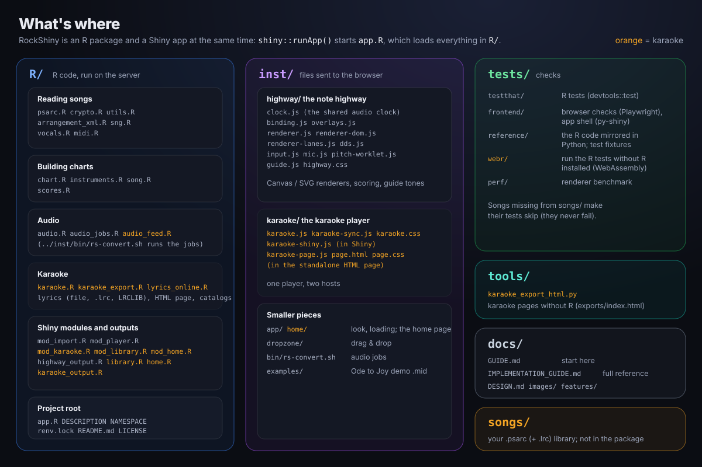

### Full tree

```
RockShiny/
├── app.R                    # thin shell: options, resource path, page layout (Instrument | Karaoke), modules
├── DESCRIPTION              # Imports: shiny, bslib, htmltools, jsonlite, later, xml2, openssl
├── LICENSE                  # MIT (the DESCRIPTION's "MIT + file LICENSE")
├── R/
│   ├── utils.R              # vectorised little/big-endian readers over raw vectors
│   ├── crypto.R             # AES-256-CFB128 (TOC) and AES-256-CTR (SNG) via openssl
│   ├── psarc.R              # PSARC container: header, TOC, block table, extraction
│   ├── arrangement_xml.R    # arrangement XML → raw chart (all DD levels)
│   ├── sng.R                # SNG decrypt/inflate + binary parser → same raw chart
│   ├── chart.R              # TECH flags, DD merge + difficulty, tuning/section names, JSON
│   ├── vocals.R             # lyrics from vocals XML/SNG, split into display lines
│   ├── audio.R              # song .wem via .bnk, tool discovery, encoder/format negotiation
│   ├── audio_jobs.R         # background pre-decoding queue (quick-start clips, then full songs)
│   ├── audio_feed.R         # audio_feed(): song audio → a browser player (background jobs)
│   ├── song.R               # high-level API + content-hash cache (no Shiny code)
│   ├── highway_output.R     # highwayOutput()/renderHighway() + R → JS control helpers
│   ├── scores.R             # scored runs → scores.csv, personal bests, history (played and sung)
│   ├── instruments.R        # any part → piano / harmonica (pitches, hands, harp mapping)
│   ├── midi.R               # Standard MIDI Files: parser, tempo map, parts, beats
│   ├── karaoke.R            # karaoke song model: lyrics, manifest metadata + sections, JSON
│   ├── karaoke_output.R     # karaokeOutput()/renderKaraoke() + R → JS control helpers
│   ├── karaoke_export.R     # karaoke_export_html(): standalone page (the HTML format)
│   ├── lyrics_online.R      # lyrics for songs without: sidecar .lrc, cache, LRCLIB lookup
│   ├── library.R            # the song library: index, lazy opening of big folders, background scan,
│   │                        # uploads kept in the data folder
│   ├── mod_library.R        # library folder: status line (home page, both sidebars) + folder dialog
│   ├── home.R               # home page data: catalog, playlists, recently played, genres (MusicBrainz),
│   │                        # random_song() (Shuffle)
│   ├── mod_home.R           # home page module: homeOutput()/renderHome(), album art, play queue
│   ├── mod_import.R         # drag & drop + library song list → reactive rs_song
│   ├── mod_player.R         # arrangement/settings UI, highway, audio hand-off
│   └── mod_karaoke.R        # karaoke mode: sidebar, lyrics stage, audio, HTML download
├── inst/
│   ├── highway/             # clock.js, renderer.js (canvas), renderer-dom.js (HTML/SVG),
│   │                        # overlays.js (song card, lyrics, transport, results card),
│   │                        # dds.js (album art decoder), input.js (input bus + hit judge),
│   │                        # mic.js + pitch-worklet.js (microphone scoring), binding.js,
│   │                        # renderer-lanes.js (piano / harmonica), guide.js, highway.css
│   ├── karaoke/             # karaoke.js (timing model, view, AudioDeck), karaoke.css,
│   │                        # karaoke-sync.js (LRC parsing, sync to the recording, LRCLIB in the browser),
│   │                        # karaoke-voice.js (the original voice: volume / mute, AudioWorklet),
│   │                        # karaoke-sing.js (singing: pitch worklet, scorer, lane, results),
│   │                        # karaoke-shiny.js (output binding), karaoke-page.js + page.html
│   │                        # + page.css (standalone page template)
│   ├── examples/            # ode-to-joy-demo.mid (public domain; piano + harmonica parts)
│   ├── bin/rs-convert.sh    # background Wwise -> web audio conversion (POSIX sh)
│   ├── home/                # home.js (the home page: views, playlists, search) + home.css
│   ├── app/                 # app.css: the Shiny chrome (navbar, sidebar, accordion, theme);
│   │                        # app.js: the shown mode's player takes the keyboard focus; the
│   │                        # loading overlay on a player (RSLoading)
│   └── dropzone/            # dropzone.js/.css (forwards drops to a Shiny fileInput)
├── tests/
│   ├── testthat/            # R tests: NIST AES vectors, TOC md5s, XML↔SNG parity, karaoke, …
│   │                        # (helper-setup.R: need_song() skips tests whose song is absent)
│   ├── frontend/            # harness.html (Shiny stub) + check_frontend.py (Playwright),
│   │                        # check_scoring.py (microphone scoring accuracy),
│   │                        # karaoke_harness.html + modes_harness.html + check_karaoke.py,
│   │                        # check_app_shell.py (app.R's page in real bslib, via py-shiny),
│   │                        # check_library.py (big libraries: catalog, lazy server, library UI),
│   │                        # home_harness.html + check_home.py (the home page),
│   │                        # sing_synth.js + check_sing.py (voice, singing score: accuracy,
│   │                        # benchmarks, stress)
│   ├── webr/                # run the R code in webR (R as WebAssembly) where R is not
│   │                        # installed: run_webr.mjs, shims.R (openssl/xml2/jsonlite),
│   │                        # testthat-shim.R, run_tests.R
│   ├── perf/                # bench.html + run_bench.py: page x renderer benchmark;
│   │                        # library_bench.R (library index on a big folder, R / webR);
│   │                        # embed_bench.py (songs with embedded audio per page)
│   └── reference/           # Python mirror of the R parsers (cross-check + fixtures),
│                            # synth_performance.py (synthesized guitar / piano / harmonica takes),
│                            # instruments_ref.py (mirror of instruments.R + midi.R), make_demo_midi.py,
│                            # karaoke_ref.py (mirror of karaoke.R + lyrics_online.R; fixtures),
│                            # check_lyrics_lookup.py (the lookup over HTTP, stand-in LRCLIB),
│                            # library_ref.py (mirror of library.R), make_big_library.py (a test
│                            # library of distinct .psarc files), check_export_parity.py (R = Python pages),
│                            # home_ref.py (mirror of home_catalog(), fixtures for the home checks)
├── tools/
│   └── karaoke_export_html.py   # karaoke_export_html() / karaoke_export_library() in Python (no R
│                                # needed); no arguments: exports/index.html with every song (not in
│                                # git); big libraries: catalogs, --serve builds songs on request
├── docs/
│   ├── GUIDE.md             # the short guide
│   ├── IMPLEMENTATION_GUIDE.md  # this reference
│   ├── DESIGN.md            # look and delivery formats
│   ├── images/              # architecture.svg, directory.svg
│   └── features/            # screenshots + manifest.json
└── songs/                   # the default library folder (any folder can be chosen in the app),
                             # optional .lrc lyrics next to a song (same name); not part of the package
```

<br>

---

## 3. Setup

### R packages

```r
# xml2 and openssl are new relative to renv.lock
renv::install(c("xml2", "openssl"))
renv::snapshot()
shiny::runApp()
```

### External tools (audio only)

Without them the highway and karaoke still work, silently.

| Tool | Why | Install |
|---|---|---|
| `vgmstream-cli` | decodes Wwise Vorbis `.wem` → WAV | macOS `brew install vgmstream`; Windows/Linux: release zip from <https://vgmstream.org> |
| `ffmpeg` | WAV → OGG Vorbis (or AAC) | `brew install ffmpeg` / <https://ffmpeg.org> |

If a tool isn't on `PATH`, point to it:

```r
options(rockshiny.vgmstream = "/path/vgmstream-cli", rockshiny.ffmpeg = "/path/ffmpeg")
```

### Options

| Option | Default | What it does |
|---|---|---|
| `rockshiny.cache_dir` | `tools::R_user_dir("RockShiny", "cache")` | converted audio; persistent |
| `rockshiny.audio_format` | `"auto"` | or `"ogg"`, `"m4a"`, `"opus"`, `"flac"`, `"wav"`: try that format first |
| `rockshiny.library_dir` | the folder chosen in the app, else `"songs"` | the library folder (`.psarc` and `.mid`; the bundled `inst/examples` demo is always listed too). Set in the app with *Change…*; remembered in `tools::R_user_dir("RockShiny", "config")/library.dcf` |
| `rockshiny.library_recursive` | the saved choice, else `FALSE` | include subfolders |
| `rockshiny.library_lazy_threshold` | `50` | libraries with more files are *lazy* (Step 14): mapped at once, scanned in the background, audio and md5 only when a song is picked |
| `rockshiny.library_scan_budget` | `1` | seconds a lazy library may spend scanning when it is opened (the rest in the background) |
| `rockshiny.library_scan_slice` | `0.25` | length of one background scan step, in seconds |
| `rockshiny.library_picker` | `TRUE` | `FALSE` hides *Change…* (e.g. on a shared server) |
| `rockshiny.uploads_dir` | `<data_dir>/uploads` | where uploaded songs are kept (listed under *Uploaded*) |
| `rockshiny.genres_online` | `TRUE` | look artists' genres up on MusicBrainz in the background (only the artist's name is sent) |
| `rockshiny.prewarm` | `TRUE` | `FALSE`: no background pre-decoding of the library (only small libraries are pre-decoded anyway) |
| `rockshiny.head_seconds` | `30` | length of the quick-start clip |
| `rockshiny.data_dir` | `tools::R_user_dir("RockShiny", "data")` | where `scores.csv` (scored runs), `playlists.json`, `history.json`, `genres.json` and the uploads are kept |
| `rockshiny.lyrics_online` | `TRUE` | look up lyrics on LRCLIB for songs without (only artist and title are sent) |
| `rockshiny.lyrics_timeout` | `10` | seconds to wait for LRCLIB |

### Console use (no Shiny involved)

```r
song  <- load_song("songs/Pink-Floyd_Wish-You-Were-Here_v5_DD_m.psarc")
song                                   # arrangements table
chart <- song_chart(song, "wishyouwhizzhere_lead")
head(chart$notes)                      # time, string, fret, sustain, slide_to, bend, tech, chord
song_audio(song)                       # path to cached audio.ogg

k <- load_karaoke_song("songs/Dire-Straits_Sultans-of-Swing_v443_m.psarc")
karaoke_lines(k)                       # one string per lyric line
karaoke_export_html(k, "sultans.html") # standalone karaoke page
```

### Without R: Python

`tools/karaoke_export_html.py` writes the same karaoke pages as `karaoke_export_html()`
(byte-identical output, see Step 13). It needs only Python 3.9+ (`cryptography` is optional:
a pure-Python AES is used without it); for audio, `vgmstream-cli` on `PATH` or
`pip install wem2ogg`, plus `ffmpeg`.

```bash
python3 tools/karaoke_export_html.py            # every song in songs/ -> exports/index.html
python3 tools/karaoke_export_html.py --serve    # ... and serve it at http://localhost:8000/index.html
python3 tools/karaoke_export_html.py songs/Dire-Straits_Sultans-of-Swing_v443_m.psarc -o sultans.html
python3 tools/karaoke_export_html.py --library songs -o songbook.html --audio files
python3 tools/karaoke_export_html.py --library ~/dlc --recursive -o karaoke/index.html --jobs 4   # a catalog (Step 14)
python3 tools/karaoke_export_html.py --library ~/dlc --serve       # a catalog whose songs are built on request
```

<br>

---

## 4. Step by step

<br>

### Step 1 · PSARC container

> **Files:** `R/psarc.R`, `R/crypto.R`
>
> **In one line:** open the archive, decrypt its table of contents, read any file inside.

1. **Header** (32 bytes, big-endian): `"PSAR"`, version, `"zlib"`, `toc_length`
   (header + TOC), entry size (30), entry count, block size (65536), flags.
2. **TOC decryption:** if `flags & 4`, the TOC is AES-256-CFB128 encrypted with a fixed key
   and IV. `openssl` has no CFB mode, so `aes_cfb128_decrypt()` builds it from single-block
   encryptions (CFB only needs the forward cipher). Verified against the NIST SP 800-38A vectors.
3. **Entries:** `md5[16] | zindex u32 | length u40 | offset u40`. The 40-bit fields are
   decoded column-wise from a raw matrix (`be_uint_cols()`).
4. **Block table:** the rest of the TOC holds one u16 per 64 KiB block.
   - `0` means a full block stored raw.
   - Otherwise the block is zlib, or stored raw when compression didn't help
     (`inflate_or_raw()` checks the zlib header and falls back).
5. **Entry 0** is a newline-separated list naming entries 1..n. Each TOC md5 is
   `md5(file name)`; the tests use that as an end-to-end check of decryption.
6. **Big entries** (`.wem`, 15–65 MB) are streamed block by block to disk
   (`psarc_read(arc, name, out = path)`), never held whole in memory.

<br>

### Step 2 · Arrangements and the right audio file

> **Files:** `R/song.R`, `R/audio.R`
>
> **In one line:** list the playable parts from the manifests, and find the full-song audio (not the preview).

- **Arrangements** come from `manifests/**/*.json` (`ArrangementName`, song metadata).
  Vocals and ShowLights are skipped. Each manifest maps to `songs/arr/<base>.xml` and
  `songs/bin/<platform>/<base>.sng`.
- **Two `.wem` files** per archive: the full song and the preview. The song soundbank
  (`song_<key>.bnk`, not `_preview.bnk`) contains its wem ID as a little-endian u32, so
  `find_song_wem()` searches the bank bytes (`grepRaw`).

> **Don't use manifest order:** in *Sultans of Swing* the preview is listed first.

<br>

### Step 3 · Note charts

> **Files:** `R/arrangement_xml.R`, `R/sng.R`
>
> **In one line:** two independent parsers (XML and the compiled SNG) produce the same raw chart.

#### XML — present in CDLC built with the Custom Song Toolkit

- Read only `/song/levels/level/...`. `<transcriptionTrack>` also contains
  `<notes>`/`<chords>`.
- **Dynamic Difficulty:** DD files have one `<level>` per difficulty (up to 14 in the
  samples). The full chart is assembled per phrase iteration `[start_i, start_{i+1})` using
  the level equal to that phrase's `maxDifficulty` (`select_max_difficulty()`, a vectorised
  `findInterval`).
- **Chords:** the **chord template** decides which strings and frets sound.
  `<chordNote>` children are often partial (for example, only the one muted string). They
  override per-string sustain, slide, bend and techniques but do not define the chord.

> Treating `<chordNote>` children as the full chord silently loses notes: on 13 of the first
> 25 sample arrangements it dropped 2–58 % of *all* notes.

#### SNG — the compiled format; official DLC ships only this

- `u32 magic | u32 flags | IV[16] | AES-256-CTR payload`. The payload is `u32 length | zlib`.
  The key depends on platform (`songs/bin/macos/` vs `generic/`); `"auto"` tries both.
- The body is a sequence of `u32 count` + packed struct arrays. Fixed-size arrays are skipped
  or decoded vectorised from their offsets. Only notes (trailing variable-length bend data)
  need a pointer walk.
- Notes with `chordId >= 0` are expanded through the chord template and the per-string
  `chordNotes` masks, then go through the same `build_chart()`.

#### Cross-validation

XML and SNG are independent encodings of the same chart. On all 51 guitar/bass
arrangements of the 18-song library (10 of them with Dynamic Difficulty), both paths agree
**note for note**: time, string and fret, all 16 technique bits, slides, chord counts,
anchors and beats.

The one difference is sustain on a chord whose strings have different sustains: the SNG
stores one sustain per chord, so XML is preferred when present.

<br>

### Step 4 · Chart model and JSON contract

> **Files:** `R/chart.R`
>
> **In one line:** the chart goes to the browser once, as columns that become typed arrays.

`chart_json()` sends **columns, not rows**. Each column becomes a typed array in JS
(`Float64Array` times, `Int8Array` strings/frets). 1-element columns stay arrays
(`auto_unbox = FALSE`, scalars unboxed explicitly):

```json
{ "format": "rockshiny-chart/1", "songKey": "<md5>",
  "meta":  {"title": "...", "arrangement": "Lead", "n_strings": 6, "tuning": [0,0,0,0,0,0], ...},
  "notes": {"t": [], "s": [], "f": [], "sus": [], "tech": [], "slide": [], "slideU": [], "bend": [], "chord": []},
  "chords": {"t": [], "name": [], "hd": []},
  "anchors": {"t": [], "fret": [], "width": []},
  "beats": {"t": [], "m": []},
  "sections": {"t": [], "name": []} }
```

`tech` is a bit field that **must be identical** in `R/chart.R` and `renderer.js`:

| bit | technique | bit | technique |
|---:|---|---:|---|
| 1 | hammer-on | 512 | link-next |
| 2 | pull-off | 1024 | tap |
| 4 | palm mute | 2048 | bend |
| 8 | fret-hand mute | 4096 | slide |
| 16 | harmonic | 8192 | unpitched slide |
| 32 | pinch harmonic | 16384 | chord |
| 64 | vibrato | 32768 | ignore |
| 128 | tremolo | | |
| 256 | accent | | |

<br>

### Step 5 · Audio

> **Files:** `R/audio.R`, `R/audio_jobs.R`, `inst/bin/rs-convert.sh`
>
> **In one line:** decode the Wwise audio once per song, in the background, into a format this browser plays.

#### Pipeline

> **FFmpeg cannot decode Rocksmith audio.** A `.wem` is a RIFF file with format tag `0xFFFF`
> (Wwise Vorbis: headerless packets plus external codebooks). `ffmpeg -i song.wem` fails
> with *"no decoder found"*. This was confirmed on the sample files.

`vgmstream-cli song.wem → wav` (decoded once), then FFmpeg encodes a delivery format.
The fallback decoder is `ww2ogg` with the codebook file, then `revorb`.

#### Format negotiation

FFmpeg builds differ: `libvorbis`, `libopus` and `libmp3lame` are optional external
libraries, and some Homebrew/conda builds lack them, failing with *"Unknown encoder
'libvorbis'"*. Browsers differ too: open-source Chromium has no AAC, and older Safari has
no Ogg. So the format is negotiated per request:

1. The client reports what it can play (`canPlayType`) in `<id>_ready$formats`.
2. `ffmpeg_encoders()` parses `ffmpeg -encoders` once per binary.
3. `audio_format_candidates()` keeps formats that are both encodable and playable, in order:
   Ogg Vorbis (`libvorbis`) → AAC/M4A (native `aac`, built into every FFmpeg) → Ogg Opus
   (`libopus`) → FLAC (native, lossless, ~25 MB) → WAV.
4. `convert_wem()` tries them in order and falls through if an encode fails.
   `tests/testthat/test-audio.R` reproduces the libvorbis failure with a stand-in FFmpeg.

**Sync check:** a click track encoded in each format and decoded again (by FFmpeg, and by
Chromium's `decodeAudioData`) has every click within 0.13 ms of its original position.
AAC's encoder priming is hidden by the MP4 edit list FFmpeg writes.

#### Caching and serving

- Conversion happens **once per file content**, cached at `<cache>/<md5 of psarc>/audio.<ext>`.
  Any cached format the browser can play is reused.
- Output goes to a `.partial` file and is renamed on success, so a failed run never poisons
  the cache.
- `addResourcePath("rs-cache", cache_root())` lets httpuv serve the file directly; R is not
  involved in streaming.
- The browser `fetch()`es the file into a `Blob`. Seeking a `blob:` URL never depends on the
  server supporting HTTP Range requests.
- **UX:** the chart is rendered first. The client then reports `<id>_ready`, and only then
  does R run the slow decode (seconds per song). You can scrub and play silently meanwhile;
  the audio takes over at the current position.

#### Pre-decoding and quick-start

- **Separate process:** conversions run via `system2(wait = FALSE)` running `rs-convert.sh`.
  R only polls the job's status file with `later`, so the Shiny process never blocks.
- **Two files per job:** `head.<ext>`, the first 30 s, as soon as it is encoded, then
  `audio.<ext>`, the whole song. Both go through per-process temp files and are renamed when
  complete. Encoders are tried in the negotiated order.
- **Library warm-up:** at startup every song in the library folder is queued: quick-start
  clips for all songs first, then full files. The cache is persistent
  (`tools::R_user_dir("RockShiny", "cache")`), so this happens once per song, ever.
  Opt out with `options(rockshiny.prewarm = FALSE)`.
- **Two job slots:** the song you open runs in its own *priority* slot immediately and never
  waits behind warm-up.
- **In the browser:** playback starts on the clip. When the full file arrives while playing,
  it starts muted a little ahead, is aligned by nudging its `playbackRate` until both
  elements agree within ~6 ms, then cross-faded over 80 ms and made the clock master without
  re-anchoring.
  - Measured: alignment 1–6 ms, largest clock step around the switch 1–3 ms, no pause.
  - If the clip runs out first, or you seek past it, playback **holds** at that point with a
    banner and resumes exactly there when the full file arrives.
- **Fallbacks:** without `sh` or vgmstream (e.g. plain Windows) the synchronous
  `song_audio()` path is used.

<br>

### Step 6 · Shiny integration

> **Files:** `R/highway_output.R`, `inst/highway/binding.js`, `inst/dropzone/`
>
> **In one line:** a custom output binding for the chart, one custom message type for everything else.

- **Dependencies:** `highwayOutput()` attaches two `htmlDependency`s: `rockshiny-core`
  (`clock.js`, `dds.js`, shared with the karaoke player, so a page with both loads them once)
  and `rockshiny-highway` (the rest of `inst/highway`).
- **Rendering:** `renderHighway()` uses `createRenderFunction()` and ships the chart as a
  pre-serialised JSON string, which the binding `JSON.parse`s.
- **One controller per element:** the binding keeps one `HighwayController` per element ID.
  A chart with the same `songKey` (arrangement switch) keeps the audio and playback position.
- **Control messages:** `highway_set_audio()`, `highway_settings()`, `highway_play()`,
  `highway_pause()`, `highway_seek()` and `highway_status()` send one custom message type,
  dispatched by element ID. Module namespaces are handled with `session$ns()`.
- **Drag and drop:** `dropzone.js` turns the whole zone into a drop target and forwards the
  `File` to the Shiny `fileInput` inside it, via `DataTransfer` and a `change` event.
  - Shiny's uploader, progress bar and `input$file` work unchanged.
  - Drops on Shiny's own drop box are left to Shiny, to avoid a double upload.
  - `shiny.maxRequestSize` is raised to 512 MB (the default of 5 MB is smaller than any `.psarc`).

#### The app shell: Instrument | Karaoke

- **Page:** `bslib::page_navbar()` with one `nav_panel()` per mode, each a complete
  `layout_sidebar()`. `navbar_options(underline = FALSE, collapsible = FALSE)`: the mode
  switch is a pill (`app.css`) and never hides behind a menu.
- **Topbar fix:** bslib gives the tab list `flex: 1 1 0%`, so the pill stretched to the
  window's right edge, and the underline-style tabs were taller than it. The pill is now
  sized to its buttons, centred, next to the brand, one row at any width
  (`check_app_shell.py`: 1440 / 700 / 420 px).
- **One mode plays at a time:** `app.R` pauses the hidden mode's player.
- **Keyboard fix (`app.js`):** after a click on a mode tab the keyboard focus stayed on the
  tab, and Bootstrap's tabs treat ← → Home End on a focused tab as "go to the next tab"
  (and stop the event). So the players' ±5 s shortcuts *switched the mode*, which paused the
  player: play/pause seemed to stop working. The shown mode's player now takes the focus.
- **A hidden player never plays:** the first Play creates the Web Audio context (up to
  ~0.4 s on a sleeping audio device); a mode switch during that wait used to let the now
  hidden player start anyway, with no visible pause button. Both players pause when they
  become hidden and do not start while hidden.

<br>

### Step 7 · The renderers

> **Files:** `inst/highway/renderer.js`, `inst/highway/renderer-dom.js`
>
> **In one line:** two interchangeable backends draw the same 3-D scene for time *t*.

Both have the same interface (`setChart()`, `setOptions()`, `resize()`, `draw(t, dt)`) and
are switchable at runtime from the sidebar or with
`highway_settings(session, id, list(renderer = "dom"))`:

| Renderer | How it draws |
|---|---|
| **Canvas 2D** (`renderer.js`, default) | everything is painted each frame |
| **HTML/SVG** (`renderer-dom.js`) | extends the canvas renderer's camera and visibility logic; notes are pooled `<div>`s moved with compositor `transform`s; the board is an SVG rebuilt only when the camera moves |

#### World space and camera

- **World space:** x = frets (lane *n* spans `[n-1, n]`), y = string height,
  z = seconds until the note × (depth / lookahead). A pinhole camera with a fixed pitch is
  projected by hand (a few multiply-adds per vertex). A vertical lens shift pins the "now"
  line at 78 % of the screen height at any zoom.
- **Camera** (`_cameraTarget()`, `_updateCamera()`):
  - it frames the union of anchor zones *and* fretted notes in the next ~1.5 s;
  - a **dead zone** means it pans only when upcoming notes come within 1 fret of the screen edge;
  - it zooms in 2-fret steps: out as soon as needed, in only when the view is 6+ frets too wide;
  - all motion goes through a **critically damped spring** (SmoothDamp: 0.45 s for panning,
    0.8 s for zoom, 14 frets/s cap), which eases in *and* out with no velocity jumps.

Measured over *Sultans of Swing* lead at 60 fps:

| | before | after |
|---|---:|---:|
| travel | 324 frets | 71 frets |
| peak speed | 30 frets/s | 6.5 frets/s |
| peak acceleration | 1,821 frets/s² | 68 frets/s² |
| RMS jerk | 4,890 /s³ | 87 /s³ |

*Wish You Were Here* went from 25 pans to none. No note due within 0.5 s is ever off-screen
(checked every frame on three charts).

#### Ghost neck

`_neckShapes()` draws, in the plane just behind the strings:

- a translucent rosewood fretboard with fret wires, nut and inlays (double at 12/24);
- a headstock left of the nut; each string runs into its own tuning peg (six-in-line, four
  for bass), labelled with the string's open note *in the song's tuning* (e.g. Eb, or D for
  drop D).

The geometry is produced once as screen-space shapes; the canvas paints them and the DOM
renderer serialises them to SVG, so both draw the same neck.

#### Draw order and chord names

- **Draw order:** background/board/haze → beats → anchor zones → ghost neck → chord frames →
  sustains → gems (far to near) → chord names → strings → hit flashes → fret numbers.
- The camera-static layers are cached while the camera rests and painted directly while it
  moves (a cache re-render plus blit would cost two passes).
- **Chord names** appear once per chord change (or after a 2 s gap) and always on the nearest
  upcoming chord, outlined so notes can't hide them.

#### Playing techniques

Shared geometry in the base renderer, painted by both renderers: `bendAt()`, `noteX()`,
`noteYOff()`, `forEachRibbon()`, `stringPolyline()`, `forEachEffect()`.

| technique | approaching | sustain / at the strike line |
|---|---|---|
| bend | label ("↑½", "↑full", "↑1½"; curves are in semitones); pre-bends ride high | ribbon rises along the bend curve (full = one string gap); the string is pushed up at the fret; the glow rides on it |
| vibrato | "~" | wavy ribbon; string oscillates at the fret (5.5 Hz) |
| tremolo | "≡" | faint ribbon with bright dashes; strobing glow (12 Hz) |
| accent | white outline, pulsing gem | expanding shockwave ring on the hit |
| harmonic / pinch | diamond outline | four-point sparkle |
| palm mute / fret-hand mute | "PM" band / "X" | grey "puff" instead of the bright flash |
| hammer-on / pull-off / tap | hollow gem + "H"/"P"/"T" | normal flash |
| slide | "↗" | ribbon and glow travel to the target fret |

Bend curves (`<bendValues>` in XML, bend arrays in SNG including the shared `chordNotes`
records) are carried in the chart JSON (`bends: {n, t, s}`). XML and SNG agree point for
point on all 51 arrangements (2,806 points). Where the XML `bend` attribute disagrees with
its own curve (rounded up on some chord notes), the curve wins, as in the compiled SNG.

#### Rocksmith conventions

- String colours: E red, A yellow, D blue, G orange, B green, e purple.
- Low E on top by default (`invertStrings` gives tab order).
- Open strings are bars across the anchor zone.
- Repeated chords (`highDensity`) are frame only.
- Upcoming anchor zones are highlighted along the highway.

#### Performance

`draw(t)` is a pure function of `(chart, t)`. Visible notes come from binary searches over
typed arrays, and the loop allocates nothing per frame (scratch vectors, precomputed
colours, font caching). The static layer is re-rendered only when the camera moves. While
the highway is hidden (the app is in karaoke mode) its loop skips drawing altogether.

<br>

### Step 8 · Audio/visual sync

> **Files:** `inst/highway/clock.js`, `inst/highway/binding.js`
>
> **In one line:** a note reaches the strike line at the moment you *hear* it.

The chain, and what each stage handles:

1. **One time source.** The `<audio>` element's `currentTime` is the master; the chart never
   runs on its own timer.
2. **Per-frame extrapolation.** `currentTime` is coarse and jittery. The clock keeps an anchor
   `(mediaTime, perfTime)` and extrapolates with the `requestAnimationFrame` timestamp.
   - Each fresh report is compared with the prediction. Small errors are corrected
     exponentially, with a 0.33 s time constant based on elapsed time, so the behaviour is
     the same at 60 or 20 fps.
   - If the audio runs ahead by more than 50 ms, the clock snaps forward.
   - If the audio falls behind (start-up, stall), the clock *waits* for it. While playing it
     never moves backwards (measured: 0 backward steps).
3. **Present-time prediction.** A frame drawn at rAF time `ts` appears about one frame later,
   so the highway is drawn for `clock.time(ts + frame)`.
4. **Output latency.** Sound also takes time to leave the speakers. Playback is routed through
   a Web Audio graph, so this latency is known (`AudioContext.outputLatency`) and is
   subtracted automatically, ramped at 0.1 s/s so the notes never jump.
   - The graph is created on the first Play press (browsers require a user gesture).
   - Elements join it only while nothing is playing: a graph source starting during playback
     caused ~50 ms skips in the playing audio in our measurements.
   - A full file handed over mid-song joins at the next pause, seek or loop wrap; the
     quick-start clip never joins.
   - The last measured latency is remembered for the first half-second of the next session.
5. **Manual fine-tune.** The offset slider handles anything the browser does not report
   (e.g. Safari has no `outputLatency`).
6. **Speed changes** re-anchor the clock; `preservesPitch` keeps slow practice in tune.

**Measured end to end** (`check_frontend.py`, headless Chromium). An AudioWorklet tap on the
app's own audio path timestamps every click *as it is output* (`getOutputTimestamp()`), and
the chart time on screen at that instant is compared with the note's time:

| | shown minus heard |
|---|---|
| routed, no compensation | +33 to +36 ms (picture leads the sound by ~the device latency) |
| routed, compensation on (32 ms reported) | steady state −11 to −3 ms, i.e. within one frame (−16 to −9 ms on the karaoke authoring machine; see Step 13) |
| clock vs `currentTime` (1.0× / 0.75×) | mean within ±2 ms |

<br>

### Step 9 · Song card, lyrics and practice

> **Files:** `inst/highway/overlays.js`, `R/vocals.R`, `R/mod_player.R`
>
> **In one line:** HTML overlays on top of the highway, shared by both renderers.

#### Song card and section pill

- album art decoded from the archive's DXT1 `.dds` by `dds.js`;
- title, artist · album · year;
- tags: arrangement, tuning name ("E Standard", "Drop D", …), capo, and difficulty when
  below 100 %;
- the current section in a pill, coloured by section type.

#### Lyrics, as in the game

- Syllables come from `*_vocals.xml` (or the vocals `.sng`, identical in all 13 songs of the
  18-song library that have lyrics).
- `+` ends a line and `-` joins syllables; charts without `+` break at pauses over 1.2 s or
  after 8 words.
- The current line is shown at the top: sung syllables white, the current one in the accent
  colour, the next line underneath.
- A line stays up until it has been sung, then the next one is previewed up to 1.2 s ahead.

#### Practice (Riff Repeater style)

- *From/To* section pickers and *Loop this part*.
- A lead-in with an on-screen countdown before each pass.
- *Speed* plus *Speed up / loop* (+2/5/10 % per pass until 100 %).
- *Difficulty* 0–100 %: the chart is rebuilt with each phrase at that share of its maximum
  level (DD charts). Playback position and audio are kept.
- Shortcuts: double-click a section in the timeline, *Practice current section*, or `L`.
  All of them go through the R inputs, so the UI stays the single source of truth.
- The client applies the speed and loop only when those settings actually change, so a
  running speed ramp survives unrelated setting changes.

> **Fixed:** the lead-in countdown was computed but never shown: `CountdownView` reset its
> inline `display` to `""`, which let the stylesheet's `display: none` win. It now sets
> `"block"`, and `check_frontend.py` has a practice-loop check that asserts the countdown is
> on screen, the loop wraps and the speed ramps.

#### Transport

Play/pause and restart (to the loop start when looping), a timeline coloured by section type
with hover labels and a playhead, the loop band, and speed/loop badges.

<br>

### Step 10 · Input seam for scoring

> **Files:** `inst/highway/input.js`
>
> **In one line:** every input goes through one seam, so the renderers and the judge never know where a hit came from.

```
 input source ──► InputBus ──► HitJudge ──► per-note state ──► renderers
 (keyboard,        events       matches       pending/hit/       (read only)
  microphone)                   due notes     missed
```

#### Triggers

| Form | Meaning |
|---|---|
| `controller.bus.noteHit = true` | "the due note was played now" (boolean form) |
| `bus.hit({at, midi, string, fret})` | rich form: the onset timestamp (`performance.now()`) plus the detected pitch |
| `bus.hit({chartTime, notes})` | a detector that already mapped its onset to chart time and verified exactly which notes sounded (the microphone) |
| `bus.noteMiss = true` | a wrong note |
| `highway_input(session, "highway", hit = TRUE, midi = 64)` | the same from R |

#### HitJudge

- matches a hit to the due note (or whole chord) within ±120 ms; the window is adjustable in
  the UI;
- honours the pitch when one is given (so wrong notes don't count);
- marks passed, unplayed notes as missed, and re-arms after seeks and loop wraps;
- keeps accuracy, streak and "perfect" (±40 ms) counts, and sends them to R as
  `input$<id>_judge`;
- `expectedAt(t)` returns the due notes *with their MIDI pitches* (tuning and capo aware),
  which is what a pitch detector needs.

#### Renderers and sources

- **Renderers:** when an input source is active, hit effects fire at the player's actual hit
  time, missed notes turn grey with a red "×", and a streak/accuracy chip appears. With no
  source active, every note auto-plays its effects as before.
- **Sources:** register with `RSHighway.registerInputSource(name, factory)`.
  - The factory returns `{start(), stop()}` (plus optional `setOptions`, `resume`) and
    receives `{bus, judge, chart, expectedAt, chartTime, options, onLevel, onDevices,
    onOnsetRaw}`.
  - Built in: `"keyboard"` (D/F/J/K, timestamped with the key event's `timeStamp`, for
    testing) and `"microphone"` (Step 11).
  - Select one from R with `highway_settings(session, "highway", list(inputSource = "microphone"))`.

<br>

### Step 11 · Microphone scoring

> **Files:** `inst/highway/mic.js`, `inst/highway/pitch-worklet.js`, `R/scores.R`
>
> **In one line:** play along on a real guitar or bass; notes light up when you play them.

Works with a microphone, or an instrument / Real Tone cable.

```
 getUserMedia (no AGC / noise suppression; echo cancellation optional)
   └► AudioWorklet "rs-guitar-analyzer"     audio thread, sample-accurate times
        onsets: log-spectral flux (1024-pt, 256 hop) + level rise, adaptive threshold
        frames: 8192-sample (bass 16384) Hann spectra every 20 ms, real FFT
   └► NoteVerifier (main thread, ~0.1 ms per frame)
        "were the notes that are due now actually played?"
   └► bus.hit({chartTime, notes}) ─► HitJudge (missDelay 0.35 s for analysis)
```

#### Verification, not transcription

The chart says which pitches are due, so the verifier only has to decide *whether* they
sound. That works for chords; blind polyphonic transcription does not, reliably.

1. Each analysis frame is mapped to a log-frequency axis (3 bins per semitone, 35 Hz–5 kHz).
2. The frame is explained jointly by harmonic templates for: the due pitches, their semitone
   neighbours (the likely wrong notes), the notes still ringing from before, and a flat noise
   floor. This is a KL-NMF with a fixed dictionary (40 multiplicative updates).
3. A due pitch is *present* when its activation beats both neighbours by 2× (the Sensitivity
   slider scales this) and holds ≥ 2 % of the energy. A pitch that is an exact harmonic of
   another candidate and too weak to tell apart is "not checkable" and follows the rest of
   the chord.
4. Rules per note:
   - picked notes need an onset within the timing window, and the spectrum must come from
     *that* attack (frame window starting within ±¼ window of the onset);
   - the verified notes must not have decayed across the attack (≥ 0.5× the level just
     before), so that a stray onset on ringing strings does not count;
   - hammer-ons, pull-offs and taps need no attack: the new pitch has to appear and must not
     have been sounding before;
   - fret-hand mutes and pinch harmonics need only the attack;
   - chords count when ≥ 50 % of their checkable notes are present.
5. Expected pitches come from `HitJudge.setChart`: tuning, capo (open strings only), cent
   offset, natural-harmonic nodes and pre-bends.

#### Latency

- Captured sound is mapped to `performance.now()` through the capture context's output
  timestamp, minus the *input latency*.
- The first estimate comes from the browser (track latency + context latency).
- **Calibrate latency** plays 8 clicks through the output and matches the onsets the input
  hears. It works both ways: the microphone hears the speakers, or, with a cable and
  headphones, you strum a muted string on each click.
- The median offset becomes the input latency, remembered per device in `localStorage`.

#### Results

- When the last note has passed (or the song ends), a results card shows accuracy, score
  (100/70 points per perfect/good note × streak multiplier up to ×4), best streak,
  early/late counts, median timing and accuracy per section, with **Play again** and
  **Practise <weakest section>** buttons.
- Loop passes get a short toast ("Pass 3: 82 %") and are scored on their own.
- The timeline shows per-section accuracy ticks while you play, and a small
  Perfect/Early/Late flash appears above the transport.

#### Persistence (R)

- Each run arrives as `input$highway_result`; `score_save()` appends it to `scores.csv` and
  compares it with the personal best: the best complete run (≥ 90 % of the notes) at 100 %
  speed.
- Loop passes and slowed-down runs are kept in the history but never count as a best.
- R answers with `highway_result_ack()`, and the card shows "New personal best!".
- The Scoring panel lists the last runs.

#### Measured accuracy

`tests/frontend/check_scoring.py`: synthesized performances of real chart excerpts are
rendered through the real worklet in an `OfflineAudioContext`, then replayed through the
real verifier and judge. The performances are Karplus–Strong plucked strings with known
mistakes: per event, 80 % correct, 10 % a semitone off, 10 % omitted, ±15 ms jitter,
strummed chords and soft legato attacks. Each row is 60 s.

| Excerpt | Events | Correct notes counted | Wrong/omitted notes counted | Timing error (median, p90) |
|---|---:|---|---|---|
| Sultans of Swing, lead | 110 | 98.9 % | 4.3 % | −4 ms, 6 ms |
| Wish You Were Here, lead (chords) | 111 | 98.7 % | 3.1 % | −3 ms, 6 ms |
| Sultans of Swing, bass | 175 | 98.6 % | 0 % | −3 ms, 6 ms |
| Get Lucky, lead (funk chords) | 238 | 100 % (97.8 % before Step 12's onset rules) | 0 % (6.8 %) | −4 ms, 6 ms |
| All My Life, rhythm (palm-muted riff) | 268 | 98.6 % | 0 % | −1 ms, 5 ms |
| *held out from all tuning:* | | | | |
| Still Got the Blues, lead | 114 | 100 % | 0 % | −3 ms, 6 ms |
| Riding with the King, rhythm | 70 | 100 % | 0 % | −4 ms, 6 ms |

- The first three excerpts were used to design the detector. Get Lucky and All My Life were
  added later as held-out checks, but All My Life then drove one change (the rise threshold,
  for fast palm-muted re-strikes), so only the last two rows are truly unseen.
- **Live path:** the same script runs Chromium's fake capture device as "microphone" →
  `getUserMedia` → worklet → verifier → judge in real time: 97 % of correct notes counted and
  0–12 % of wrong ones (1 of 8) over ~44 events.
- The live run depends on the host keeping the capture real time. Later in the session the
  sandbox lost up to 0.3 s of captured audio per 8 s whenever the page was rendering; a
  recording probe confirmed this, and there was no loss with rendering paused. The script
  now measures the capture clock and reports such runs as inconclusive instead of failing.

#### Limitations

- The guitars are synthetic (no real pickups, room or amp distortion).
- Bends are not synthesized (the target pitch at the onset is checked; bend *accuracy* is not
  scored), and slides and vibrato are judged only at their onset.
- Heavy distortion reduces accuracy.

> **Use headphones:** through speakers, the recording's own guitar reaches the microphone and
> plays the chart "perfectly" for you. Echo cancellation (a switch in the panel) reduces that
> but can swallow quiet notes.

<br>

### Step 12 · Piano and harmonica

> **Files:** `R/instruments.R`, `R/midi.R`, `inst/highway/renderer-lanes.js`, `inst/highway/guide.js`
>
> **In one line:** any pitched part, played on a 3-D keyboard or a 10-hole harmonica.

Rocksmith archives chart only guitar and bass (plus lyrics). The other instruments therefore
need a pitched *source part*, and the app has three:

| Source | Where from | Notes |
|---|---|---|
| any guitar/bass arrangement | `chart_pitch_events()` | sounding pitches (tuning, capo on open strings, natural harmonics, pre-bends); a held bend adds its target as a second note; fret-hand mutes dropped; Dynamic Difficulty still applies |
| pitched lyrics | "Vocals (melody)" arrangement | only when the vocals carry pitches (Get Lucky in the 18-song library; the others use the "unpitched" code 254) |
| a MIDI file | `read_midi()` → `midi_parts()` | one part per track/channel (drums skipped); "Piano (all parts)" joins the piano tracks (e.g. one track per hand) |

#### Piano (`events_to_piano`)

- The exact pitches, optionally transposed by octaves ("Transpose").
- The left hand plays below middle C (blue) and the right hand above it (green).
- The keyboard is drawn in whole octaves around the part's range (at least two octaves).

#### Harmonica (`events_to_harmonica`)

A 10-hole diatonic (Richter) harp:

1. The melody line is the top note of each chord. Runs faster than ~11 notes/s are thinned
   (a harmonica player cannot articulate faster), and each note ends where the next begins.
2. `harp_layout(key)` lists every playable note: 20 natural blow/draw notes, 12 bends
   (draw 1–4 and 6, blow 8–10) and 7 overblows/overdraws. Each has a difficulty cost:
   natural 0, bends 1–1.8, overblows 3.
3. `harp_choose()` tries all 12 harp keys (G…F#) × 7 octave shifts. It picks the lowest total
   cost, where unplayable notes cost 10, then prefers no transposition and the common keys.
   "Harmonica key" in the sidebar can force a key.
4. `harp_assign()` picks, for each note, hole and breath with the cheapest technique plus the
   least hand movement: a Viterbi pass over the options (e.g. G4 is 2 draw *or* 3 blow).
5. The tab on the blocks follows common notation: `4` blow, `-4` draw, `-3''` two-semitone
   draw bend, `6o` overblow. Blow notes are blue, draw notes orange, overblows violet; bends
   are striped.

Examples from the library:

- Sultans of Swing lead → C harp, one octave up, 768 notes, 4 thinned;
- Get Lucky vocals → A harp;
- Still Got the Blues → C harp, with 68 out-of-range notes of the solo left out (the hint in
  the sidebar says so).

#### The lane highway (`renderer-lanes.js`)

- Keeps the guitar highway's camera, clock, lookahead, beat lines, lyrics, timeline, practice
  loop and judge contract.
- Strings and frets become lanes: one lane per key above a 3-D keyboard (black-key lanes
  narrower, between the white ones), or ten lanes above a harmonica.
- Notes are blocks as long as the note lasts; they are consumed at the strike line, where
  keys go down and holes light up.
- The camera is static and fits the instrument's near edge to the width.
- The static parts (lanes, idle instrument) are cached in an offscreen canvas, so a frame
  draws only the blocks, pressed keys and effects.
- The DOM renderer is guitar-only; lane charts always use this canvas renderer.

#### MIDI files (`R/midi.R`)

Parsed in R like the PSARC:

- chunks, variable-length quantities, running status, note-on velocity 0 as note-off;
- meta events: tempo, time signature, track name, marker; SysEx is skipped; SMPTE time
  division is supported;
- the tempo map becomes a vectorised tick → seconds function;
- beats and bar numbers come from the time signatures, sections from marker or cue events
  (else "Part" every 8 bars).

Drop a `.mid` on the sidebar, or pick `inst/examples/ode-to-joy-demo.mid` (Ode to Joy,
public domain: two piano hands and a harmonica track) from the library. The demo is written
by `tests/reference/make_demo_midi.py`.

#### Guide tones (`guide.js`, "Audio & sync" panel)

MIDI songs have no recording, so a small Web Audio synth plays the chart:

- timbres: a decaying additive piano, a breathy filtered-sawtooth reed, a plucked triangle
  for guitar;
- notes are scheduled 0.3 s ahead at the context time that is *audible* when the block
  reaches the strike line (`getOutputTimestamp`), so output latency is included;
- seeks, loops, pauses and rate changes cancel the scheduled voices.

Guide tones are on by default for MIDI songs and available for any chart.

#### Scoring

Works unchanged. `HitJudge` takes the pitches from the lane chart.

- Harmonica notes count as legato: a breath has no pick attack, so the pitch appearing is
  enough (or an onset, if there is one).
- The verifier assigns an onset to the due note nearest to it, and a repeated pitch to its
  later note when that note is already due.
- These two rules came from the harmonica takes and also improved guitar (Get Lucky:
  97.8 → 100 %, false accepts 6.8 → 0 %).

| Excerpt (60 s, synthesized take) | Correct notes counted | Wrong/omitted counted |
|---|---|---|
| Wish You Were Here lead → piano | 100 % | 0 % |
| All My Life rhythm → piano (low chords) | 99.1 % | 0 % |
| Sultans of Swing lead → harmonica | 96.8 % | 5.7 % |
| Get Lucky vocals → harmonica | 96.0 % | 5.2 % |
| Still Got the Blues lead → harmonica | 97.3 % | 3.7 % |
| *held out:* Riding with the King rhythm → piano | 100 % | 0 % |
| *held out:* Comfortably Numb lead → harmonica | 96.1 % | 0 % |

The piano takes model inharmonic struck strings with a hammer thump and a damper; the
harmonica takes model a breathy reed with vibrato, played legato. Harmonica timing is looser
(p90 30–40 ms versus 3–10 ms for piano and guitar) because a soft breath onset is placed less
precisely than a pick attack.

<br>

### Step 13 · Karaoke mode

> **Files:** `R/karaoke.R`, `R/karaoke_output.R`, `R/karaoke_export.R`, `R/mod_karaoke.R`,
> `R/audio_feed.R`, `inst/karaoke/`, `tools/karaoke_export_html.py`
>
> **In one line:** sing along: the lyrics light up syllable by syllable, in the app or in one offline HTML page.


A second mode of the app, chosen in the navbar (**Instrument | Karaoke**), with its own
sidebar, player, audio element and settings.

#### Which songs

- The song list has **songs with lyrics** first: `karaoke_groups(lib)` (Step 14) splits the
  library into songs with lyrics (in the archive, a sidecar `.lrc`, or found online before),
  songs to look up online when opened (see *Lyrics from the web* below) and, while a big
  library is still being scanned, songs *not checked yet*. `karaoke_choices()` and
  `karaoke_choices_online()` are the first two groups of a folder, for the console.
- A `.psarc` qualifies when its vocals track (the vocals XML, or the vocals SNG of official
  DLC, as in Step 9) has at least one real syllable.
- The check is kept in the library index, per path + modification time + size.
- In the 4-song sample folder, 3 qualify: *Into The Night* has no vocals track.
- A song without lyrics anywhere is refused with a message, and the song on stage stays.

#### The song model

`load_karaoke_song()` reads only what a singer needs:

- the lyrics, through `vocals_lines()` (same line rules as the highway);
- the title, artist, album, year and length, plus the section list (`Sections`: name,
  number, start time), from the first instrument manifest (or the file name when there is
  no manifest);
- the album art.

No chart is parsed, so a song opens in a fraction of a second. Its key is the file's md5, so
karaoke shares the audio cache with the highway.

#### Cross-links between the modes

- The instrument sidebar offers *Sing along in karaoke mode* when the loaded song has lyrics.
- The karaoke sidebar offers *Play it in instrument mode* for library songs.
- Switching modes pauses the other player. Keys reach only the visible one.
- While hidden, the highway ignores keys and skips drawing (its ResizeObserver sees 0 × 0).
  Both are `binding.js` one-liners.

#### JSON contract

`karaoke_json()`, columns as in Step 4. `vocals` has the highway's lyric columns, so both
front ends read lyrics the same way:

```json
{ "format": "rockshiny-karaoke/1", "songKey": "<md5>",
  "meta": {"title": "...", "artist": "...", "album": "...", "year": "1988", "duration": 345.999},
  "vocals": {"t": [], "d": [], "w": [], "j": [], "l": []},
  "sections": {"t": [], "name": [], "label": []},
  "lyrics": {"source": "lrclib" | "file", "synced": "line" | "none", "lrc": "<LRC text>",
             "lrcDuration": 226, "url": "...", "align": true, "offsetMs": 1230}
          | {"source": "lookup", "align": true, "lookup": {"artist", "title", "album", "duration"}},
  "art": "<base64 .dds>",
  "audio": {"embed": "<script id>" | "src": "<url>", "type": "audio/ogg"} }
```

- `lyrics` appears only for songs whose archive has no lyrics: `vocals` is then empty and the
  browser builds the lines from the LRC. `offsetMs` is a sync found earlier; `lookup`
  means "not found yet: look it up in the browser".
- `audio` appears only in standalone pages; Shiny sends the audio separately, as for the
  highway.

#### Timing model

`RSKaraoke.state(song, t)` is a pure function; `t` is the time as heard.

| What | Rule |
|---|---|
| current line | line *k* becomes current at `clamp(end[k-1] - 0.05, start[k] - 0.5, start[k] - 0.05)`: as soon as the previous line has finished, but at most 0.5 s and at least 50 ms before its first syllable. Monotone, so the focus never steps back while the song plays. |
| syllable | the last one that has started; its wipe progress is `(t - t_s) / max(d_s, 0.08)`. Earlier syllables are sung, later ones not. |
| instrumental break | a gap of at least 4 s between lines. One second after a line ends, the next line is previewed with a countdown ("Instrumental · 0:08"); the last 3 s show count-in dots. The intro works the same way. |
| section names | Rocksmith sections are fine-grained ("Verse 1" … "Verse 11"). A label goes before a line only when the kind of section changes (Verse → Chorus), or when another kind lies between two lines (Verse, solo, Verse). A line belongs to the section that holds its *midpoint*: sung pick-ups start just before the boundary (Sultans' first line starts 0.66 s before Verse 1). |

#### View

`KaraokePlayer`, plain DOM:

- **One scrolling column:** earlier lines above, upcoming lines below, the current line at a
  fixed height. It moves with a compositor `transform`.
- **Cheap frames:** line positions are measured only on load, resize and setting changes.
  Per frame, at most one CSS variable changes: `--p` on the syllable being sung. It drives a
  hard-stop gradient clipped to the text (the colour wipe).
- **Two views:** *Stage* (large lines) and *Lyric sheet* (the whole song, smaller). Text size,
  section names, count-in dots and an album-art backdrop are options.
- **Controls:** click a line (or ↑/↓) to sing from there with a 1.5 s run-up; repeated ↑/↓
  step on from the line jumped to, and ↑ first restarts a line that is under way. Space,
  ←/→ and Home work as on the highway. The timeline shows the sung lines and sections.

#### Sync

The chain is the highway's (Step 8) and reuses its code:

- `SongClock`: audio master, per-frame extrapolation, drawn for the frame's display time;
- `AudioOut`: output-latency compensation (ramped);
- a manual *Lyrics timing* offset (+ = highlight later).

`audio_feed()` serves the audio the same way `mod_player` does: background conversion, a
quick-start clip, then the full file; the browser hands over without a gap. `AudioDeck` in
`karaoke.js` is the highway's handover algorithm as a reusable class.

#### HTML delivery

From R: `karaoke_export_html(songs, file, audio = "embed" | "files" | "none",
audio_format = "auto" | "mp3" | "m4a")`, or *Download as HTML* in the karaoke sidebar.
At most `KARAOKE_EMBED_MAX` = 12 songs can have their audio embedded in one page; whole
libraries become catalogs (`karaoke_export_library()`, Step 14).

Without R: `tools/karaoke_export_html.py` — the same page, byte for byte (same template,
assets, JSON and escaping; checked on all three audio modes, and on both lyrics paths:
a sidecar `.lrc`, and a song left for the browser to look up):

```bash
python3 tools/karaoke_export_html.py                     # every song in songs/ -> exports/index.html
python3 tools/karaoke_export_html.py --serve             # ... then serve it at http://localhost:8000/
python3 tools/karaoke_export_html.py SONG.psarc -o song.html            # audio embedded
python3 tools/karaoke_export_html.py --library songs -o songbook.html --audio files
python3 tools/karaoke_export_html.py SONG.psarc -o lyrics.html --audio none
#   --audio-format auto|mp3|m4a|copy   --view stage|sheet   --text-size 1.2   --title "..."
#   --no-online  --no-lookup-in-browser
#   --cache-dir DIR | --no-cache       (default: the app's cache, R_user_dir("RockShiny", "cache"))
```

Its only hard requirement is Python 3.9+: the PSARC reader (`rockshiny_ref.py`) falls back
to a pure-Python AES-256 when `cryptography` is missing (NIST CTR and CFB vectors; a song
opens in ~0.2 s). `exports/index.html` in this repository was built this way, in the
sandbox: the four songs with their own audio (26 MB); *Into The Night* is there with its
lyrics to be looked up by the page.

The Python tool decodes the audio with `vgmstream-cli` when it is on `PATH`, else with the
`wem2ogg` package, which repackages the Wwise Vorbis stream losslessly: its output is
**sample-identical to vgmstream's** (0 samples offset, max difference 5 × 10⁻⁷ on
*Sultans of Swing*). Conversions are stored in the app's cache, so the app reuses them.

What the page contains:

- `clock.js`, `dds.js`, `karaoke.js`, `karaoke-page.js` and the CSS, inlined;
- the songs as JSON in a `<script type="application/json">` (`<` escaped);
- each song's audio as base64 in its own `<script>`, decoded only when the song is opened —
  or a sidecar file in `<file>_files/`;
- several songs make a songbook with a song picker.

The page has the sidebar's controls (view, text size, timing in 10 ms steps or 100 ms with
Shift, speed, full screen), *Audio…*, which pairs the lyrics with any local audio file, and
*Lyrics…*, a local `.lrc` for the current song. It remembers them in `localStorage`
(timing per song), and so lyrics found or loaded there, and the sync offsets. It opens from disk: `file://`
pages cannot `fetch()` files next to them, so the audio element loads sidecar files directly.

> Only share pages with embedded audio when you have the rights to the recording.


#### Lyrics from the web (songs without lyrics in the archive)

> **Files:** `R/lyrics_online.R`, `inst/karaoke/karaoke-sync.js`, `tests/reference/karaoke_ref.py`

**Sources**, first hit wins (`lyrics_lookup()`):

| Source | Notes |
|---|---|
| sidecar `.lrc` | `Song_m.psarc` + `Song_m.lrc` in the same folder |
| the cache | `<cache>/lyrics/<md5>.json`: an earlier lookup, a dropped `.lrc`, the sync offset found; a "not found" is retried after 7 days; network errors are never cached |
| **LRCLIB** | `https://lrclib.net/api/search`, no key; only artist and title are sent; `options(rockshiny.lyrics_online = FALSE)` or the sidebar switch turns it off |

**The search** (`lrclib_search()`) tries the full artist and title, then the main artist
(without "ft. …", "(ft …)", "& …") and the title without "(Live)", "[Remastered]", then a
free-text query. Among the results it drops instrumentals and other songs (normalised title
must match), prefers **synced** lyrics, then the one whose track length is closest to the
song's. `tests/testthat/test-lyrics-online.R` and `tests/reference/check_lyrics_lookup.py`
(real HTTP, a local stand-in for LRCLIB) cover the choice, the cache and the failures. R and
Python share the cache files.

**LRC** (`RSKaraoke.parseLRC()`): `[mm:ss.xx]` line tags (several per line for repeated
lines), `[offset:±ms]`, metadata tags, and enhanced `<mm:ss.xx>` word tags. LRCLIB's lyrics
are timed **by line**.

**Syllable by syllable.** Web lyrics are wiped per syllable like the archive's
(`RSKaraoke.vocalsFromLRC()` makes one vocals entry per syllable):

1. **Syllables** (`RSKaraoke.syllabify()`): an English heuristic — vowel groups (y as a
   vowel after a consonant), silent final *e* / *-es* / *-ed*, V-CV and VC-CV splits, onset
   clusters (*st*, *tr*, *ch*…) kept together, *ta|ble*, *go|ing*, hyphens. It is for display
   and timing, not a dictionary: *e|ve|ry|thing*, *Mis|sis|sip|pi*, *strict|ly*.
2. **Word-timed LRC** (`<mm:ss.xx>` tags): each word at its own time, its syllables spread
   over the word (at most 0.28 s each).
3. **Line-timed LRC** (`RSKaraoke.timeLine()`): a timing model — 0.28 s per syllable,
   weighted by √(letters), plus a 0.3-syllable breath before each word after the first;
   the line lasts `min(next line − 0.3 s, 0.28 s × syllables)`. The player flags these
   lyrics with a **≈ syllables** badge (and `is-estimated` on the element).

**How the model was chosen and how good it is.** The three songs with studio-timed
syllables (720 charted notes) were turned into line-timed LRC; the estimated onsets were
compared with the charted ones (the charts split words by sung note, e.g. Sultans is charted
word by word, so "syllable" here means charted note):

| Line-timed LRC → syllable times | median error | within 100 ms | 90th percentile |
|---|---:|---:|---:|
| even spacing, 0.26 s per syllable (line jitter 150 ms, as in LRCLIB) | 232 ms | 23 % | 1.06 s |
| **the model (grid search over rate, breath, weights)**, same jitter | **206 ms** | 25 % | 0.96 s |
| the model, exact line times | 160 ms | 37 % | 0.83 s |
| upper bound: even spacing with the *true* line end | 118 ms | 46 % | 0.46 s |

In the player (`check_karaoke.py`, exact line times): median word-onset error **175 ms**
(44 % within 150 ms); the word being sung is the one highlighted 44 % of the sung time,
the sung word or a neighbour **81 %**. It reads as a plausible guide, not as studio timing.

**What did not work** (numpy prototypes, same data): detecting syllable onsets in the mixed
recording. Onset features (energy rise, spectral flux, SuperFlux; on the mid channel, a
centre-channel magnitude / phase mask, and the harmonic part of an HPSS split) separate true
syllable onsets from other frames inside sung lines with an AUROC of only **0.47–0.61**;
a dynamic-programming aligner over them (first syllable near the line time, log-normal gap
penalty) reached 216–260 ms, no better than the model. Snapping to the beat grid (the
arrangement's beats) did not help either (Sultans is sung freely across the grid), nor did
per-song syllable rates derived from the line gaps, nor voice-activity detection of the line
end (AUROC 0.55–0.79). A singing-voice separation or phoneme model would be needed: out of
scope for a dependency-free page.

**Sync to this recording.** LRC lyrics are timed for *a* recording (the streaming version);
the `.psarc` audio can start earlier or later. Once the full audio is in, the browser:

1. decodes it at 8 kHz (`OfflineAudioContext`) and takes the centre channel;
2. computes a spectrogram (512-point FFT, 10 ms hop) and splits it into harmonic and
   percussive parts by median filtering (17 frames along time, 17 bins along frequency), so
   drums and strums do not count;
3. takes the rise of harmonic energy in the vocal band (250–3000 Hz) as onset strength;
4. slides the estimated word onsets of the LRC over it (smoothed ±100 ms), ±2 s around two
   priors: no shift, and the difference of the track lengths (LRCLIB reports its track's);
5. takes a shift only when it scores **8 % better than staying put**, and never with fewer
   than 8 lines: lyrics that already fit the recording stay where they are.

The offset is shown ("Lyrics synced to this recording: +1.23 s"), sent to R
(`input$<id>_aligned`) and cached, so a song is synced once; *Lyrics timing* fine-tunes.

**How it was chosen** (numpy prototype on the three songs with studio-timed syllables,
turned into LRC-style line times with an unknown shift and 150 ms per-line jitter):

| Feature matched against the lyrics | found within 150 ms | within 300 ms |
|---|---:|---:|
| plain onsets (vocal band), line starts, ±20 s | 7 % | — |
| plain onsets, estimated words, ±2 s | 14 % | 25 % |
| **harmonic onsets (HPSS), estimated words, ±2 s** | **73 %** | **92 %** |
| harmonic onsets, line starts only, ±2 s | 17 % | 32 % |

| Margin before moving | lyrics already in sync stay within 150 ms | shifted 0.5–1.5 s: median error |
|---:|---:|---:|
| 0 % | 33 % | 115 ms |
| 6–10 % | **100 %** | 150–180 ms |
| 15 % | 100 % | 510 ms |

Per-line re-timing and word snapping were also tried: no gain, dropped. The JavaScript
features equal a naive reference implementation to 2.5 × 10⁻⁷; one 5¾-minute song takes
~2.5 s on the (slow) test machine, in chunks that keep the page responsive.

**In the browser** (`check_karaoke.py`, the songs' real audio, the same LRC construction):

| | Result |
|---|---|
| offset error, 3 songs × (0, +1.5 s, −1.0 s) | median 110 ms; **9 of 9 within 300 ms** (was 40 ms / 7 of 9 with the earlier per-word estimate) |
| lyrics already in sync | 3 of 3 left in place |
| line starts after the sync | median 119 ms (LRC jitter included) |
| the largest errors | *Riding With The King* −1.0 s (250 ms) and *Sultans* +1.5 s (220 ms): fine-tune by hand |

**Browser fallback.** A page whose songs' lyrics could not be looked up when it was made
(`lookup_in_browser = TRUE`; the Python tool's default) asks LRCLIB itself when such a song
is opened (`RSKaraoke.lookupLRCLIB()`), then syncs. Whether lrclib.net allows such
cross-origin requests could not be checked offline; if not, the page says so and offers
*Lyrics…* (a local `.lrc`).

#### Measured

`tests/frontend/check_karaoke.py`, headless Chromium; the audio is a click at every syllable
onset.

| Check | Result |
|---|---|
| Highlighted syllable at every syllable onset, 3 songs | 720/720 (267 + 158 + 295): right line current, exactly that syllable wiping |
| Wipe half-way through a syllable | 456/456 at 50 % (±2 %) |
| Focus steps back while time advances (10 ms grid, whole songs) | 0 |
| Clock vs `audio.currentTime` (1.0× / 0.8×) | mean −0.2…+1.5 ms, never backwards |
| Heard vs shown (AudioWorklet tap on the output) | median −16…−13 ms over 4 runs. The highway's own check gave −16…−9 ms in the same environment, since both share the clock; this headless Chromium reports more output latency than its measured path. The heard syllable was highlighted within a frame for 24/24 clicks. |
| Quick-start clip → full file while playing | alignment 3–6 ms, largest clock step 1–4 ms, no pause; a seek past the clip holds and resumes |
| Line stepping (↑/↓, line click) | 1.5 s run-up; repeated presses step on (5, 6, 7, 6, 5) |
| Two players on one page (the app's modes) | keys reach only the visible one; the hidden highway makes 0 draws during 0.5 s of playback, then draws normally when shown (finite camera) |
| Cost per frame | `render()` p95 0.1–0.4 ms. 42–59 fps with audio in headless software raster, depending on machine load; there, compositing the lyrics' fade mask dominates (−5…10 fps), which is negligible with a GPU. |
| Standalone page, from disk and over HTTP | embedded, sidecar and *Load audio…* audio play; songbook switching; settings survive a reload (`check_library.py` checks the songbook: switching plays the new song, the last song and text size come back after a reload) |

With the songs' **own audio** (decoded by the Python tool):

| Check | Result |
|---|---|
| Decoded length vs the manifest's song length | within 15 ms on all 3 songs (e.g. 346.00 vs 345.999 s) |
| Lyric timestamps vs the singing (vocal-band onset strength cross-correlated with the syllable onsets) | best lag +40, −30, +40 ms: no systematic offset, within authoring precision |
| Pages with the real audio, opened from disk | play, stay in sync (clock vs audio 0.1–3 ms), no errors |

<br>

### Step 14 · Big song libraries

> **Files:** `R/library.R`, `R/mod_library.R`, `R/karaoke_export.R` (`karaoke_export_library()`),
> `inst/karaoke/karaoke-page.js`, `tools/karaoke_export_html.py`, `tests/reference/library_ref.py`
>
> **In one line:** any folder, any size: listed at once, read song by song when picked.


The library used to be read in full whenever a page opened: every archive's manifest, its
lyrics, the md5 of every file (to find cached lyrics) and the audio of every song
(pre-decoding). Fine for 4 songs; for 827 songs (6.2 GB) that is minutes of work and hours
of audio conversion before anything can be picked.

#### The folder

- **Choosing it:** a status line under both song lists (folder, number of songs, scan
  progress) with *Change…*, which opens a dialog: a path field, *Include subfolders*, and a
  small browser of the folders of the machine running the app (Up, sub-folders, how many
  song files are there). *Use this folder* switches both modes; the choice is saved in
  `tools::R_user_dir("RockShiny", "config")/library.dcf` and used at the next start
  (`options(rockshiny.library_dir =)` still wins). `options(rockshiny.library_picker = FALSE)`
  hides *Change…* where users should not browse the server's folders.
- **Watching it:** the app re-lists the folder when its modification time changes (checked at
  most every 5 s; files added to sub-folders of a recursive library need *Use this folder*).
- **Files:** `.psarc`, `.mid`, `.midi`, `.kar`; hidden files and folders (e.g. `._x.psarc`
  from macOS zips) are skipped. The library is app-wide: all sessions share it.

#### The index

`<cache>/library/index.tsv`, one row per file, shared with the Python tool:

```
# rockshiny-library/1	songs scanned by RockShiny (R and tools/karaoke_export_html.py)
path	size	mtime	kind	artist	title	album	year	length	lyrics	md5	error
/…/Dire-Straits_Sultans-of-Swing_v443_m.psarc	17347367	1794648262	psarc	Dire Straits	Sultans of Swing	Money for Nothing	1988	345.999	1
```

- A row is reused while the file's size and modification time (whole seconds) match; a
  changed file is scanned again.
- A scan (`library_scan_file()`) reads the archive's header and table of contents, the
  first manifest that names the song, and whether the vocals have a real syllable (the
  vocals XML is only searched for a non-empty `lyric="…"`; SNG vocals are parsed).
- `md5` is filled in when a song is opened (`load_song()`, `load_karaoke_song()`): it is the
  key of the audio and lyrics caches, and reading 6 GB to compute it up front is exactly what
  a big library must avoid.
- Tab-separated text, not JSON: `read.delim()` is fast everywhere (also in webR, where
  jsonlite is a pure-R stand-in) and Python's `csv`-free split reads it the same way. Written
  atomically (temp file + rename), at most every 5 s during a background scan.

#### Small and lazy libraries

One threshold, `getOption("rockshiny.library_lazy_threshold", 50)` files:

| | up to 50 files | more than 50 |
|---|---|---|
| opening | scanned completely (from the index after the first time) | *mapped*: listed, labelled from the index or the file name (`Artist-Name_Song-Title_v2_DD_p.psarc` → "Artist Name — Song Title"), 1 s of scanning; the rest in the background |
| cached lyrics | md5 computed for songs without lyrics in the archive | only for songs opened before (md5 in the index) |
| audio | pre-decoded in the background (`audio_prewarm_library()`) | converted when a song is picked (quick-start clip first, as always) |
| karaoke list | with lyrics / look up online | + *Not checked yet* until the scan is through |

Why 50: a first scan costs 2–5 ms per file with the files in the OS cache and ~60 ms from a
cold disk (Python, same algorithm, this sandbox), an md5 reads the whole file (~7 MB), and
pre-decoding costs seconds of CPU and ~6 MB of cache per song. 50 songs keep all of that to
a few seconds and ~0.3 GB, once.

**Background scan** (`library_background()`): `later` runs `library_scan_more()` in slices
of 0.25 s with 50 ms gaps, on the R process that serves the app (no extra process; Shiny
stays responsive between slices). Sessions follow it through `reactivePoll()` on a version
counter (0.5 s, the status line) and a 2 s `throttle()` for the song lists, which are only
re-sent when they changed. Songs can be picked before they are scanned: opening a song reads
it in full anyway.

#### Big libraries as HTML: catalogs

A page with embedded audio has to read all of it before the first note plays:

| Songs with embedded audio (`tests/perf/embed_bench.py`) | page | first song ready | switch to the last song |
|---:|---:|---:|---:|
| 4 | 30 MB | 3.0 s | 1.2 s |
| 12 | 84 MB | 6.2 s | 2.1 s |
| 24 | 167 MB | 10.9 s | 1.6 s |
| 32 | 223 MB | 15.0 s | 1.8 s |

Hence `KARAOKE_EMBED_MAX` = 12 (both R and Python refuse more, pointing to `audio = "files"`
or a catalog). A **catalog** (`karaoke_export_library()`; Python `--library` with more than
50 songs, or `--catalog`) is:

- `index.html`: the player, and the song list as stubs `{id, meta, lyrics: "archive" | "web",
  src}` written from the library index, without opening an archive;
- `index_files/songs/<id>.js`: one script per song, `RSKaraokeSong(id, <karaoke_json()>)`,
  loaded with a `<script>` tag when the song is picked, so it works from `file://`, where
  `fetch()` of neighbouring files is not allowed;
- `index_files/audio/<id>.<ext>` (`audio = "files"`), or nothing (`"none"`: *Audio…* pairs a
  local file).

`id` = a slug of artist and title + 6 hex digits of the md5 of the file's path *inside the
library*, so ids (and the page's remembered timings) survive moving the folder. Songs whose
script is newer than their archive are not rebuilt. The page gets a search box (more than
20 songs: all words must match "Artist — Title"; Enter opens the first match) and groups the
list into *Songs with lyrics* / *Lyrics from the web*. R and Python write the same catalog,
byte for byte (`check_export_parity.py`).

`tools/karaoke_export_html.py --library DIR --serve` writes only the catalog page and serves
it; the first request for a song's script builds it (the lyrics: ~0.3 s) and starts its audio
conversion in a thread pool, which the audio request then waits for. Built songs stay on disk
(and in the app's audio cache), so a second visit is immediate.

#### Measured

827 distinct `.psarc` files, 6.26 GB, 405 with lyrics and 422 without
(`tests/reference/make_big_library.py`: real PSARC archives re-packed from the four sample
songs with other titles, artists, years and sizes; ~25 % have their lyrics removed).

| | Result |
|---|---|
| **R**, in webR (`tests/perf/library_bench.R`) | listing 0.1–0.2 s; lazy first open 1.5 s (mapping 0.45 s + 1 s of scanning); background scan 285–340 ms per file (webR's pure-R AES / JSON / XML stand-ins; native R uses the compiled packages); reopen from the index **0.07–0.09 s**; karaoke groups + instrument list 0.07 s (405 / 422 / 0); picking a song (md5 + lyrics) 0.6 s; index 118 KB |
| **Python** (`library_ref.py`, the same algorithm) | scan 2–5 ms per file with warm OS caches, ~60 ms cold (all 827: 1.6 s warm, 53 s cold); reopen from the index 0.06 s |
| **Catalog page** (Chromium, from disk) | 0.32 MB page + 39 MB of song scripts (~47 KB each, album art included); opens in 1.5–3.2 s; search 9–37 ms; a song on stage 0.1–0.3 s (median of 30 across the list 150–270 ms); JS heap 3–6 MB |
| building it | lyrics only, 4 processes: 28–55 s (mostly the md5 of 6.2 GB); with audio, 60 songs, repackaged Ogg (`--audio-format copy`): 29 s, 9 MB per song; re-encoding to Vorbis took ~38 s per song in this sandbox, so a full library with audio is an overnight job there (`--serve` avoids it) |
| **Lazy server** (`--serve`) | up in 0.5–0.8 s, nothing built; first pick: lyrics 0.25–0.29 s, audio playing after 0.8–0.9 s (repackaged Ogg); second visit 0.02–0.1 s |
| **App UI** (py-shiny rebuild of the sidebars, same bslib / shiny.js / `app.css`) | the 827-song list filled ~2 s after page load; the dropdown opens in 20–150 ms; search 10–60 ms; karaoke list grouped 405 / 422; the folder dialog browses and switches libraries |

What was not run: the R Shiny server itself (no R here); its module code is exercised in
webR where it does not need Shiny (library state, index, grouping, catalogs) and its UI is
rebuilt in py-shiny. Native R timings are not measured; the Python numbers are the best
proxy (same I/O, compiled AES / JSON / XML).


<br>

### Step 15 · Home, playlists and genres

> **Files:** `R/home.R`, `R/mod_home.R`, `inst/home/home.js`, `inst/home/home.css`, `app.R`
>
> **In one line:** the first page: your library as a music app shows it; anything plays in either mode, one song after the other.


The navbar has three pages: **Home | Instrument | Karaoke**; Home is the first. Its layout
follows a streaming service's home page, in the app's own look (the dark glass panels, the
amber accent, the navbar pill):

| Part | What it holds |
|---|---|
| *Your library* (left) | playlists, or all artists / albums / genres (chips), a filter, **+** new playlist; the library folder's status line and *Change…* at the bottom |
| top bar | back / forward, search ("What do you want to play?"), **Open in: Instrument \| Karaoke** (remembered in the browser) |
| home view | greeting by time of day; up to 8 quick tiles (playlists, recently played, then albums); shelves *Jump back in*, *Your playlists*, *Sing along* (lyrics in the file), *Artists*, *Albums*, *Genres*, *Recently added* -- one row each, as many cards as fit, *Show all* for a grid |
| album / artist / genre / playlist pages | a hero (cover, or a 2 x 2 mosaic for playlists; the backdrop takes the cover's average colour), big play, **Play** (instrument) and **Sing** (karaoke), shuffle, add all to a playlist; the track list (number / play, cover + title + artist, album, lyrics: 🎤 in the file, 🌐 from the web, duration, row buttons: play, sing, add, remove); "More by …" |
| search | songs (first 50), artists, albums, playlists, genres; every word must match |

**Rendering.** The page is one JavaScript component (`RSHome.Home`) behind a Shiny output
binding, like the players: R sends the catalog once (`home_catalog()`: id, title, artist, album,
year, length, lyrics state, kind, source, date added -- about 130 bytes per song as JSON
columns), the user's data (playlists, recently played, genres) whenever it changes (custom
message `rs-home`, `cmd: "user"`), and the scan progress. Navigation, search and grouping by
artist / album / genre happen in the browser; long grids and track lists are built 60 / 120
items at a time as they scroll into view. **Album art** is served per song on request
(`session$registerDataObj()`: the archive's 64 / 128 / 256 px DDS, cached in `<cache>/art`),
fetched only when a cover scrolls into view (IntersectionObserver), decoded once by `dds.js`
and reused as a blob URL everywhere it appears.

**Actions** arrive as one input, `input$<id>_action` `{op, ...}`: `play` (song ids, start,
mode, context), `playlist_new` / `_rename` / `_delete` / `_add` / `_remove` / `_move`,
`genre_set`. Playlist changes are answered at once with the new user data (a new playlist
carries a token, so the page opens it); other sessions see changes within a second
(`reactivePoll()` on a version counter).

**The play queue.** `play` starts a queue (songs, position, mode, context) and asks `app.R` to
open the song in its mode (`request` for the instrument's `mod_import_server()`, the existing
`sing` request for karaoke) and to switch the navbar. The mode's sidebar shows *Playing from
"Blues night" · 3 of 12* with previous / next / stop (`mod_home_queue_ui()`). The players send
`<id>_ended` when a song plays to its end (new in `binding.js` and `karaoke-shiny.js`); the
queue then opens the next song. Opening another song by hand ends the queue. Songs that cannot
be sung (MIDI) are left out of karaoke queues.

**Data** (`R/home.R`, all in the data folder, JSON, written atomically):

| File | Contents |
|---|---|
| `playlists.json` | `{format: "rockshiny-playlists/1", playlists: [{id, name, created, songs: [{path, title, artist}]}]}` -- a song is found by path, or by artist + title when the file moved (`playlist_resolve()`); songs found neither way show as "not in the library any more" |
| `history.json` | the last 100 songs opened, newest first, one entry per song (`history_add()`, called when either mode opens a song) |
| `genres.json` | genres set by hand, per artist (normalised name) and per song |
| `<cache>/genres/artists.json` | genres found online, per artist, with the tags and the time; "none found" is retried after 30 days, network errors are never cached |

**Genres.** Rocksmith manifests have no genre (checked on all 4 sample archives: title, artist,
album, year, tuning, tempo, tones -- no genre or tag field). So: set by hand (artist page,
*Set genre*; song-level in R with `genre_set_song()`), and **MusicBrainz** in the background
(`genres_background()`): one artist search per ~1.1 s (MusicBrainz's rate limit; a descriptive
User-Agent as it asks), `artist:"<name>"` without "(ft ...)" / "& ...", the best-scored result
(≥ 80) whose normalised name matches; its tags by votes are mapped to a short list of display
genres (`GENRE_TAGS`: "classic rock", "album rock" → *Classic Rock*; "blues rock" → *Blues Rock*;
"latin rock" → *Latin*; ...). The first network error stops the lookups for the session
(offline). Hand-set genres win. As with LRCLIB, the live service could not be reached from the
authoring sandbox: the client follows MusicBrainz's documented search format and is tested
with a fake (`test-home.R`).

**Measured** (`check_home.py`, headless Chromium):

| Check | Result |
|---|---|
| home view, 4-song folder + the MIDI demo | greeting, quick tiles, 5 shelves, covers painted from the archives' art, no errors |
| navigation | artist → album (backdrop from the cover) → back → forward; search "sultans" → 1 song; Escape returns |
| playing | a card's ▶ sends `{op: "play", mode, ids, context}`; "Open in" is remembered; singing "everything" leaves the MIDI song out; a row's guitar button plays one song |
| playlists | **+** makes "My playlist #1" and opens it; 3 songs added from menus; dragging the 3rd to the top reorders; remove; rename; play (queue of 2, context playlist); delete → home |
| genres | a genre set on an artist → *Genres* shelf and a genre page |
| 827 songs (504 artists, 826 albums) | catalog loaded and home drawn in 57 ms (581 DOM nodes); all albums 19 ms (60 cards, 826 after scrolling); search 61 ms; artist page 11 ms |
| in the app's page (`check_app_shell.py`, real bslib) | Home is the first tab; the page fills the window; ▶ in Home switches to Karaoke / Instrument and the loading overlay shows until the player has the song |

R side (`test-home.R`, in webR): catalog columns and ids, playlist create / add / move / remove /
rename / delete, a moved song found again, history order and cap, genres by hand and from a
faked MusicBrainz (tags → genre, "(ft …)" dropped from the query, hand-set wins, network errors
not cached), the user JSON for the page, uploads listed in both modes.

<br>

### Step 16 · Opening songs: progress, uploads, and the pause button

> **Files:** `inst/dropzone/dropzone.js`, `inst/app/app.js`, `R/mod_import.R`, `R/mod_karaoke.R`,
> `R/library.R` (`library_store_upload()`), `inst/highway/overlays.js`


**Progress.** A dropped or browsed file now shows its way in the dropzone: *Uploading
<name> (17 MB) 42 %* with a bar (mirrored from Shiny's own upload progress bar, which is
hidden), then *Opening <name>…* with an indeterminate bar, then ✓ *Opened* (or the error, in
red). The player shows an overlay -- an equalizer in the app's amber, *Opening Artist — Title…*,
and what is being done (*Unpacking the archive*, *Reading the lyrics*) -- whenever R opens a
song: picked in a list, uploaded, or played from Home. R sends `rs-loading` `{target, state:
"start" | "error" | "end", text, zone}` (`rs_loading()`); the overlay ends when the player
reports a *new* song (`<id>_ready` with another song key -- a ready event for the song already
on screen, e.g. when a hidden player becomes visible, does not count), on an error, or after
90 s. It fades in after 120 ms, so quick opens never flash.

**Uploads are kept.** An uploaded file used to live only as long as Shiny's temporary copy.
Now `library_store_upload()` copies it into `<data_dir>/uploads` (a different file with the
same name gets a suffix; the same file is stored once), and the song lists of both modes
offer it under **Uploaded** (after *Library*; the bundled examples under *Examples*), as does
the home page. The list selects it.

**The pause button.** *Symptom:* clicking pause sometimes did nothing, while Space always
paused. *Investigation:* a Playwright script clicked the button with a real mouse (press, hold,
release) while playing, 12 times per hold time:

| Hold time | highway, before | karaoke, before | highway, after |
|---:|---:|---:|---:|
| 30 ms | 6 / 12 paused | 12 / 12 | 12 / 12 |
| 120 ms | **0 / 12** | 12 / 12 | 12 / 12 |
| 250 ms | **0 / 12** | 12 / 12 | 12 / 12 |

*Cause:* the highway's transport bar (`overlays.js`, `TransportView.update()`, called every
100 ms while playing) re-assigned the play button's `innerHTML`, i.e. replaced its SVG icon
ten times a second. A click is only dispatched when the button is pressed and released on the
same element; the pointer was on the icon, the icon pressed was gone by the release, and the
browser dropped the click. Short clicks got through about half the time, normal ones almost
never. Space calls the same toggle directly, so it always worked. The karaoke player swapped
its icon only when the state changed, which is why it was not affected. *Fix:* the icon is
swapped only when the playing state changes, and icons in all transport buttons ignore the
pointer (`pointer-events: none`), so the button itself is always the target. The measurement
is now a regression check in `check_karaoke.py`.

<br>

### Step 17 · Shuffle, a wider timing range, and a bigger sample library

> **Files:** `R/home.R` (`random_song()`), `app.R`, `R/mod_import.R`, `R/mod_karaoke.R`,
> `inst/karaoke/karaoke-page.js` + `page.html`, `R/vocals.R` (`vocals_lines()`)

**Shuffle.** Every time the app is opened, both modes start with a song picked at random
(`random_song(lib, "lyrics")`: a song with lyrics in the file, so the karaoke mode has it
too; any song when the library has none). The last picks are remembered in
`<data_dir>/random.json` (up to 10, at most half the library), so consecutive starts do not
repeat. The first song is not written into *Recently played* (you did not choose it). A
**Shuffle** button under each mode's song list opens another random song (karaoke: one with
lyrics), and Home's hero has a **Shuffle** pill that plays the whole library shuffled.

The HTML page does the same: a songbook or catalog opens on a random song (preferring songs
with lyrics, not one of the last few; remembered in the browser's `localStorage`) and has a
shuffle button next to the song list.

> In a big (lazy) library that was never indexed, whether a song has lyrics is not known at
> the first start; the random song may then be one without, and the karaoke mode looks its
> lyrics up online. From the second start on, the index knows.

**Lyrics timing ±2 s.** The *Lyrics timing* slider (karaoke sidebar) and the HTML page's
nudge keys now reach ±2000 ms (they stopped at ±500 ms), for web lyrics timed to a
different edit of the song.

**70 more songs.** The sample library grew from 4 to 73 archives (39 with lyrics; 5 with
pitched vocal charts: *Get Lucky*, *Dream On*, *Little Wing*, *Steady As She Goes* and Robert
Johnson's *Sweet Home Chicago*). That is above the 50-song threshold, so `songs/` is now
opened as a lazy library by default (Step 14). Re-running every check on it found three bugs:

| Finding | Cause | Fix |
|---|---|---|
| *Steady As She Goes*, *Dream On* and the Blues Brothers' *Sweet Home Chicago* showed all their lyrics as **one line** (355 syllables for *Steady*) | their vocals charts have a single line-break marker (`+`), on the last syllable; `vocals_lines()` re-broke lines only for charts with **no** marker | a chart line of more than 14 words is re-broken like an unmarked chart (at pauses > 1.2 s, or after 8 words): 42, 37 and 32 lines. The other 36 songs with lyrics: identical lines. Same in R and in the Python mirror |
| *Parisienne Walkways* was listed as a song **without lyrics** by the app (R), with lyrics by the Python exporter | the library scan (`archive_has_lyrics()`) matched `lyric="…"` as bytes and then called `nchar()`/`substr()`, which fail on byte strings with non-ASCII letters (here *sée*); the error was caught and the song marked lyric-less | matched and trimmed with byte-safe regular expressions; index rows that recorded a scan error are scanned again when the library opens (so indexes written before the fix heal themselves). Regression test in `test-library.R` |
| R and Python exports differed for *Só Os Loucos Sabem* (`check_export_parity.py`): file `charlie-brown-jr-s-os-…` vs `…-so-os-…` | R made file names with `iconv(…, "ASCII//TRANSLIT")`, which depends on the platform's iconv (glibc: `ó` → `o`; macOS: `'o`; webR: dropped) | `ascii_fold()` (`R/utils.R`): a fixed table generated from Python's Unicode data (Latin letters with accents, ligatures, full-width forms), the same everywhere and the same as the Python exporter; also used for lyrics look-up keys and playlist matching |

Tests that assumed a small `songs/` now say so: the R tests that need every song read at once
open it with `threshold = Inf`; `check_library.py` builds its small songbook from 4 of the
songs; `check_app_shell.py` records the loading overlay from inside the page (a slower
machine made Playwright's click return after the whole ~1 s open, so polling afterwards
missed it); and the page's reload check expects a *random* song with lyrics (Shuffle), no
longer the last one.

<br>

### Step 18 · Singing: the original voice turned down, and a score for your singing

> **Files:** `inst/karaoke/karaoke-voice.js` (voice processor + control),
> `inst/karaoke/karaoke-sing.js` (pitch tracker, scorer, lane, results), `inst/karaoke/karaoke.js`
> (plugins, shared audio decoding), `inst/karaoke/karaoke.css`, `R/mod_karaoke.R` (*Sing & score*),
> `R/karaoke_output.R` (`karaoke_sing()`, `karaoke_voice()`), `R/scores.R`
> (`sing_score_save()`, `sing_score_best()`), `R/karaoke.R` (`vocals$n`)


Both features are **player plugins**: they run in the browser, the same in the Shiny app and
in the standalone HTML page, and talk to R only through two inputs (`<id>_voice`,
`<id>_sing`) and one result (`<id>_score`). Nothing per-frame goes through the websocket.

#### The original voice: volume and mute

A Rocksmith archive has no vocal stem: the song is one stereo mix. Lead vocals are mixed in
the **centre** (identical in both channels); most instruments are not. So the voice is
estimated per time–frequency bin, in an AudioWorklet (`rs-voice`) between the audio element
and the player's gain:

```
STFT of L and R            2048 points (44.1/48 kHz), hop 512, sqrt-Hann; both channels in one complex FFT
centre weight              c = (|L+R|² / (2(|L|²+|R|²)))²      1 = the same in both channels
vocal band                 150 Hz – 7 kHz (ramps below 225 Hz and above 7 kHz): bass and kick stay
voice                      V = c · band · (L+R)/2
output                     L − a·V,  R − a·V,     a = (1 − voice volume) · gate
```

The **gate** opens only around sung lines (0.35 s before a line to 0.5 s after it, from the
lyric timing): centre-panned instruments in the vocal band are touched only while somebody
sings. With `a = 0` the output *is* the input, delayed by 2048 samples (43–46 ms), which the
player adds to its latency compensation (`AudioDeck.latency`), so the lyrics stay in sync.
The processor is inserted only when the voice is first turned down, so people who never touch
it get exactly the old audio path.

*Why this and not more:* a numpy prototype on the 39 library songs with lyrics compared
centre extraction variants (masks, exponents, band limits, line gating) against the 4 songs
whose charts carry the sung pitches. With the chosen one, the voice's pitch stays the
strongest pitch class in the song in 6 % of the charted notes (22 % before), and its share of
the energy at the sung pitch class drops from 50 % to 23 %. It does **not** remove the voice
completely (reverb, doubled or wide vocals stay; so do centre-panned instruments in the vocal
band while lines are sung) — the control is called *volume*, and *mute* means "as far down as
it goes".

The control is a person icon in the transport bar; its popover has the slider (0–100 %, step
5) and a mute button. The setting is kept in `localStorage`. In the Shiny app the sidebar's
*Original voice* slider and *Mute* switch mirror it both ways; a value sent by R is applied
but not reported back (a slider being dragged in the sidebar would otherwise be reset by its
own echo), and the popover reports a dragged value once it rests (120 ms).

#### Singing into the microphone

```
microphone ─► AudioWorklet "rs-sing"                       ─► SingScorer (main thread) ─► lane, HUD, results
              decimate to ~16 kHz (31-tap windowed sinc)       the sung pitch at song time
              YIN, 64 ms window, every 10 ms, 70–1100 Hz       vs the reference of that moment
              → {t, f0, confidence, level}
```

A pitch frame's audio-clock time is mapped to the song (the output timestamp, minus the input
latency the browser reports, or the calibrated one), so scoring is in song time at any speed.

**What a sung moment is compared with** depends on the song:

| Mode | When | Reference | Scoring of one frame |
|---|---|---|---|
| **melody** | the chart's vocal notes carry pitches (≥ 8 notes, ≥ 4 distinct, range ≥ 5 semitones; Rocksmith writes 254 = unpitched) — 5 of the 39 songs: *Get Lucky*, *Dream On*, *Little Wing*, *Steady As She Goes*, *Sweet Home Chicago* (R. Johnson) | the charted note due at that moment (±0.1 s) | octave-free distance to it: full marks within 50 cents, none beyond 300 cents |
| **tonality** | all other songs with lyrics in the file | which pitches the singer uses in *this line*, measured from the song's centre channel (36-bin chroma, 100–1000 Hz, ~0.3 s for a 2-minute song; 30 % of the whole song's profile blended in) | the weight of the sung pitch class in the line's profile |
| **timing** | the song's audio cannot be read (not loaded, or a page opened from disk with its audio in a file next to it) | — | timing only |

Lyrics from the web (LRC) are scored like the second row, against their estimated syllable
times; lyrics without any timing (plain text) are not scored.

*Why tonality and not a melody extracted from the audio:* the prototype tried to extract the
sung melody from the mix (centre channel, harmonic summation, Viterbi smoothing). Checked
against the 4 charted melodies, it named the right pitch class only 18–57 % of the time — a
score built on it would punish people for singing right. The tonality profile does not claim
to know the note; it knows the notes the singer *uses* in a line. Validated on the charted
songs without their charts (a singer on the charted notes vs the same singer transposed), it
separates right from wrong per line with AUC 0.75–0.78: reliable over a song, indicative per
line. The results card says which mode was used.

**Timing:** only the time of the sung syllables counts (±0.1 s); singing in the gaps is
neither rewarded nor punished. Per line: `timing = voiced frames near syllables / (0.8 ×
syllable frames)` (capped at 1), `line = timing × (0.2 + 0.8 × pitch)`. The song: 0–10 000
points, the lines weighted by their sung time. Ratings per line: *Perfect!* ≥ 0.85, *Great*
≥ 0.65, *Good* ≥ 0.45, *OK* ≥ 0.2, else *Missed*; three *Great*s in a row start a streak.

**On screen** (while the microphone is on): a **pitch lane** above the transport (the
reference in amber — charted notes, or the line's strongest pitch classes; your voice as dots,
green / yellow / red by how close), the **score** and the last line's rating top right, and at
the end of the song a **results card** (score, rating, pitch and timing %, lines sung, best
streak, a bar per line, personal best). The microphone button in the transport shows the
input level. Seeking re-opens the lines from there; a run with seeks is a *practice run*,
not a record.

**Where it is switched on:** the microphone button in the transport (both the app and the
HTML page), or *Sing & score* → *Score my singing* in the sidebar. Browsers start audio input
only after a gesture: switched on before Play, it waits (pulsing) and starts with Play.
The microphone is opened with the browser's echo cancellation on (it may take some of the
song out of the microphone) and noise suppression and auto gain **off** (they smear the pitch).

**Personal bests:** in the app, R stores each finished run in `scores.csv` (`kind = "sing"`,
arrangement `vocals`) and sends the verdict back to the results card (`score_ack`); the
sidebar shows the best and the last five runs. The HTML page keeps its best per song in
`localStorage`.

#### Measured (`tests/frontend/check_sing.py`)

The singer is synthetic (`tests/frontend/sing_synth.js`): a formant voice (vowel formants,
vibrato 5.5 Hz, slow drift, breath noise) singing a song's charted melody, or a wrong one, fed
to the real worklets — offline, or live as the page's microphone (a `MediaStream`).

*The voice processor*

| Check | Result |
|---|---|
| off, or gate closed | output = input delayed by 2048 samples, bit-exact |
| a centre tone (440 Hz) / centre bass (80 Hz) / a tone only left / only right | −83 dB / 0.00 dB / −1.2 dB / −1.2 dB |
| real songs (voice at 0 %): vocal band 200 Hz–4 kHz while lines are sung / between lines | *Get Lucky* −10.9 / 0.00 dB, *Steady* −9.1 / 0.00 dB, *Sultans* −10.0 / 0.00 dB |
| at the charted notes: the sung pitch class / the other pitch classes | *Get Lucky* −8.6 / −4.7 dB, *Steady* −5.0 / −3.7 dB |
| speed (offline, one thread) | 18–63× real time (the machine's speed varied between runs) |

*The pitch tracker* (bass, tenor, alto, soprano ranges; 30 s of notes each)

| Condition | Voiced | Right note or octave | Median error |
|---|---|---|---|
| clean / noise at −10 dB / the song leaking in at −20 dB (headphones) | 100 % | ≥ 98.1 % | 12 cents |
| the song leaking in at −10 dB (loudspeakers) | 93–99 % | 82–98 % (octave errors up to 22 %) | 12 cents |

*Scoring, offline, whole song sections* (points of 10 000)

| Singer | *Get Lucky* melody | tonality | *Steady* melody | tonality |
|---|---:|---:|---:|---:|
| the right melody | **9840** | **8218** | **9861** | **6846** |
| the right melody an octave up | 9978 | 8281 | 9923 | 6888 |
| +2 semitones | 5404 | 5230 | 5685 | 4769 |
| −3 semitones | 2473 | 5058 | 2972 | 6139 |
| random notes | 4577 | 4643 | 5122 | 5798 |
| 300 ms late | 7787 | 8064 | 7628 | 6800 |
| every other line | 4871 | 4205 | 4914 | 3232 |
| right, the song leaking in at −10 dB | 9319 | 8089 | 8683 | 6368 |
| silent | 0 | 0 | 0 | 0 |
| nobody singing, the song leaking in at −4 dB | 3569 | 3644 | 1169 | 1250 |

Melody mode separates right from wrong clearly. Tonality mode ranks the right melody first in
both songs, but on *Steady* a singer 3 semitones low scores 6139 against 6846 for the right
one: it is a coarse judge (see the limitations). Without headphones, the song in the
microphone earns 1200–3600 points on its own.

*Live* (the song playing with the voice at 30 %, the singer as the microphone, 35 s each)

| Run | Pitch | Timing | Pitch frames / audio s | Lane + score per frame (p50 / p95) |
|---|---:|---:|---:|---|
| right | 0.99 | 1.00 | 100 | 0.2 / 0.3 ms |
| 300 ms late | 0.82 | 1.00 | 100 | 0.2 / 0.3 ms |
| +2 semitones | 0.41 | 1.00 | 100 | 0.1 / 0.2 ms |
| right, at 75 % speed | 1.00 | 1.00 | 100 | 0.2 / 0.3 ms |

The voice processor delivered 86.1 frames per audio second (= 44100/512: it keeps pace), the
audio clock kept pace with the wall clock as in a calibration run without the plugins
(1.000 / 0.995 vs 0.997), and the frame rate (software raster, headless) was 51–56 fps
against 53 without them. (On a loaded machine, all of these drop together, the calibration
with them: 26 fps and a pace of 0.95 in one run, with no plugin on.)

*Stress*

| Test | Result |
|---|---|
| an hour of pitch frames (360 000) through one scorer, the song 17 times with a seek back each time | 0.5 µs per frame (1.1 on a loaded machine); the singer's trail stays ≤ 800 points; the score always within 0–10 000 |
| the microphone on and off 40 times, every third time stopped before it had started | 40 streams opened, 0 left open (**before the fix: 1 left open** and the button showing off — see below); on again: 100 frames/s |
| 40 seeks while singing | score always within range, playback continues |
| 400 voice-slider changes in ~4 s | 1 report to the host (once it rests); stored and applied (amount 0.65 for 35 %) |
| 4 songs switched under a singing microphone | each re-scored in melody mode, 99–101 frames/s, the voice processor on each new audio element |
| the lane with 800 trail points on screen | 0.3 ms median, 0.5–0.7 ms p95 per frame |
| after all of it | 0 microphone streams open, heap +0.3 MB (after GC) |
| the controls by click: popover drag, mute, a host command, click outside; the microphone button; the host switching it off | as specified; the host's value is not echoed back; the lane spans the player (98 % of its width) |
| the standalone page opened from disk (`file://`) | voice processor and scoring work (worklets from `data:` URLs there: Chromium refuses `blob:` worklets on `file://`) |

Found and fixed on the way:

| Finding | Cause | Fix |
|---|---|---|
| the singing plugin cost 6–14 ms per frame in the live runs | it read the lane canvas's `clientWidth` each frame, right after the player had changed the lyrics' classes: a forced layout of the whole page | the size comes from a `ResizeObserver`; the dots and reference bars are drawn as one path per colour. Now 0.2 / 0.3 ms (p50 / p95) |
| the pitch lane was a small box in the corner (seen in the first screenshot) | a `<canvas>` is a replaced element: `left` + `right` do not stretch it, so it kept its intrinsic 300 px | an explicit `width: calc(100% - 28px)`; `check_sing.py` now measures the lane (it only checked that it was shown) |
| a microphone could stay open after a quick on/off | `stop()` during `start()`'s `getUserMedia` did not cancel the start | a start generation: a stopped start releases its stream and returns |
| a slider dragged in the Shiny sidebar could jump back | the player echoed R's own value back | host commands are not reported back; the player's own changes are reported once they rest |
| the live benchmark failed on a loaded machine | it compared the audio clock's pace with 1.0; headless Chromium's fake audio device drifts when the host is slow (0.74–0.95 with **no** plugins) | the pace is compared with a calibration run on the same page without the plugins, pitch frames per *audio* second |

#### Exported pages opened from disk

Testing the singing in a songbook with its audio in files next to the page (`audio =
"files"`), opened from disk, turned up an older bug: **no sound**. Since Step 13 the player
routes the full audio through Web Audio to compensate the output latency; Chromium treats a
`file://` audio file as cross-origin to a `file://` page, and a `MediaElementAudioSource` of a
cross-origin element outputs silence ("outputs zeroes due to CORS access restrictions"). Pages
with embedded audio, served pages and the app were not affected; catalogs and `files`
songbooks opened from disk were, in Chromium (no check listened to them).

*Fix:* an element that plays a file next to a page opened from disk is marked (`_direct`) and
never routed: it plays on its own (no latency compensation there, as before Step 13). What
needs the samples says so instead of failing silently: the voice button is dimmed and its
popover explains ("open it through a web server … or export it with the audio embedded"); the
*in key* score falls back to timing with the same reason; melody scoring, which needs only the
microphone, works. `check_sing.py` now opens such a songbook from disk and checks that the
audio advances without a CORS warning.

The exports shipped in `exports/` are therefore two: `index.html` (the 39 sample songs with
lyrics, audio in `index_files/`; everything when served, e.g. `python3 -m http.server -d
exports`) and `sing-sampler.html` (6 songs with their audio inside: everything from disk).

<br>

---

## 5. Verification

### How it was verified

The original R code was written where **no R was installed**: each algorithm was mirrored
step by step in Python (`tests/reference/rockshiny_ref.py`) and validated on real files;
the frontend was tested in headless Chromium.

For the karaoke work, the **R code was executed** in webR, R 4.6 compiled to WebAssembly
(`tests/webr/`), with the project's own `R/` files sourced unchanged. webR has base R only,
so three compiled packages are replaced by small stand-ins (`tests/webr/shims.R`):

- `openssl`: a pure-R AES-256 that passes the NIST SP 800-38A CTR and CFB vectors through
  `crypto.R`;
- `xml2`: flat element lists (enough for lyrics; not the nested chart XPath);
- `jsonlite`: a parser and a writer with `toJSON(auto_unbox = FALSE)` semantics.

A `testthat` stand-in runs the test files unchanged. In webR, `test-karaoke.R`,
`test-crypto.R`, `test-psarc.R`, `test-vocals-practice.R` and `test-scores.R` pass, and so
does `test-midi.R` except one check that compares parsed JSON integers (the jsonlite
stand-in returns doubles). The chart and instrument tests need the real `xml2` (nested
XPath); they ran on the real R instead (below). In webR, a test that reaches one of those
`xml2` functions is *skipped* with that reason (since the 73-song folder has *Get Lucky*, a
chart test in `test-vocals-practice.R` gets there).

The Shiny modules (`mod_karaoke.R`, `mod_library.R`, `mod_import.R`, `app.R`) were checked for
syntax, for calls to undefined functions, and for argument names against the package APIs;
they reuse `mod_player`'s audio logic and the highway binding's patterns. Their non-Shiny
parts (library state, index, grouping, status texts, catalogs) run in webR
(`test-library.R`), and the library UI is rebuilt in py-shiny (`check_library.py`).

### Test results on a real R (macOS, R 4.6, `devtools::test()`)

Before the fixes below: `[ FAIL 2 | WARN 0 | SKIP 4 | PASS 273 ]`. Both failures came from
songs that are not in this library:

| Test | Problem | Fix |
|---|---|---|
| `test-instruments.R` "real songs convert" | one test for three songs; only the first was guarded | one test per song; each skips when its song is absent |
| `test-vocals-practice.R` "XML and SNG agree" | required 13 songs with lyrics (the 18-song library) | requires every song that has both to agree |
| `R CMD check`: tests | `tests/testthat.R` used a path relative to the project root | the standard `test_check("RockShiny")` |
| `R CMD check`: warnings | `later` not declared; no `LICENSE` file; local files in the build | `later` in Imports; `LICENSE`; `.Rbuildignore` entries |
| `test-midi.R` demo (skipped) | `inst/examples/ode-to-joy-demo.mid` missing | generated (`make_demo_midi.py` now creates the folder) |

`need_song(name)` (in `helper-setup.R`) returns a sample song's path or skips the test with
the song's name, so the tests run on whatever part of the library is present.

Second run (with the karaoke, library and lyrics tests): `devtools::test()` gave
`[ FAIL 1 | WARN 0 | SKIP 1 | PASS 597 ]`, and `R CMD check` `1 ERROR, 6 WARNINGs`:

| Finding | Cause | Fix |
|---|---|---|
| `test-lyrics-online.R:59`: offset "equal but not identical" to 1234 | jsonlite reads a cached `1234` back as an integer (webR's stand-in parser returns doubles, so it passed there) | `lyrics_result()` returns `offset_ms` as a double |
| Rd: unknown macro `\u`, `\u003c` | `"\u2014"` escapes (R string syntax) inside roxygen comments | replaced by plain text in all roxygen blocks |
| Rd: lost braces; missing links `offset:`, `48` | `[start_i, start_{i+1})`, `[offset:]` and `char[48]` read as markdown links / Rd braces | code spans; the internal ones are not documented any more |
| undocumented arguments (~80 functions), undocumented code objects (`highway_play` ...) | roxygen blocks written as comments, without `@param` | internal helpers: `@noRd` (no Rd file); exported functions: every argument documented, `highway_play/pause/seek` and `karaoke_play/pause/seek` documented with `*_set_audio()` (`@rdname`); print methods titled |
| files with future time stamps (LICENSE, README.md) | written in the authoring sandbox's time zone | file times set to the past before delivery |
| licence | `DESCRIPTION` says `MIT + file LICENSE` | `LICENSE` (year, holder) plus the full MIT text in `LICENSE.md` (excluded from the build, as usual) |

The roxygen output itself could not be generated here (no R); the blocks were checked by a
script: every exported function has a title and one `@param` per argument, every other block
has `@noRd`, no `\u` escapes or brace / bracket markup remain.

### Results

#### Containers, charts and lyrics

| Check | Result |
|---|---|
| TOC decryption: md5(name) == TOC md5, 459 entries, 18 archives | 459/459 |
| Every non-audio entry extracts at its declared length | all |
| Song wem via `.bnk` (vs preview; 3 songs share one wem) | 18/18 |
| XML vs SNG charts after DD merge: notes, techniques, chords, anchors, beats | 51/51 arrangements identical (up to 14 DD levels) |
| Difficulty 0/50/80 % (DD charts): XML vs SNG | 75/75 identical |
| Bend curves XML vs SNG | 51/51 arrangements, 2,806 points identical |
| Lyrics: vocals XML vs vocals SNG | 13/13 songs identical (R and Python; 3/3 in the 4-song folder) |
| Lyrics display: highlighted syllable at every syllable onset (4 songs) | 1,233/1,233 correct |
| Album art (DXT1 decode) | verified visually on 4 covers |

#### Audio

| Check | Result |
|---|---|
| Delivery formats re-decoded (FFmpeg and Chromium): click positions | all within 0.13 ms (Vorbis, Opus, FLAC; AAC via FFmpeg) |
| Missing `libvorbis` (stand-in FFmpeg) → negotiated M4A / falls through to FLAC | `tests/testthat/test-audio.R` passes (real R) |
| Background conversion script: fallback to M4A without libvorbis, head (30 s) + full, failures, two concurrent jobs on one song | all as specified (run against real ffmpeg) |
| Quick-start handover while playing | alignment 1–6 ms, clock step around the switch 1–3 ms, no pause |
| Clip runs out / seek past it before the full file | holds at the point, resumes there |
| `wem2ogg` (Python tool) vs vgmstream on the same `.wem` | sample-identical: 0 samples offset, max difference 5 × 10⁻⁷ |

#### Sync and rendering

| Check | Result |
|---|---|
| Heard-vs-shown, end to end (AudioWorklet tap) | −11…−3 ms with compensation vs +33…+36 ms without |
| Frontend render smoke (3 charts incl. 4-string bass, both renderers) | no JS errors |
| Clock vs `audio.currentTime` while playing (click track, 1.0× and 0.75×) | mean error within ±2 ms, worst single frame 10–26 ms across runs, never goes backwards |
| Seek while playing / pause | re-locks within 1 frame / clock frozen |
| Draw cost at 1280×720, **software** raster (headless, pessimistic) | p50 3–10 ms |
| Practice loop: lead-in countdown *on screen*, wrap, speed ramp (cap 100 %), ramp survives other settings, loop off | all as specified (countdown visibility fixed; see Step 9) |

#### Scoring

| Check | Result |
|---|---|
| Judge: boolean trigger, ±early/late, pitch filter, misses, re-arm after seek, R trigger | all as specified |
| Microphone scoring, 7 synthesized guitar/bass takes (Step 11) | 98.6–100 % of correct notes counted, 0–4.3 % of wrong/omitted ones; timing median −1…−4 ms |
| Live microphone path (fake capture device → worklet → verifier → judge) | 97 % / 0–12 % over ~44 events (when the host keeps the capture real time; see Step 11) |
| Analysis cost | worklet FFT 0.5 ms (guitar) / 1.3 ms (bass) per 20 ms; verifier ~0.1 ms per frame on the main thread |
| Results card, loop-pass results, latency calibration (stand-in input: 37 ms → 37 ms) | as specified |
| `scores.csv`: append, quoting, personal best rules, older files | `tests/testthat/test-scores.R` passes (real R and webR) |

#### Instruments and MIDI

| Check | Result |
|---|---|
| Piano / harmonica conversion: pitches, bends, hands, harp layout/key/octave/Viterbi, real songs | Python mirror (`instruments_ref.py`) → `tests/testthat/test-instruments.R` expectations; pass on real R |
| MIDI: round trip of a 3-track file with tempo changes, running status, vel-0 offs, 3/4 bar | 155/155 notes, timing within 1 ms; `tests/testthat/test-midi.R` |
| The bundled demo (Ode to Joy): parts, sections, piano and harmonica conversion | passes (webR) |
| Lane renderer: 5 charts (2 pianos, 2 harmonicas, MIDI), instrument fits the view, judge states, switching back to guitar | no JS errors; as specified |
| Guide tones heard vs shown (AudioWorklet tap) | median +3…+10 ms |
| Scoring on piano / harmonica takes (Step 12) | 96–100 % of correct notes counted, 0–5.7 % of wrong ones |

#### App shell (`check_app_shell.py`: `app.R`'s page in real bslib 0.12 + shiny.js, via py-shiny)

| Check | Result |
|---|---|
| topbar at 1440 / 700 / 420 px: switch next to the brand, sized to its buttons, centred, one row | all three (it failed before: 1151 px wide, two rows below 768 px) |
| play / pause with clicks and keys across mode switches (16 steps) | as expected (before the fix: an arrow key after a tab click switched the mode) |
| mode switch while the audio starts up | the hidden player does not start (it did before) |

#### Karaoke

| Check | Result |
|---|---|
| R tests (`test-karaoke.R`, `test-lyrics-online.R`, `test-library.R`, `test-home.R`, `test-sing.R`, plus crypto, psarc, vocals) in webR | all pass on the 73-song folder (`run_tests.R`: 46 pass, 2 skipped: a song not in the folder, and a chart test that needs the real `xml2`) |
| lyrics lookup over HTTP (`check_lyrics_lookup.py`) and the shared R/Python cache | all checks; Python's cache read by R, R's offset read by Python |
| LRC lyrics in the browser: LRCLIB lookup (mocked), per-syllable highlighting (≈ badge), word-timed LRC at its own times, sync, remembered after a reload offline | as expected |
| estimated syllable timing vs the charted syllables (3 songs, exact line times) | median word-onset error 175 ms; the sung word or a neighbour lit 81 % of the time |
| sync accuracy on the songs' real audio | see Step 13 (*Lyrics from the web*) |
| `karaoke_json()` (R, in webR) vs its Python mirror (`karaoke_ref.py`) | field-for-field identical, 3/3 songs |
| `karaoke_export_html()` (R, in webR) vs `tools/karaoke_export_html.py` | byte-identical pages: all three audio modes, a sidecar `.lrc`, a song left for the browser to look up; `check_export_parity.py` re-checks a single page, a songbook and a catalog (page + 4 song scripts) |
| Big libraries (`check_library.py`, 827 songs) | catalog page from disk, search, 30 songs opened across the list, a web-lyrics song; `--serve` building songs on request and playing them; the library UI (list of 827, search, grouping, folder dialog); the small-library songbook unchanged — see Step 14 |
| Browser checks (`check_karaoke.py`) | see Step 13 |

#### Singing (`check_sing.py`)

| Check | Result |
|---|---|
| the voice processor: pass-through when off, a centre tone removed, side tones and bass kept, real songs | see Step 18 (*Measured*) |
| pitch tracker: 4 voice ranges × clean / noise / the song leaking in | right note or octave ≥ 98.1 % (headphones), 82–98 % (the song at −10 dB) |
| offline scoring, 10 singers × 2 modes × 2 songs | the right melody 9840 / 9861 (melody mode), wrong notes 2473–5685, silent 0 |
| live: the song playing, the singer as the microphone, 1.0× and 0.75× | pitch 0.99–1.00 for the right singer, 0.41 for +2 semitones; 100 pitch frames per audio second; 0.2 / 0.3 ms per frame |
| stress: an hour of frames, 40 microphone toggles, 40 seeks, 400 slider changes, 4 song switches, a full lane | all pass; 0 streams left open, heap +0.3 MB |
| controls by click, and what Shiny hears (`<id>_voice`, `<id>_sing`) | as specified |
| the standalone page from disk: embedded audio (everything) / audio in files (plays; voice off with a reason) | both pass |
| R: `sing_score_save()`, `sing_score_best()`, `random_song()`, `vocals$n` in `karaoke_json()` (`test-sing.R`, webR) | pass |

#### Highway regression after the karaoke changes

`check_frontend.py` was re-run after the `binding.js` one-liners (keys ignored and drawing
skipped while hidden) and the countdown fix. The songs it needs are absent from the 4-song
folder, so it ran on stand-in fixtures built from the songs that are here. All checks pass.

It was run again after the pause-button fix (`overlays.js`) and the `<id>_ended` input
(`binding.js`): 31 / 31 checks pass, except that the end-to-end A/V check (chart time on screen
when a click is heard) is noisy in this sandbox. A/B over 12 runs of 10 s each, this version
against the files before the change: the same distribution (medians −13…+9 ms; the p10–p90
spread usually 5–30 ms, sometimes far more in both versions -- one run of the *old* files
spread over 1.2 s), i.e. the machine, not the change. Its criterion is now that of
`check_karaoke.py` (median within one 60 Hz frame, p10–p90 spread under 30 ms); it still fails
now and then here.

The 1.0× clock-vs-audio mean (5 ms threshold) and the E2E median (12 ms) depend on machine
load: a heavily loaded run missed them with the original and the changed `binding.js` alike
(−17…−7 ms and −12…−10 ms, alternating under the same load).

### Run them yourself

**R tests**

```r
devtools::test()                                   # or testthat::test_dir("tests/testthat")
```

**Browser checks** (Python 3 + `pip install playwright cryptography numpy` + `playwright install chromium`, and ffmpeg)

```bash
python3 tests/reference/karaoke_ref.py        # karaoke fixtures + click tracks (once; automatic)
python3 tests/frontend/check_karaoke.py       # karaoke: highlighting, A/V sync, handover, keys, two modes, cost,
                                              # LRC lyrics + sync accuracy (real audio when wem2ogg is installed)
python3 tests/frontend/check_app_shell.py     # app.R's page in real bslib (pip install shiny libsass): topbar, modes
python3 tests/reference/check_lyrics_lookup.py   # lyrics lookup over HTTP (a local stand-in for LRCLIB)
python3 tests/reference/make_fixtures.py      # chart fixtures + click track (once; needs the 18-song library)
python3 tests/frontend/check_frontend.py      # highway: render, A/V sync, practice loop, scoring UI, draw cost
python3 tests/frontend/check_scoring.py       # microphone scoring accuracy + live fake-microphone run
python3 tests/frontend/check_sing.py          # singing: the original voice, pitch, scores, live runs, stress, pages
python3 tests/frontend/check_sing.py live stress   # only some sections: voice pitch offline live stress controls page
```

**Without R installed** (R in WebAssembly)

```bash
(cd tests/webr && npm install webr@0.6.0)      # once, ~40 MB
node tests/webr/run_webr.mjs tests/webr/run_tests.R
```

**Regenerate bundled files**

```bash
python3 tests/reference/make_demo_midi.py     # inst/examples/ode-to-joy-demo.mid
```

<br>

---

## 6. Performance: Shiny page vs plain HTML, Canvas vs HTML/SVG

**Question tested:** would a pure-HTML frontend, with Shiny kept only as the backend, run
faster? Two separate questions:

1. **Page:** the highway inside the Shiny/bslib page (Bootstrap 5.3, jQuery, sidebar inputs,
   a text output updated at 4 Hz) vs a bare HTML page.
2. **Rendering:** Canvas 2D vs the same scene built from HTML/SVG elements.

### Method

`tests/perf/`: headless Chromium, highway fixed at 960×600 on both pages, 6 s of playback per
cell, 2 repetitions averaged.

- Normal CPU speed and 4× CPU throttling (an older laptop).
- Two raster modes: Chromium's default headless software raster, and its GPU pipeline on
  SwiftShader (an emulated GPU).
- Cells show fps / main-thread ms per frame.

### Results

| chart (gems on screen) | CPU | plain + canvas | plain + DOM | Shiny + canvas | Shiny + DOM |
|---|---|---|---|---|---|
| *software raster* | | | | | |
| Sultans lead (≤ 32) | 1× | 57 / 9.5 | 60 / 3.9 | 58 / 10.1 | 59 / 4.9 |
| Sultans lead | 4× | 32 / 29.9 | 56 / 12.7 | 33 / 28.6 | 49 / 15.7 |
| Comfortably Numb rhythm (≤ 80) | 1× | 60 / 6.7 | 54 / 6.6 | 56 / 10.7 | 59 / 5.4 |
| Comfortably Numb rhythm | 4× | 37 / 24.7 | 39 / 20.5 | 36 / 27.3 | 43 / 19.3 |
| *emulated GPU (fps only, GPU-bound)* | | | | | |
| Sultans lead | 1× / 4× | 9.0 / 8.3 | 10.7 / 9.3 | 8.1 / 8.5 | 10.8 / 7.0 |
| Comfortably Numb rhythm | 1× / 4× | 12.7 / 10.4 | 15.1 / 10.8 | 12.2 / 10.2 | 12.9 / 9.7 |

### Findings

- **A plain HTML page is not faster.** Shiny's UI does no per-frame work (its JS only reacts
  to websocket messages). Plain vs Shiny differences are inside run-to-run noise, which is
  ±5–10 fps in software mode; the sign flips between runs. Keep the Shiny UI.
- **HTML/SVG vs Canvas depends on the machine.**
  - With software raster, the DOM version uses about half the main-thread time. It holds up
    much better under CPU throttling on moderately dense charts, because rasterization
    happens off the main thread and unchanged layers are reused.
  - On the densest chart the advantage mostly disappears (more elements to style and lay out).
  - On the emulated GPU both are GPU-bound and within noise of each other.
- **A layered-canvas variant** (static board on its own `<canvas>`) was also measured. It
  showed no gain and was dropped.
- **Neither headless mode is a real GPU**, so absolute numbers don't transfer to your Mac.
  That's why the app has a **Benchmark renderers** button: it renders the densest 3 s of the
  loaded chart with both renderers *in your browser* and shows fps, p95 frame time, % janky
  frames and JS draw time in the sidebar. Pick the winner in the Renderer dropdown.

### Re-run

```bash
python3 -m http.server 8765                   # at the repo root
python3 tests/perf/run_bench.py 2             # add --gpu for the SwiftShader GPU path
```

`bench.html` falls back to CDN copies of Bootstrap and jQuery.

### Other knobs

- `highway_settings(session, id, list(maxDpr = 1.5))` caps the canvas pixel ratio. Fill cost
  scales with pixels, so this is the main lever on HiDPI screens with weak GPUs (canvas
  renderer).
- If neither renderer holds 60 fps on target hardware, the next step is WebGL (e.g. Three.js
  with instanced gem meshes) behind the same four-method interface; the clock and binding
  don't change.

<br>

---

## 7. Known limitations and next steps

### Audio

- Audio decoding blocks the R process (single user: fine). For multi-user hosting, wrap
  `song_audio()` in `shiny::ExtendedTask` with `mirai` or `future`.
- Background conversion needs `sh` (macOS/Linux; Git Bash on Windows); otherwise audio is
  converted synchronously on first open.
- Output-latency compensation depends on the browser reporting `outputLatency` (Chrome,
  Firefox; not Safari) and starts after the first pause/seek when a full file arrived
  mid-song. The fine-tune slider covers the rest.

### Highway

- Not yet drawn: handshape durations, arpeggio frames, tone changes, left-handed mode.
- XML vs SNG sustain differs only for chords with mixed per-string sustains (see Step 3).

### Scoring

- Microphone scoring (Step 11) is validated on synthesized guitars and a fake capture
  device, not yet on a real instrument, amp and room: expect to tune Sensitivity and to
  calibrate latency.
- Bends, slides and vibrato are judged at their onset only.
- Scores are per user on one machine (`scores.csv`); there is no multi-user profile.

### Instruments and MIDI

- Piano and harmonica parts are *derived* (except from MIDI): a guitar line played on piano,
  or a melody mapped onto a harp. They are faithful to the pitches, not idiomatic
  arrangements.
- No chromatic harmonica; no sustain pedal or fingering numbers on piano.
- MIDI songs have no recording (guide tones only). Aligning a MIDI file with a `.psarc`'s
  audio would need a time offset / tempo-map alignment step.

### Lyrics and karaoke

- Japanese lyrics (`jvocals`) are skipped when regular vocals exist.
- Rocksmith lyrics are almost always unpitched (note code 254): only 5 of the 39 sample songs
  with lyrics have a charted melody to sing against. The others are scored *in key* (the
  pitches the singer uses per line, measured from the mix): it ranks the right melody first,
  but a singer a few semitones off can come close (*Steady*: 6139 vs 6846). Extracting the
  melody itself from the mix was tried and rejected (18–57 % right pitch classes).
- The original voice is *estimated* (the centre of the stereo mix, in the voice's range,
  while lines are sung): about −9 to −11 dB in the vocal band; reverb, doubled or wide vocals
  and backing vocals remain, and centre-panned instruments are turned down with it while
  lines are sung. Mono or very narrow mixes lose more of everything in the centre.
- Singing was tested with a synthetic singer fed in as the microphone (offline and live), not
  yet with people, real microphones and rooms. Without headphones the song in the microphone
  scores on its own (1200–3600 points in the tests; the synthetic microphone bypasses the
  browser's echo cancellation, which may lower that); the input latency comes from the browser (`getSettings().latency`) — no
  calibration step for singing yet. Tested in Chromium only (Safari and Firefox have
  AudioWorklet; not run here).
- Personal bests for singing: `scores.csv` in the app, the browser's storage in the HTML page
  (per browser, not shared).
- `.kar` MIDI karaoke files are not used in karaoke mode, because there is no recording to
  sing with.
- A page with embedded audio weighs the song's audio plus a third (base64), about 5–9 MB per
  song, all read before the first note: at most 12 songs (Step 14). Use `audio = "files"`
  or a catalog for more.
- The exported page keeps the cached format (Ogg Vorbis for most browsers). Use
  `audio_format = "mp3"` or `"m4a"` for older Safari.
- Web lyrics: LRCLIB is community-made; not every song is there, and timings vary. Their
  syllable wipe is **estimated** from line times (median word-onset error ~175 ms with exact
  line times; the ≈ badge says so); only word-timed LRC is wiped at real times. Measuring
  syllable onsets in the mixed recording did not beat the estimate (Step 13); vocal
  separation would be the next step. The syllable splitter is English-only (other languages
  get plausible vowel-group splits). The automatic sync handles a shifted start (±2 s around
  the expected offset), not a different tempo or a different edit of the song; measured: 9
  of 9 cases within 300 ms — *Lyrics timing* fixes the rest.
- The live LRCLIB API could not be reached from the authoring sandbox: the client follows its
  documented `/api/search` format and was tested against a stand-in server; the browser
  fallback depends on lrclib.net allowing cross-origin requests.
- A page opened from disk with *sidecar* audio files (`audio = "files"`) cannot read that
  audio (browsers block it on `file://`): no automatic LRC sync, no original-voice control,
  no *in key* score, no latency compensation there. It plays, and says so; embedded audio,
  or serving the page (`--serve`, any web server), has everything.

### Home and playlists

- Genres come from MusicBrainz tags or from you; the automatic ones can be too broad or odd
  for some artists (tags are crowd-sourced). The live service was not reachable from the
  authoring sandbox (tested against a fake).
- The play queue lives in the R session: it does not survive a reload, and the page does not
  show it (only the mode's sidebar bar does).
- Playlists are per computer (the data folder), not per user of a shared server.
- Genre per song can be set from R (`genre_set_song()`), not yet from the page.

### Libraries

- The background scan runs on the R process that serves the app (short slices): with several
  users and a cold disk it adds latency until it is through (once; the index remembers).
- Only the library folder itself is watched for new files; in a recursive library, files
  added to sub-folders appear after *Change…* → *Use this folder* (or a restart).
- The folder dialog browses the machine running the app: hide it on shared servers
  (`rockshiny.library_picker = FALSE`).
- Song lists are sent to the browser whole (selectize handles thousands); for tens of
  thousands of songs, server-side selectize would be the next step.
- A static catalog *with audio* converts every song up front (seconds each, `--jobs` in
  parallel); `--serve` converts on demand instead.
- R's Shiny server was not run for this work (no R in the authoring sandbox): the library
  logic ran in webR, the UI in a py-shiny rebuild.

### Legal

- Only use archives you own. The keys in `crypto.R` are the publicly documented community
  values used by the Custom Song Toolkit.
